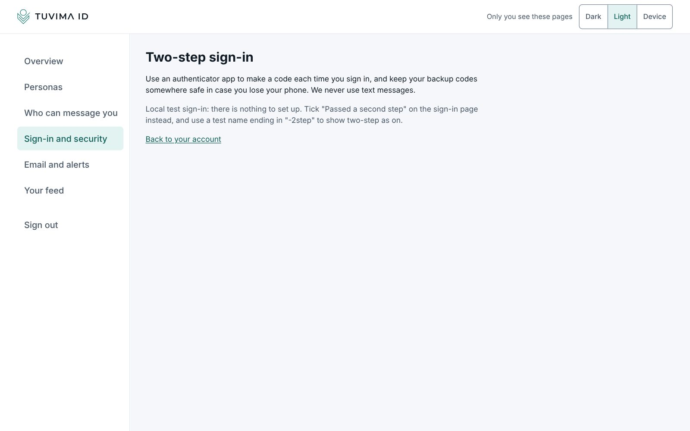
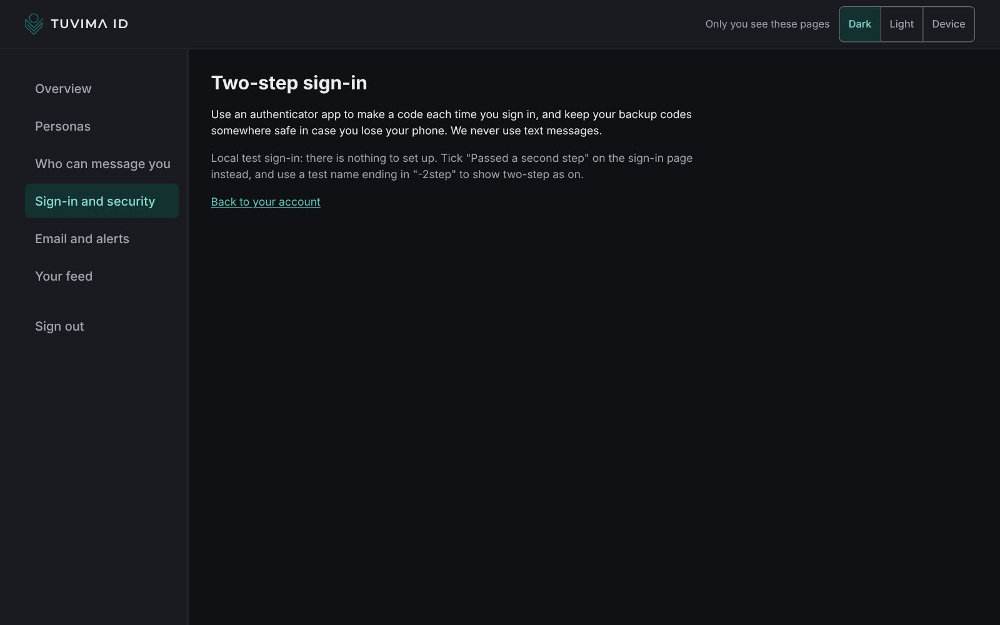
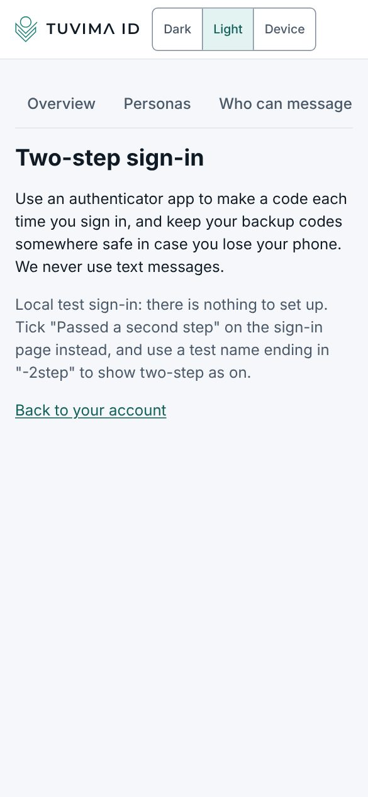
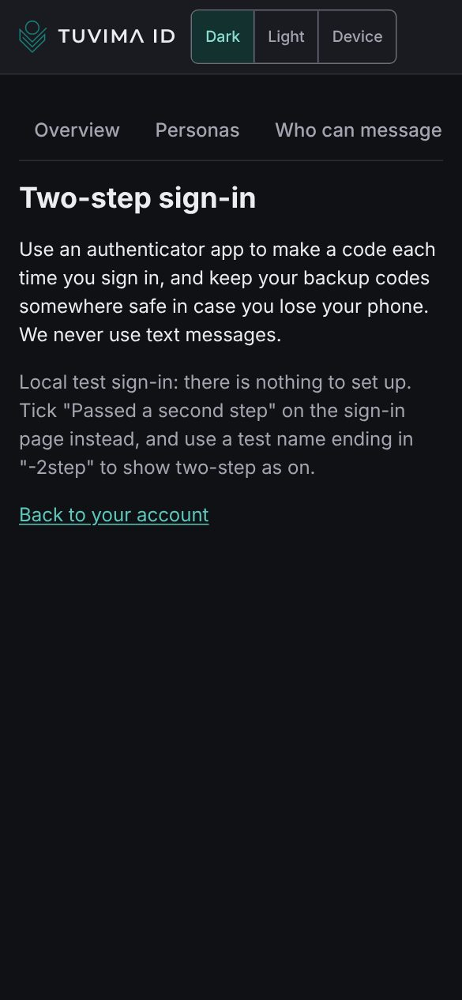

Two-step sign-in means that signing in needs two things: your usual sign-in, and a short code from an app on your phone. Someone who learns your password still cannot get in without your phone.

<figure class="tv-screens">

<figcaption>On a computer and on a phone. Everyone shown is a made-up sample person.</figcaption>
</figure>

## Before you start

Install an authenticator app on your phone. Any app that makes six-digit sign-in codes works.

## Turn it on

1. Open [your account page](your-account.md) and choose **Turn on two-step sign-in**.
2. Follow the steps on screen to link your authenticator app, usually by scanning a square code with it.
3. Enter the code the app shows, to confirm it works.
4. Save your **backup codes** somewhere safe, away from your phone. Each one works once if you lose your phone.

## Check the result

Your account page now says **On. Signing in asks for a code from your authenticator app (or a backup code).**

## Good to know

- We never use text messages for codes, because phone numbers can be stolen.
- Passkeys, which let your phone or computer sign you in without a code, are coming next.
- Tuvima staff accounts must use two-step sign-in.
