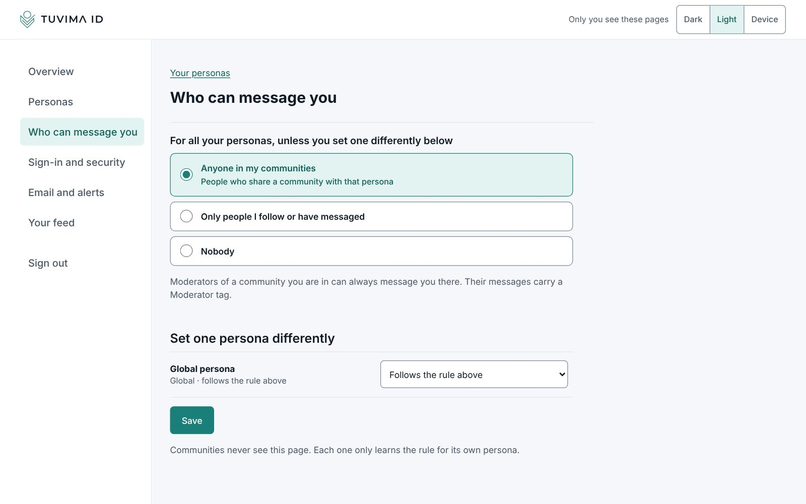
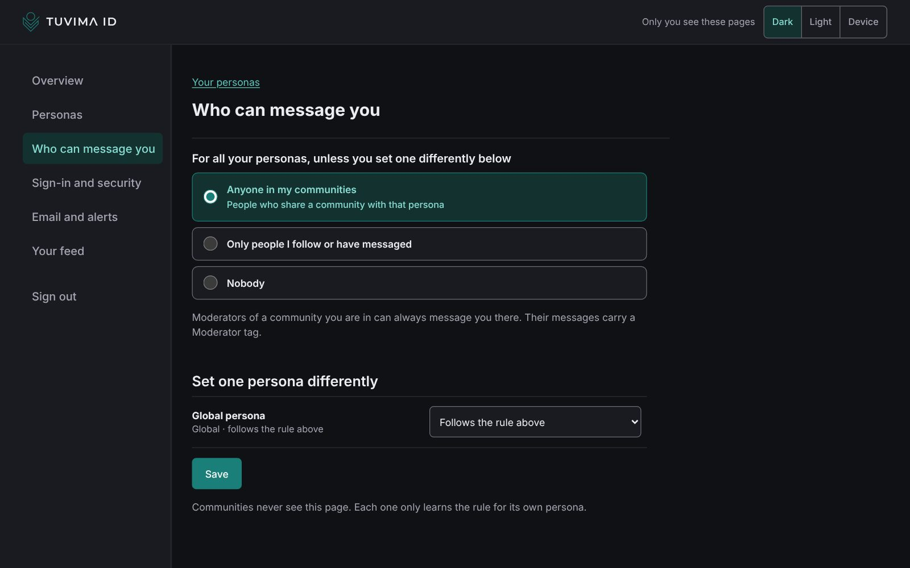
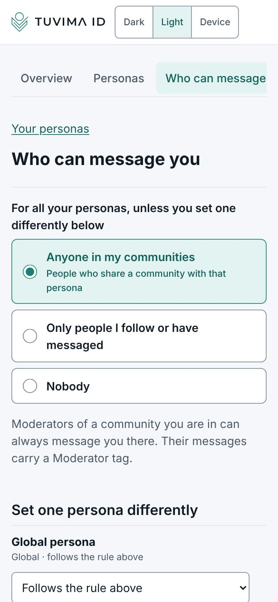
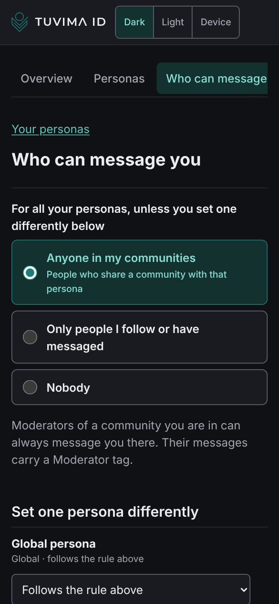

You decide who may start a private conversation with you. The choice lives in Tuvima ID so that one setting covers every persona you use, and so that communities never see how your personas are connected.

<figure class="tv-screens">

<figcaption>On a computer and on a phone; select a picture to see it full size. Everyone shown is a made-up sample person.</figcaption>
</figure>

## Set your rule

1. Sign in to Tuvima ID.
2. Open **Who can message you** from the menu, or from **Your personas**.
3. Pick one rule and choose **Save**.

| Rule | What it means |
|---|---|
| **Anyone in my communities** | Anyone who shares a community with you can start a conversation. This is where everyone starts. |
| **Only people I follow or have messaged** | Only people you follow, or people you have already written to, can start one. |
| **Nobody** | Nobody can start a conversation with you or add you to a group. You can still start conversations yourself. |

Conversations you already have carry on whichever rule you pick.

## Set one persona differently

Under **Set one persona differently** you can give a single persona its own rule. For example, keep your main persona open to anyone and close a private persona to everyone. A persona without its own rule follows the rule above.

## Share why I'm writing

When you message someone from their post, a short line tells them why: "Zoe saw your post …". **Share why I'm writing** is on to begin with. Switch it off under **Who can message you** and none of your personas add the line, anywhere. Tuvima ID only keeps this yes or no; it never sees which post you were reading.

You can also switch it off for one person, in that conversation's info panel. See [why a message shows where it came from](../../social/guides/messages.md#why-a-message-shows-where-it-came-from).

## Show when I've read messages

When someone has read your message, you see a small **Seen** under it, and they see the same for you. **Show when I've read messages** is on to begin with. Switch it off under **Who can message you** and nobody sees when any of your personas has read their messages. It works both ways: with it off, you won't see when others have read yours either.

Messages waiting under New never show Seen until you reply, whatever this is set to. You can also change it for one conversation, in that conversation's info panel. See [Seen: knowing your message was read](../../social/guides/messages.md#seen-knowing-your-message-was-read). Tuvima ID only keeps this yes or no; it never sees what you read, or when.

## Alerts for new messages

When someone you have not talked with writes to you, or invites you to a group, the message waits under **New** and you get one alert. **Alert me about new messages** is on to begin with. Switch it off under **Who can message you** and none of your personas get these alerts; the messages still wait under New. Alerts for conversations you already have are not affected, and the sender is never told either way.

## Things this setting does not change

- **Moderators can still reach you.** A moderator of a community you belong to can always message you there. Their messages carry a Moderator tag.
- **Blocking is separate.** To stop one particular person, block them from the conversation itself. See [private messages](../../social/guides/messages.md#mute-hide-and-block).
- **Nobody is told your rule.** Someone who cannot message you only sees "You can't message this person right now".

A change takes effect within a few minutes.
