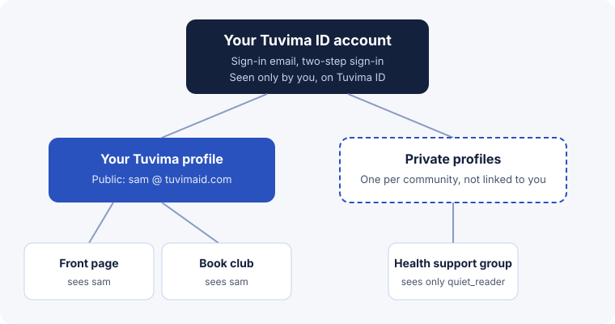

import { Aside, CardGrid, LinkCard } from '@astrojs/starlight/components';

Tuvima ID is the account you sign in with to use Tuvima. It keeps the private things, like your email address and your security settings, apart from the public things, like your profile and your posts. Communities see the profile you choose to show them, never your email.

## Choose your path

<CardGrid>
  <LinkCard title="Sign in for the first time" description="Create your Tuvima ID, confirm your email and pick a handle." href="/products/id/start/getting-started/" />
  <LinkCard title="Understand your privacy" description="What Tuvima ID keeps, what communities see, and what privacy you do not have." href="/products/id/explanation/privacy/" />
  <LinkCard title="Look after your account" description="See your communities, turn on two-step sign-in and get in touch with us." href="/products/id/guides/your-account/" />
  <LinkCard title="Choose your email" description="Decide which replies and mentions reach your inbox, and from which community." href="/products/id/guides/email/" />
</CardGrid>

## One account, the profiles you choose

<Aside type="note" title="Early Access">
  Tuvima ID is being built alongside Tuvima and is not open to everyone yet. [What's coming](reference/whats-coming.md) lists the features that are planned but not ready.
</Aside>
