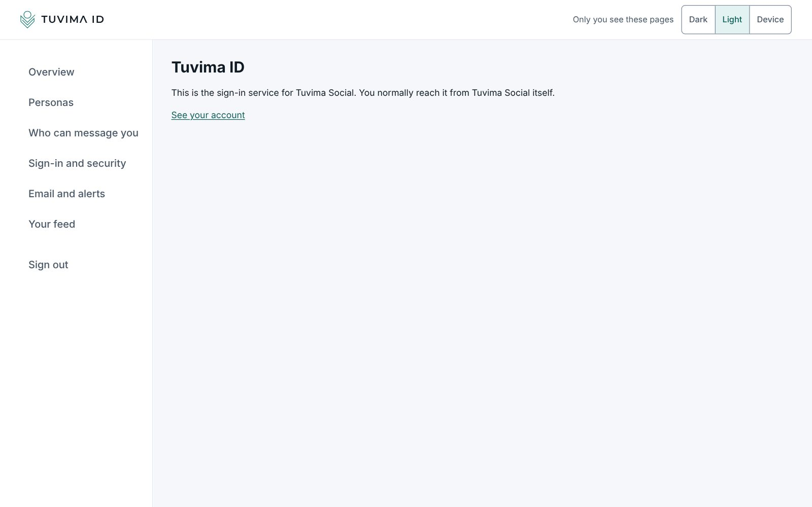
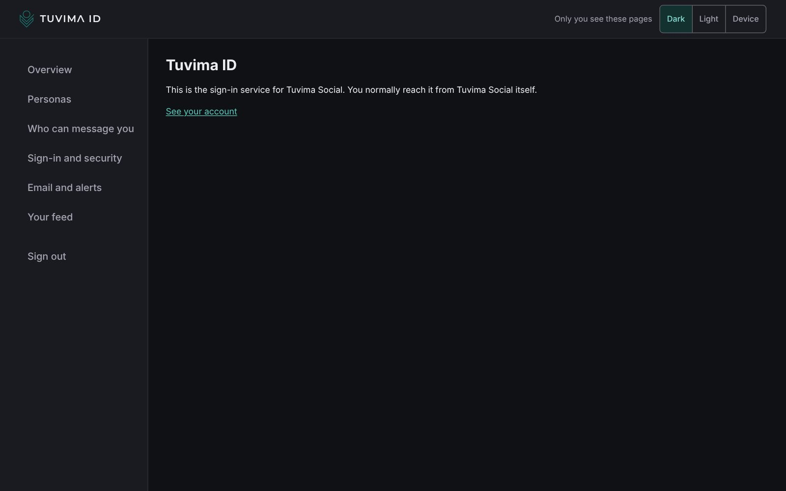
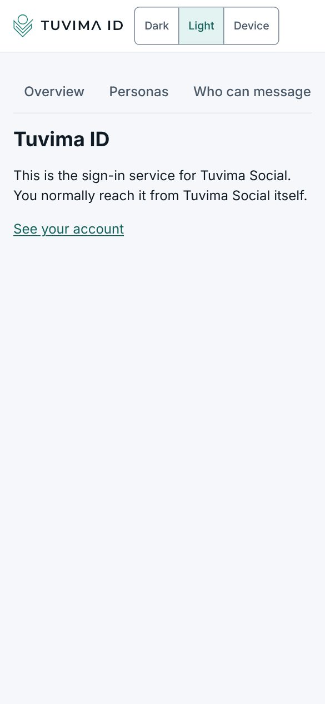
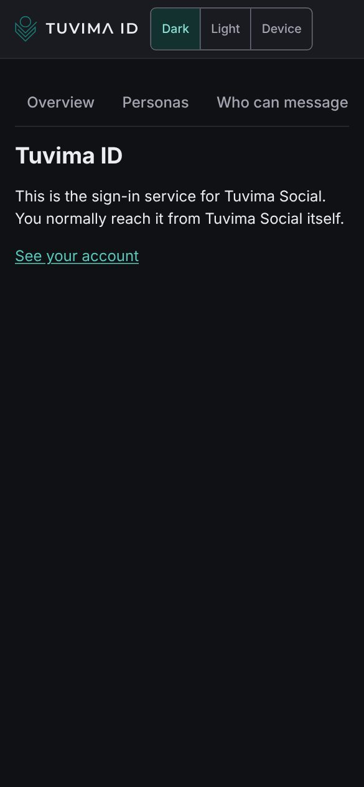

Tuvima ID is the one account you use to sign in to Tuvima. Think of it as the private back office for your public life on Tuvima: it knows who you are, and it decides what each community gets to see.

<figure class="tv-screens">

<figcaption>On a computer and on a phone. Everyone shown is a made-up sample person.</figcaption>
</figure>

## Why it is separate

Most sites keep your email address, your password and your posts in one place. Tuvima splits them on purpose:

- **Tuvima ID** keeps your sign-in email, your security settings and the private list of which personas are yours.
- **Tuvima**, where communities live, keeps personas, communities and posts. It never receives your email address.

Because the two are separate, a community owner, a moderator or another member cannot find your email or see your other personas, even if they look at everything Tuvima shows them. The people who run Tuvima can, when there is a real reason; [your privacy](../explanation/privacy.md) explains when.

## Your personas

A **persona** is who you are to other people on Tuvima: a handle, a display name and a picture. Your account stays hidden behind it. (Your **profile** is the settings page where you edit a persona.)

- **Your global persona** is public. Its full name is your handle followed by `@ tuvimaid.com`, for example `sam @ tuvimaid.com`. You can use it on the Tuvima front page and in any community.
- **A private persona** belongs to one community only. It has its own handle, and people in that community cannot tell that it is yours.

You choose which persona to use each time you join a community. See [one account, the personas you choose](../explanation/privacy.md#what-each-community-sees).

## What Tuvima ID does for you today

- Signs you in, and signs you out of everything at once.
- Shows the communities you have joined and which persona you used in each.
- Lets you turn on two-step sign-in with an authenticator app.
- Delivers your email and phone alerts for every Tuvima app, gathered into at most one email every 8 hours and held during your quiet hours, so communities never learn your address. This is being switched on soon.
- Gives you a private way to contact the Tuvima team.

## Next steps

- [Sign in for the first time](getting-started.md)
- [Understand your privacy](../explanation/privacy.md)
- [See what's coming](../reference/whats-coming.md)
