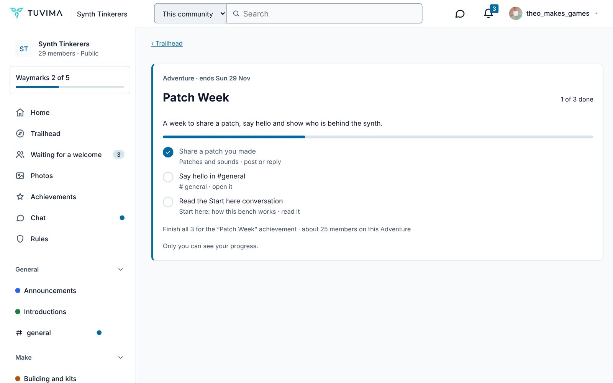
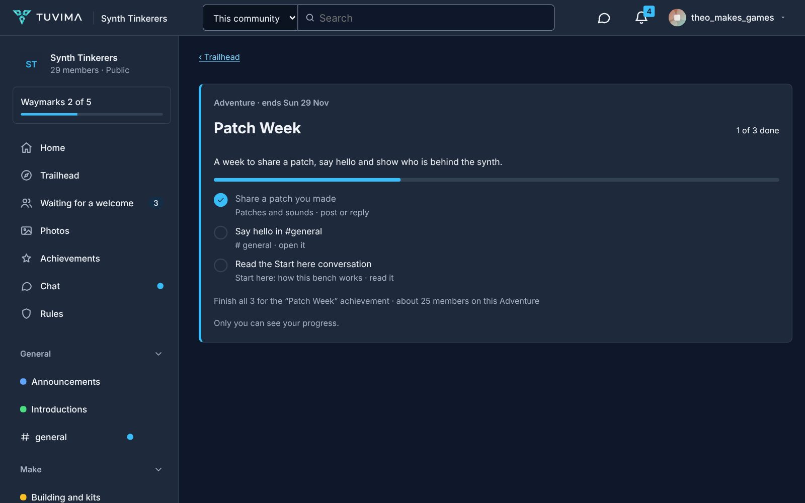
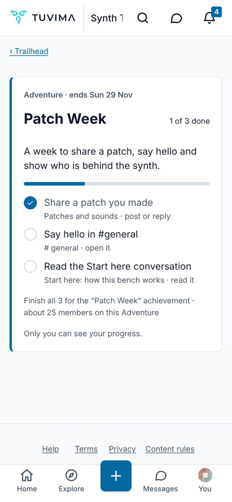
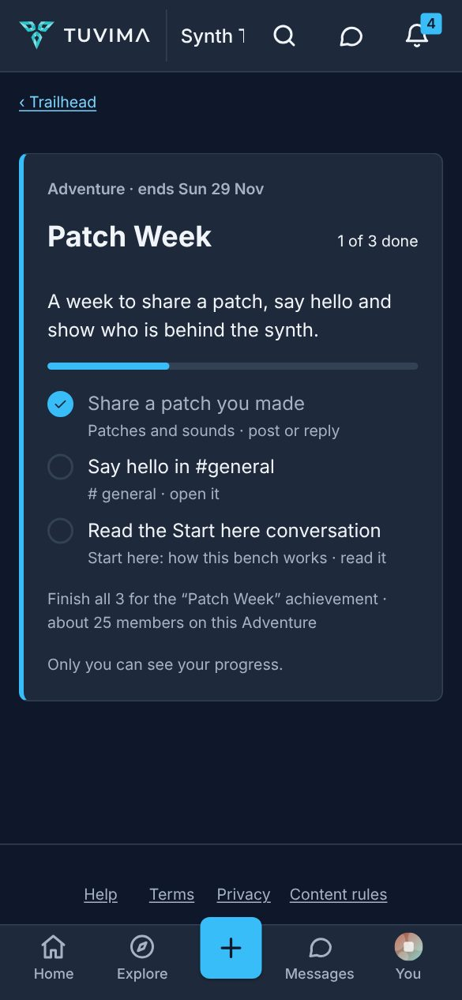

An **Adventure** is a short event a community runs, such as "Frost Week" or "Patch Week". It has a start and end date, a few steps that tick themselves as you take part, and sometimes an achievement for finishing them all. Every member can join in, not just newcomers.

<figure class="tv-screens">

<figcaption>On a computer and on a phone; select a picture to see it full size. Everyone shown is a made-up sample person.</figcaption>
</figure>

## Where you'll find them

- On the community's [Trailhead](trailhead-and-waymarks.md), above the Waymarks, while the Adventure is running.
- On your Tuvima [Home](home-feed.md), as a small card near the top until you finish it or it ends. You see at most two at a time, soonest ending first. Communities you've hidden from Home don't show theirs.
- Once in your bell, when an Adventure starts in a community you've joined. If you've muted the community's alerts, you won't get it.

Choose the card to open the Adventure's page.

## Taking part

Each step names something to do and where, for example "Share a patch you made" in a forum. Do it while the Adventure is running and the step ticks itself the next time you open the Trailhead or the Adventure's page. Only things you do between the start and the end count; something you posted last month doesn't.

A few steps, such as reading the house rules or setting a picture, also tick if you've already done them.

When every step is ticked, the page says **Done!**. If the Adventure has an achievement, you earn it then. Steps in places you can't open don't count against you.

## Who sees what

Your progress is private: only you see your ticks. The page may say roughly how many members are taking part, such as "about 25 members on this Adventure", once at least 20 are. Achievements you earn show like any other [achievement](achievements.md).

If you haven't joined the community, you can see the Adventure and its steps, with **Join to take part**.

## After it ends

The Adventure leaves the Trailhead and your Home. Its page still opens for 30 days, showing when it ended and what you ticked. An achievement you earned stays yours, even if the community later deletes the Adventure.
