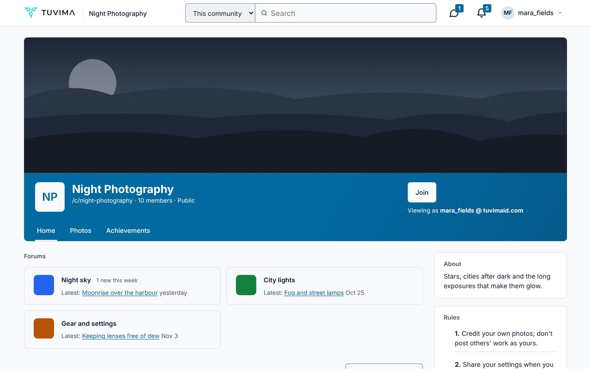
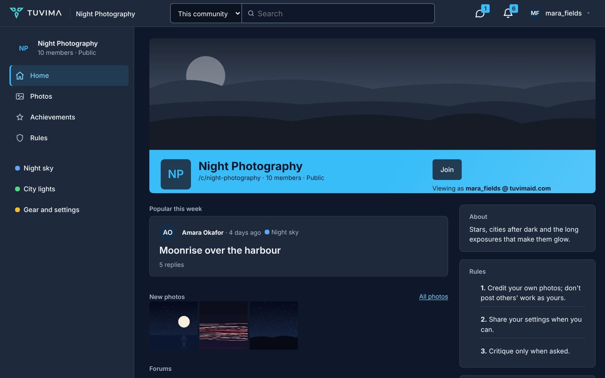
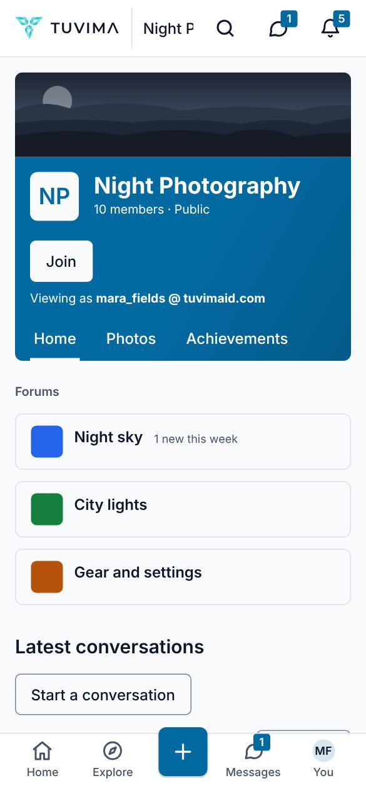
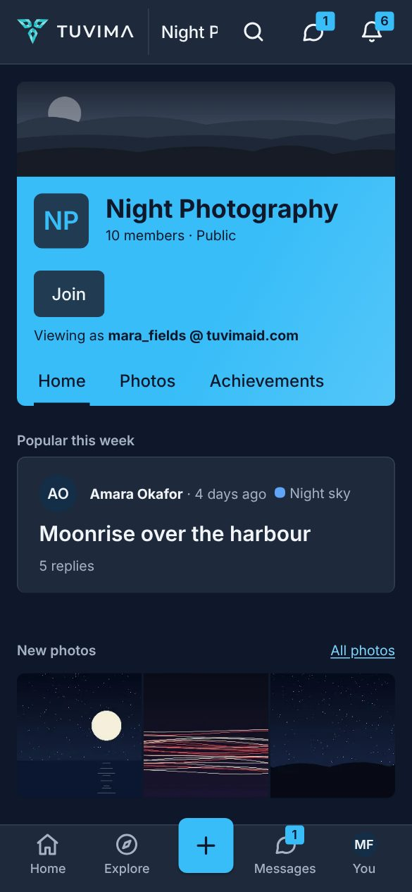

Every community on Tuvima has the same layout. Only its colour, banner and content differ, so once you know one community you know them all.

<figure class="tv-screens">

<figcaption>On a computer and on a phone; select a picture to see it full size. Everyone shown is a made-up sample person.</figcaption>
</figure>

## The community home

The top of the page is a band in the community's own colour. It shows the community's name, how many members it has, whether it is public or private, and its sections, such as **Home** and **Photos**.

Beside the name is **Join**, or, once you're a member, a **Joined** button. Choose **Joined** to see **Your membership**: the persona you use there, a link to this community's **Alerts**, **Your tiers**, and **Leave community**. On a phone it opens as a sheet from the bottom. The bell button next to it sets how much of this community reaches your alerts.

On a computer, a menu on the left takes the place of the sections in the band. It stays in the same place on every page of the community, including chat and the community's settings.

- **The community's name and picture** at the top take you back to the community's home. The arrow beside them opens the community's own menu: **Invite people**, **Manage community** and **Create forum or channel** (for those allowed), then **Alert settings**, **Your persona here**, **Mark all as read**, **Hide muted**, **About and rules** and **Leave community**.
- **Pages** lists the community's extra pages, such as **Trailhead**, **Lamplighters**, **Photos**, **Achievements** and **Rules**. You can fold it away, and Tuvima remembers your choice. When it is folded, it shows how many pages it holds.
- Then come the forums and chat channels. If the community has several categories, each one is a heading you can fold. The one you are in opens by itself, and Tuvima remembers which ones you folded.
- When a community has both forums and chat, **All**, **Forums** and **Chat** above the list show just one kind. Tuvima remembers your choice for each community.

On a phone, the community's sections stay in the band, and tapping the community's name in the top bar lets you switch to another community (see [Find your way around](getting-around.md)).

Most communities open on **what's happening** across the whole community:

- **Popular this week.** The three conversations started this week with the most replies.
- **New photos.** The six newest photos. Choose **All photos** to see the rest.
- **Chat now** (members only). The chat channels with messages today, with **Open chat**. The messages themselves stay in chat.
- **Recently earned.** Achievements people earned here lately.
- **New here.** How many people joined this week. It never says who.

An owner can switch this off so the home shows only the forums and the list. See [Build your home page with tiles](../owners/home-tiles.md).

Then:

- **Forums.** Each category is a card with its forums. The card says how many conversations started there in the last 7 days, for example **38 this week**, and each forum says how many started there, such as **11 new this week**. On a phone each forum takes one short line, so the conversations start sooner. Choose a category's name to open its own page, or a forum to go straight to its conversations.
- **Latest conversations.** One line per conversation: its title, its forum and tags, small pictures of the people who posted most recently, the number of replies and when it last moved. Pinned conversations come first. Members also get **New** (started since you joined) and **Unread** (new replies since you last read). A conversation nobody has answered yet says **No replies yet**.
- **Filter.** Choose **Filter** to narrow the list by forum, tag or label, then **Show conversations**. Each filter you use shows as a chip above the list; choose its cross to remove it. **Start a conversation** is above the list (on a phone it says **New**).
- **About** and **Rules**, and any other blocks the owners added, sit on the side. On a phone they come after the conversations.

A community with only one category skips the cards and shows its forums straight away.

There are no view counts anywhere. Tuvima doesn't track who reads what.

## A forum group's page

A category's own page shows its forums across the top, then its conversations. Choose a forum to see only that forum, or **All forums** to see the whole group again. **Start a conversation** picks that forum for you.

Inside a forum, the forum's own name is the heading, with its description and how many conversations started there this week. On a wide screen, the forum's guidelines sit beside the list.

## A conversation

The line above the title shows where you are, for example **Retro Console Club › Workshop › Help and questions**. Under the title, a short line says who started the conversation and when, when the last reply came, how many replies there are and who has joined in lately. On a wide screen these facts move into an **About this conversation** panel beside the posts.

## A member's page in a community

Choose someone's name in a community to see their page there. It shows only what they did in that community:

- **Known for here:** up to three tags they post under most in that community,
- their **Showcase:** up to six of their posts they picked,
- their level and a showcase of up to six [achievements](achievements.md) there,
- their photos there,
- the conversations they started there.

Their page never shows other communities they belong to, and a private persona is never linked to anyone's global persona.

### Your showcase

On your own page in a community, choose **Edit showcase**. Tick up to six of your posts there (conversations you started or replies you wrote), put them in order with **Up** and **Down**, and choose **Save showcase**. To take one off, choose **Unpin**.

Everyone sees your pinned posts in your order, but only the ones they could already read. A post in a members-only forum stays hidden from people outside it. If you delete a pinned post it leaves your showcase. If moderators hide or remove it, only you still see it there, marked **Only you see this**, until they put it back or you unpin it.

### Known for here

Tuvima fills this in for you from the tags on the conversations you post in, counting both conversations you start and your replies. A tag shows once you have at least three posts under it, and only your top three show. Like your showcase, it only counts posts the reader could see, so a members-only forum's tags never show to people outside it.

Don't want it? On your own page, turn off **Show "Known for here" on my page**. Then nobody else sees it, and your page looks the same as someone who simply has no tags yet.

## Change your name in a community

If you use a **private persona** in a community, you can't rename it yourself. You ask the admins.

1. Open your persona page in the community, choose **Persona settings**, then **Change my name here**.
2. Type the **New name**. You can add a **New display name (optional)**, and a **Reason (optional)**. A rename can change your handle and your display name.
3. Choose **Send to the admins**.

The page then says **Waiting for an admin**, with the date you asked. You can **Withdraw** it, and you can have one request at a time. Nothing changes until an admin approves. You get a notice either way, and a decline can carry a note.

You stay the same persona: posts, level, achievements and followers stay. Your old name shows as "formerly @old" in this community for as long as the owner chose, and a **Name changed recently** label may sit on your posts for 30 days. See [what other people see](switch-persona.md#what-other-people-see). Your picture and about text are free to change at any time, with no request.

An admin may also change your name for you if it is unsuitable. In that case no "formerly" note is shown.

If you are banned in the community, you can't ask. A global persona is renamed in your Tuvima profile, and the page says so.

### If your name is hidden

If an admin hides your name as offensive, you can still see it, with a **Name hidden** label. Everyone else sees **Name hidden** instead of your name, on your posts too. You can still ask for a new name, and approving it shows your name again. Until then you can't switch between private and global.

## For owners and admins: Insights

**Manage**, then **Insights**, shows how your community is doing over 7 days, 30 days, 90 days or a year: members, active members, new contributors, the typical time to a first reply and questions with no reply, each compared with the period before. Insights counts what people do, never what they read. It never shows page views, reading time or who looked at what, and any count of 1 to 4 people shows as "fewer than 5". See [Insights](../owners/run-your-community.md#insights).
