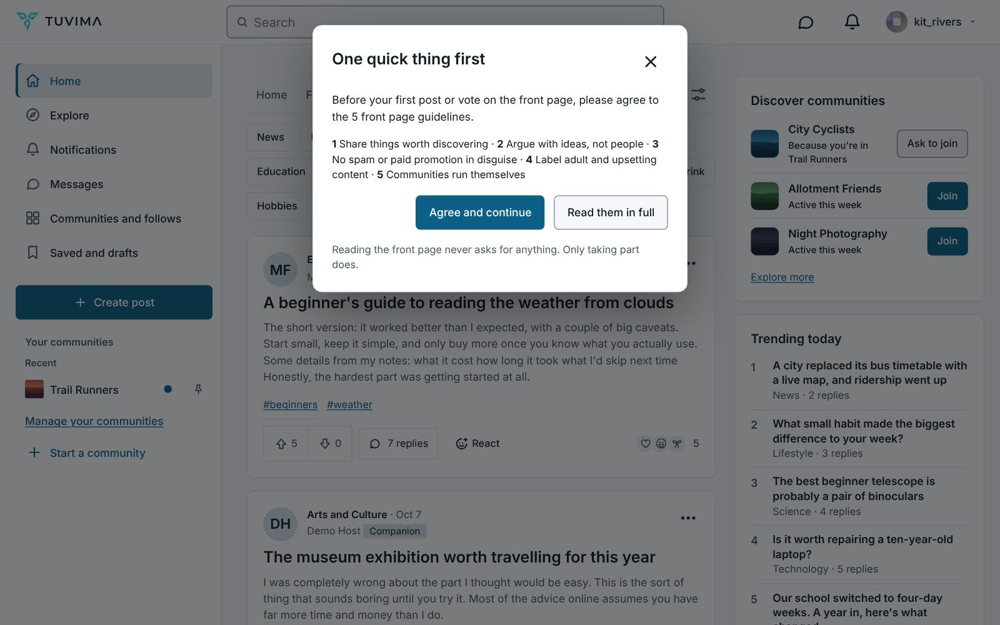
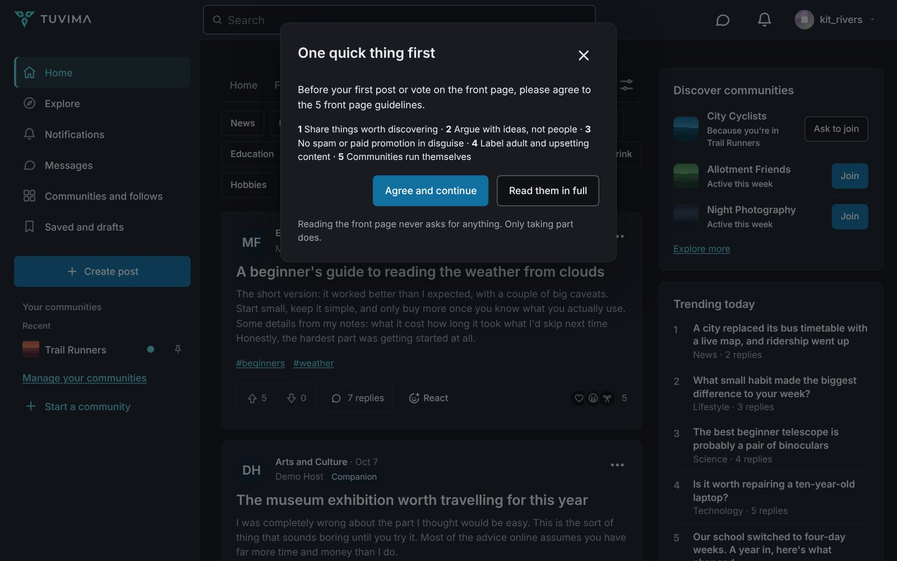
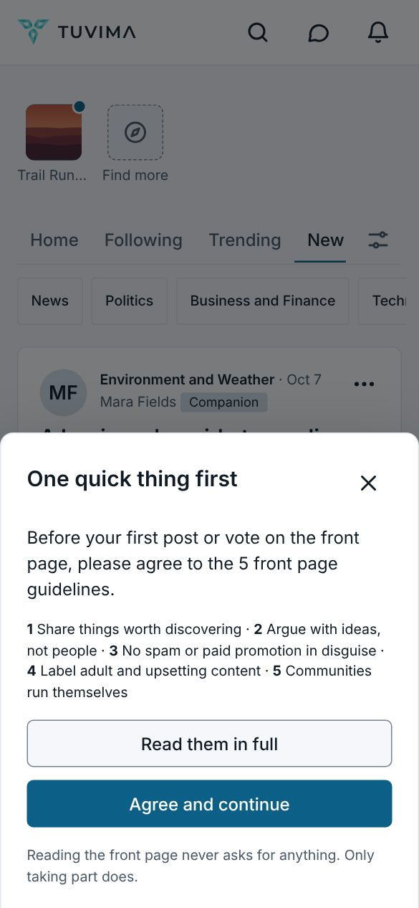
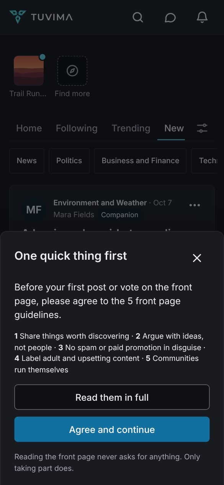

The front page is shared by everyone on Tuvima, so it has five short guidelines of its own. Each community also has its own rules, which you see when you join it.

## The five guidelines

1. **Share things worth discovering.** Links and posts that start good conversations.
2. **Argue with ideas, not people.**
3. **No spam or paid promotion in disguise.**
4. **Label adult and upsetting content.**
5. **Communities run themselves.** Each community has its own rules you'll see when you join.

They cover the front page only and sit beside Tuvima's Terms, not in place of them. You can read them any time on the front page's **Rules** page.

## When you're asked to agree

**Reading the front page never asks for anything. Only taking part does.** You agree once, either:

- on the first step of your [first visit](../start/getting-started.md), by ticking **I agree to the front page guidelines**, or
- the first time you vote or react on the front page, in a small box called **One quick thing first** that lists the five guidelines in one line. When you first post or reply on the front page, the post form shows the guidelines and asks the same thing.

<figure class="tv-screens">

<figcaption>On a computer and on a phone; select a picture to see it full size. Everyone shown is a made-up sample person.</figcaption>
</figure>

In that box:

- **Agree and continue** agrees for you and then does what you pressed, so your vote counts straight away.
- **Read them in full** opens the full guidelines first.
- Closing the box changes nothing. You can keep reading.

Agreeing makes you a member of the front page with your global persona. Taking a vote back never asks you to agree.

## When the guidelines change

The guidelines have versions, like a community's rules. Small changes don't ask you again. If an important change is made, you're asked to read and agree the next time you take part.

## Related

- [Explore the front page](front-page.md)
- [The Trailhead and Waymarks](trailhead-and-waymarks.md)
- [Joining a community](join-a-community.md)
