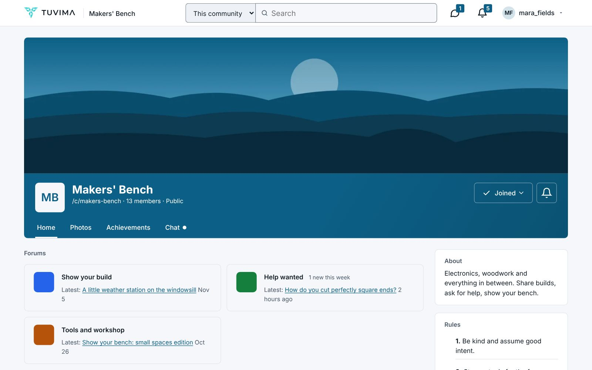
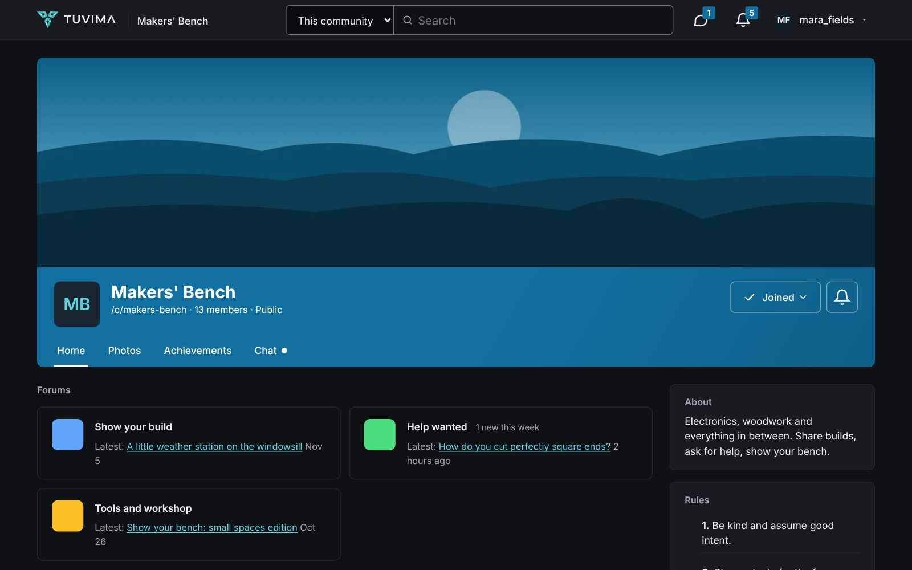
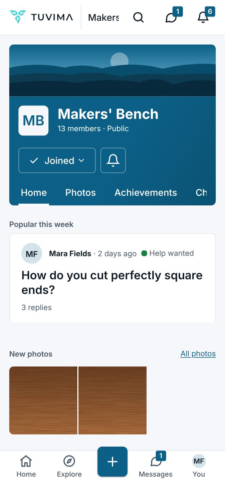
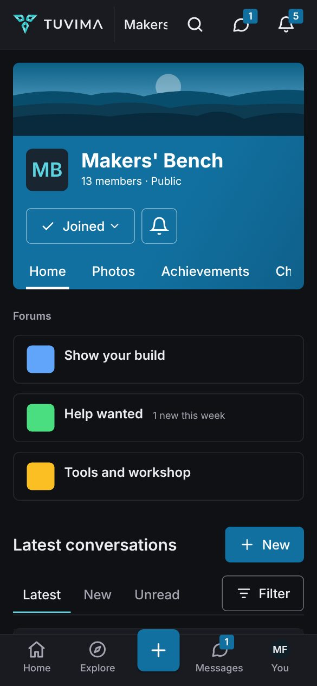

Tuvima keeps its frame quiet so the conversations have the room. Here is where everything lives.

<figure class="tv-screens">

<figcaption>On a computer and on a phone; select a picture to see it full size. Everyone shown is a made-up sample person.</figcaption>
</figure>

## The top bar

The top bar has the Tuvima name (it takes you home), the community you are in, search, the bell and your account. There is no "New post" button up here: you start a conversation from inside a community or forum, where it belongs.

## Search here or everywhere

On a community's pages, search starts at **This community**. Change the choice to **All of Tuvima** to look everywhere instead. On every other page, search covers all of Tuvima.

## Your communities on a computer

On a community's pages, a slim strip runs down the far left of the screen. It has **Home** and **Explore** at the top, then every community you are in, then **Start a community** at the bottom.

- The community you are looking at has a ring around it.
- A dot means something new has been posted since you last looked.
- Point at a picture to see the community's name.

On Tuvima's own pages (Home, Explore, your alerts), the side menu on the left lists the same communities, in the same order, with their names. **Communities and follows** at the bottom opens the full page of everything you follow.

Communities where you use a private persona are in the list too, for you only. The communities never learn that your personas belong together.

## Arrange your communities

Your communities are listed in your own order. A community you have just joined goes to the top until you move it.

- **Move one:** drag it up or down the strip or the side menu.
- **Make a folder:** drag one community onto another. Both go into a new folder. Drag more communities onto the folder to add them, or drag one out to take it out.
- **Open or close a folder:** select it. A closed folder shows small pictures of the first four communities inside, and a dot if any of them has something new.
- **Without dragging:** right-click a community (or press the menu key, or Shift and F10) on a computer, or select **···** next to it in the side menu. You get **Move up**, **Move down**, **Move to folder**, **New folder with this community**, **Mark all as read**, **Alert settings** and **Leave community**.
- **Name a folder or pick its colour:** right-click the folder, or select its **···**. From there you can also close it, move it, mark everything in it as read, or remove it. Removing a folder never removes the communities: they stay in your list where the folder was.

Your order and folders are kept with your Tuvima ID account, so they are the same on every computer and phone you sign in on. They are private to you: no community, and no one else, sees how you arranged them.

## On a phone

- The bar at the bottom holds Home, Explore, the **+** button, Alerts and You. Inside a community none of them is lit up: the community's name in the top bar tells you where you are. In a conversation the bar makes way for the reply box.
- Swipe in from the left edge of the screen, or tap **You**, to open the menu. It has your communities in your own order and folders, your account links, light or dark, and sign out.
- Inside a community, tap the community's name in the top bar to **switch community**. You get every community of yours in your own order and folders, with a box to find one by name. Tap **Arrange** to show a handle on each row and drag them with your finger, or tap **···** on a row for the same moves as on a computer. **All communities** and **Back to Home** are at the bottom.
- If your phone uses that swipe for "back", tap **You** instead.
- With reduced motion turned on in your phone's settings, the bar stays put and the menu appears without sliding.
- Everything you can tap is at least 44 pixels, about the size of a fingertip, so you don't hit the wrong thing. This includes links, buttons, filters, tick boxes and the links at the bottom of the page. A link in the middle of a sentence keeps the size of the sentence.
- Text you read at length, such as posts, titles and the boxes you type in, is 16 pixels. Small labels are 13 to 14 pixels, and no text is ever smaller than 12 pixels. Because the boxes you type in are 16 pixels, your phone doesn't zoom in when you tap one.
- On a tablet or a touch screen computer, things to tap are the same comfortable size.

## Light or dark

Tuvima starts in dark mode. Choose **Dark**, **Light** or **Follow my device** in your account menu, or at the bottom of any page. Signed in, your choice is saved with your Tuvima persona and follows you to your other devices. Signed out, it is kept on this device only.

Each community's own colours still apply inside that community, in light and dark.

## Menus and hints

Menus stay calm: pointing at a row shows a light grey highlight, and only the page you are on is marked in colour. Small pop-up hints appear only where they help: on buttons that show just an icon, on a greyed-out button to say why it can't be used yet, and on shortened text such as "3 h" to show the full date. A hint disappears after a few seconds, or as soon as you press anything.
