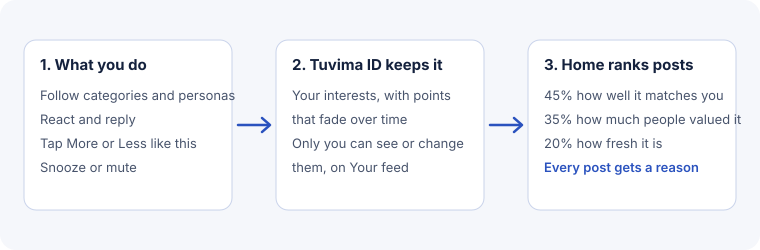

Home is your own front page. It puts the posts you are most likely to enjoy first, and it always tells you why a post is there. You stay in charge: you can see everything Home has learned, change it, or wipe it.

## The four tabs

Sign in with your global persona and the front page has four tabs:

- **Home** is the feed made for you. It mixes posts from the front page and from your communities, ranked by the recipe below.
- **Following** shows the newest posts first from the categories and personas you follow, plus posts from your communities. Nothing is ranked.
- **Trending** shows what people are taking part in right now.
- **New and rising** shows the newest posts first.

If you are not signed in, you see **Trending** and **New and rising**. Nothing about you is recorded, because there is nothing to tie it to. If Tuvima ID is slow to answer when you open Home, you see the first page of Trending instead, and Home says so.

## Why you are seeing a post

Every post on Home and Following has a small grey line above it, such as "You follow Gaming" or "Popular in Tabletop". Choose it to open **Why you're seeing this**. The sheet lists up to three reasons, with what you did this month that led to each one. When a post has no personal reason, it says why the post is worth a look, for example "Trending on Tuvima" or "A new voice".

The same sheet has the buttons that steer Home:

- **More like this** and **Less like this** tell Home what you want. Home also hides that post from now on, so you don't see it twice.
- **Snooze for 30 days** or **Mute** hides a category, tag, community or persona. For a tag you choose **Hide it, except in categories I follow** or **Hide it everywhere**.
- If a reason is a follow, you can **unfollow** from the sheet.

## The recipe

A post's place on Home is made of three parts:

| Part | Share | What it means |
| --- | --- | --- |
| How well it matches you | 45% | How strongly the post's category, tags, community and author line up with your interests. |
| How much people valued it | 35% | Votes and replies from other people (see "How a post's value is worked out"). |
| How fresh it is | 20% | Newer posts score higher. Freshness halves every 24 hours. |

A few more rules shape each page of 20 posts:

- **Discover** keeps room for new voices and good posts outside your interests. The default is 15%, so about 3 posts in every 20. You can set it anywhere from 0% to 40% on your Your feed page. A "new voice" is someone whose persona is under 30 days old.
- **Variety.** You never see more than 2 posts in a row from the same category or community, and no more than 3 posts from the same persona on one page.
- **Caught up.** Posts that are new since your last visit come first. When they run out, Home says "You're caught up". Opening Home again within 30 minutes counts as the same visit.

Home picks from the best front page posts of the last 14 days, plus the most valued posts from your communities.

## What Home learns from

Home learns from what you do, as points added to your interests. An interest is a category, a tag, a community or a persona.

| What you do | Points |
| --- | --- |
| Follow a category or persona | +8 |
| Tap More like this | +6 |
| Reply to a post | +3 |
| React with Love, Insightful or Thanks | +2 |
| React with Funny, Wow, Sad or Angry | +1 |
| Vote a post up | +1 |
| Tap Less like this | -6 |

Some things to know:

- **Disagreeing never costs a topic.** A down vote only lowers that one author a little (1 point). It never lowers a category or tag. No reaction ever means "show me less", not even Angry or Sad: it just means the post moved you. Only Less like this, Mute and Snooze do.
- **Interests fade.** After 30 days without new signals, an interest is worth half as much. It is removed once it has faded to almost nothing.
- **There is a daily limit.** One interest can gain only so much in a day, so a burst of activity cannot swamp everything else. In any 24 hours, one interest can gain up to 6 points from reactions, 9 from replies and 18 from your own choices (follows, More and Less).
- **Sensitive subjects are handled with care.** Health, religion, sexuality and politics, and any tag Tuvima staff mark as sensitive, grow only when you follow them or tap More like this. Reacting to or replying to such posts never builds them.

## How a post's value is worked out

The 35% value part comes from other people, not from the author:

- Up votes add and down votes take away. A vote counts for more when the voter has a higher level. [Reputation and levels](reputation.md) explains levels.
- Each other person who replies adds a little, but only if the post is not a pile-on. This is the **heat check**: if more than half of the vote weight is down votes, replies earn nothing.
- Reactions such as Funny, Thanks or Angry do not change a post's value. They say how a post felt, not what it is worth.
- Your own reputation never lifts your own posts, and paying never changes ranking.

The result is smoothed so one huge pile of votes cannot bury everything else.

## Your feed page

Your Tuvima ID account has a **Your feed** page. Only you can see it. It shows:

- every interest Home has learned, strongest first, with whether it is rising, fading or steady, and buttons to **Boost**, **Lower** or **Remove** it,
- your mutes and snoozes, each with a **Lift** button,
- **Download what Home knows** and **Reset everything**.

It also has these switches:

- **Pause learning** stops Home learning anything new. Your interests stay as they are.
- **Use my reactions** lets your reactions teach Home. Turn it off and Home stops learning from them straight away, and removes what they taught.
- **Show my private communities on my Tuvima Home** is on by default. Home can then include communities you joined with any persona, including a private one. Tuvima ID gives Home the list each time it loads and Tuvima never stores it next to your global persona. Only you see these posts, and Tuvima never shows which persona you used.
- **Discover** sets how much room new voices get, from 0% to 40%.

Changes show on Home within a minute.

## Your data

- Tuvima ID keeps your interests. They are used only to build your Home.
- Each thing you do is kept as a signal for 30 days. After that only the fading totals remain.
- You can download everything Home keeps, or reset it. Reset clears your interests and signals and keeps your mutes and snoozes. Turning off a source, such as reactions, removes what it taught.
- Following people is private. Others see how many followers a persona has, never who they are.
- Tuvima does not measure how long you spend reading a post. If that ever changes, it will come with its own switch.

:::note
Like any service, Tuvima has staff who can reach the data to keep it running. We keep that to the work that needs it, and we do not use your interests for anything except your Home. [Your privacy on Tuvima](privacy.md) says more.
:::

## Plain English summary

Home ranks posts by how well they match you, how much people valued them and how fresh they are, and it tells you why for each one. It learns from what you follow, react to, reply to and tap, and it never reads a down vote or an Angry reaction as "less of this topic". You can see, change, download or clear everything it knows on your Your feed page.
