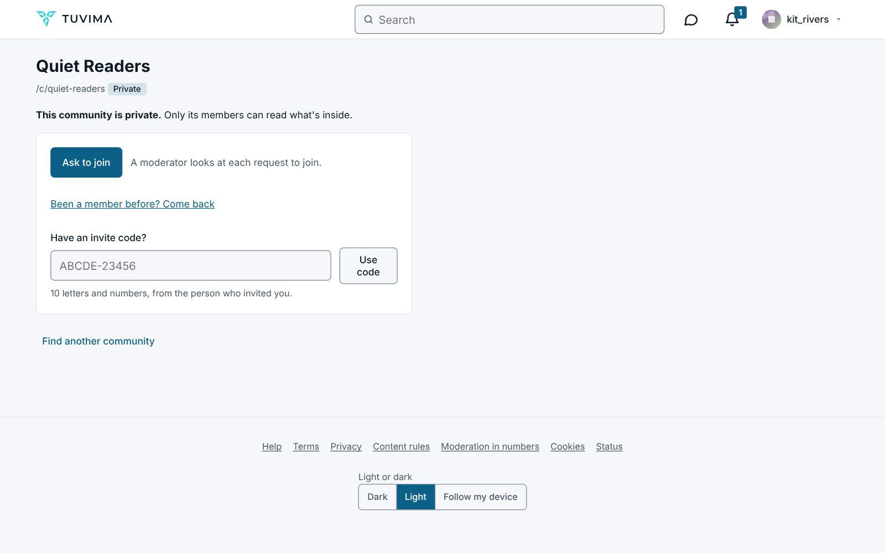
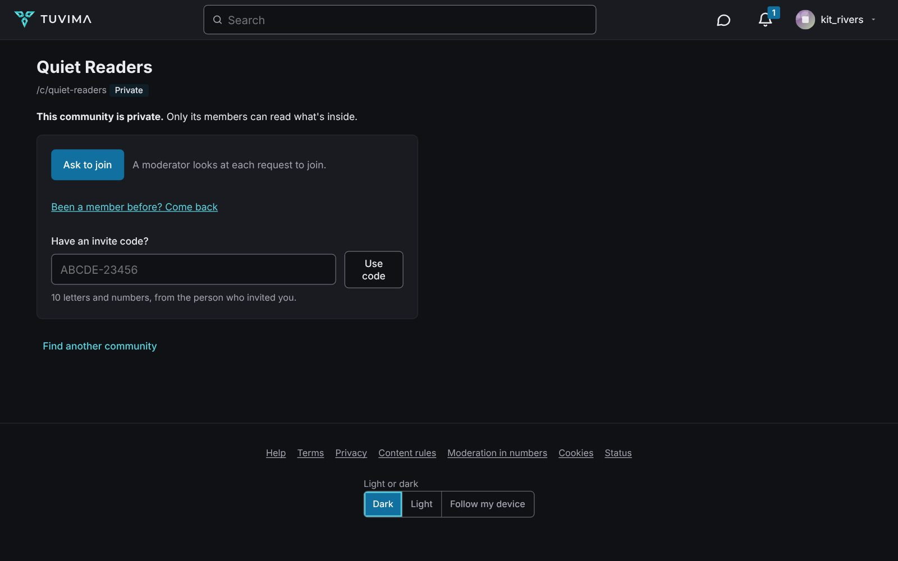
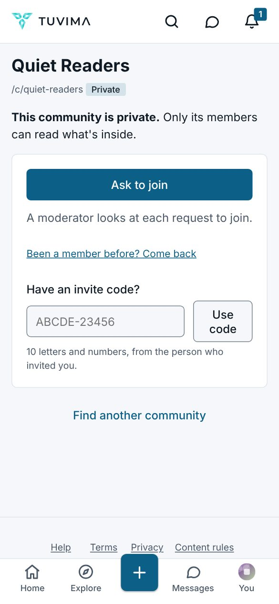
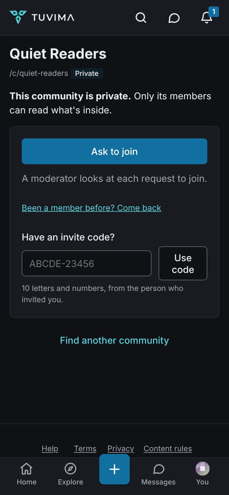

A **private** community can be read only by its members. Before you join, you see its name and only the details its owner chooses to show, such as a description or the number of members. Some public communities also ask people to be approved, or to have an invite, before they can take part.

<figure class="tv-screens">

<figcaption>On a computer and on a phone; select a picture to see it full size. Everyone shown is a made-up sample person.</figcaption>
</figure>

You need to be signed in to join any community.

## Ask to join

1. Open the community and choose **Ask to join**.
2. Choose the persona to join with, as for [any community](join-a-community.md#join).
3. Answer its questions, if it has any.
4. Choose **Agree to the rules and ask to join**. You see **Request sent**.

While you wait, the community's page says **Your request is waiting**. Choose **Withdraw** if you change your mind.

- If you are **approved**, you are told in your notifications and can take part straight away.
- If you are **not approved**, the page says **Not approved** and shows when you can ask again, 30 days later. Communities do not give reasons.
- A request nobody decides closes after 30 days.

Your answers are seen only by the people who review requests, and are deleted 90 days after a decision.

## Join with an invite

An invite lets you join straight away, even when a community is invite only or does not appear in the directory.

- **A link**: open it. Sign in if you aren't already, read the community's rules, and join.
- **A code**, such as `ABCDE-23456`: on the community's page, choose **Have an invite code?**, enter it and choose **Use code**. If the community isn't in the directory, use the invite link instead.
- **A QR code**: scan it with your phone's camera to open the link.

If you see "This invite doesn't work", it may have ended, been used up or been turned off. Ask the person who gave it to you for a new one.

## If joining is paused

If you see "You can't join more communities right now. Try again later.", you have joined several communities in a short time. This limit protects communities from spam accounts and lifts by itself.

## Members-only areas

Inside any community, some categories or forums may be open only to members, or only to some members, such as those at a certain level or with a role. You do not see areas you cannot open, unless the community shows them with a lock and their name only.

## Private does not mean secret

Being private keeps posts from people who are not members. It is not end-to-end encrypted: the Tuvima team can read what is stored, and other members can copy what they read. A [private persona](join-a-community.md#join) still hides who you are. See [your privacy on Tuvima](privacy.md).
