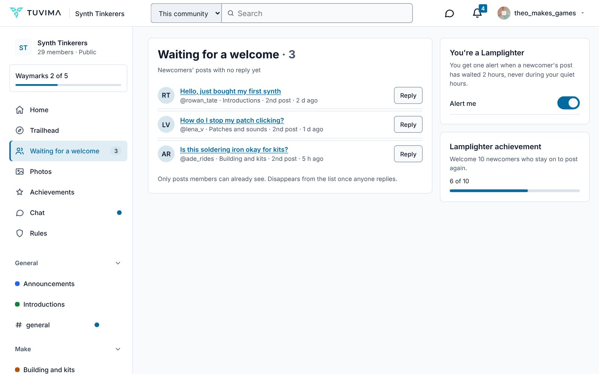
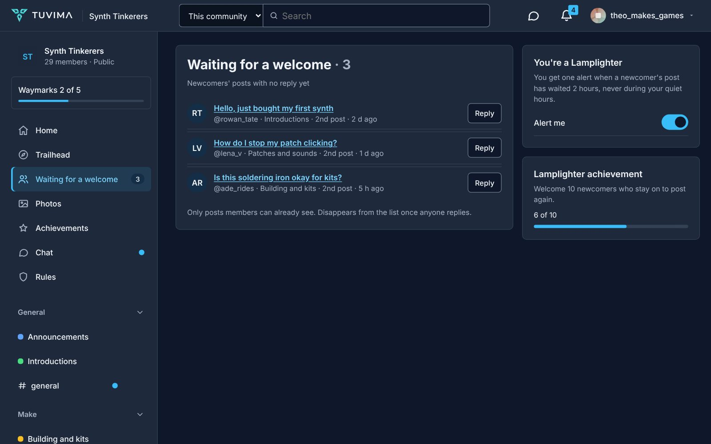
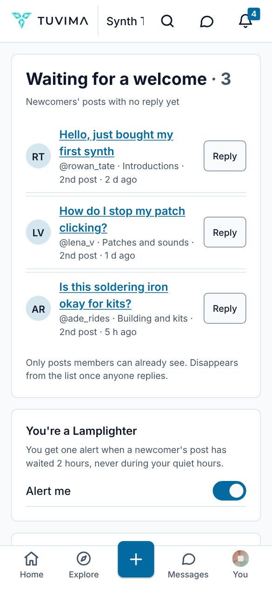
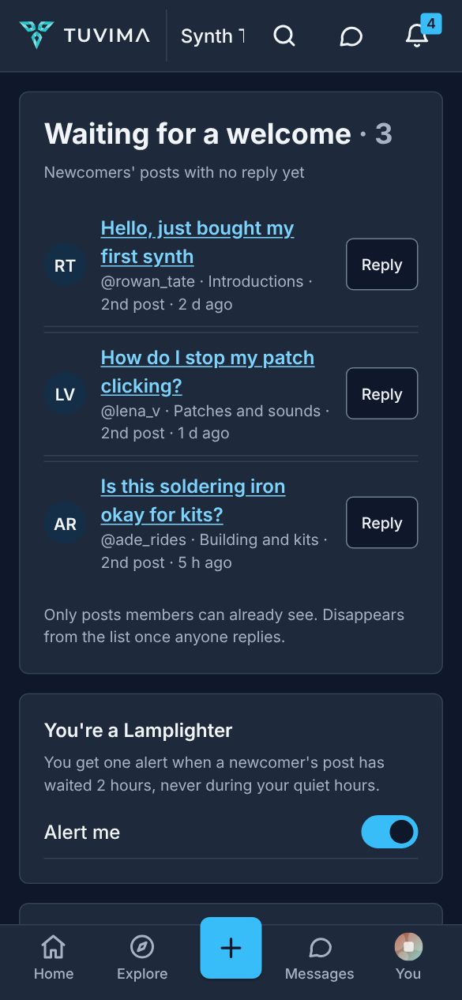

A newcomer's first post that nobody answers is the most common reason people never come back. **Lamplighters** are members who like welcoming people. When a community has switched Lamplighters on, you can pick the role and help make sure every newcomer gets a reply.

<figure class="tv-screens">

<figcaption>On a computer and on a phone; select a picture to see it full size. Everyone shown is a made-up sample person.</figcaption>
</figure>

## Become a Lamplighter

Open the community menu, choose **Pick what you see**, and switch on **Lamplighters** under **Roles you can pick**. To stop, switch it off again.

The Lamplighters role shows on your member card and posts, so newcomers know who's there to welcome them. The community's owner can change that.

## Waiting for a welcome

Once you hold the role, the community menu and the community's home show **Waiting for a welcome** with a count whenever newcomers' posts are waiting. The page lists conversations that:

- were started in the last 7 days by someone who is still new to the community,
- nobody but their author has replied to yet,
- you can already read, in places you haven't hidden.

Each row says who started it, where, whether it's their first or second post, and how long ago. Choose **Reply** to open the conversation at its reply box. As soon as anyone replies, the post leaves the list.

The list only ever shows posts members can already see. It never shows posts waiting for a moderator's approval, and it never says who else is a Lamplighter.

## One gentle alert

When a newcomer's post has waited 2 hours, you get one alert in your bell: "A newcomer's post is waiting for a welcome". That's one alert per post, and at most 3 a day. Phone alerts follow your quiet hours in your Tuvima ID settings, and there's never an email. Forums you've muted or hidden don't send these alerts.

To stop the alerts but keep the list, switch off **Alert me** on the Waiting for a welcome page.

## The Lamplighter achievement

Welcome 10 newcomers who stay on to post again, and you earn the **Lamplighter** achievement. A welcome counts when you reply to a newcomer's first post and they post again in the community within 14 days. Welcoming the same person twice counts once.

Your progress, such as "6 of 10", is only shown to you. Once you earn it, it shows with your other [achievements](achievements.md).
