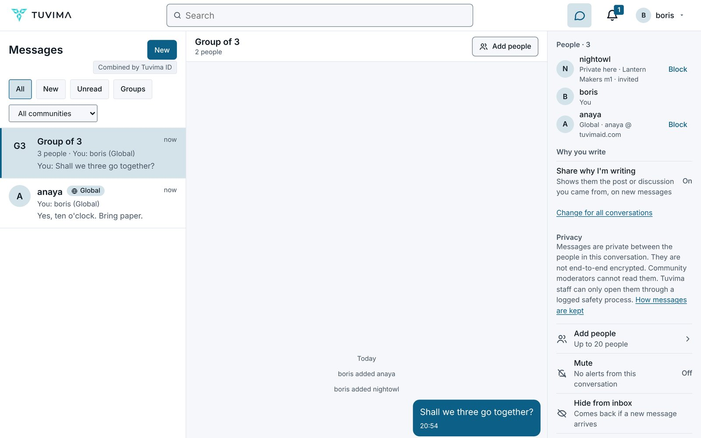
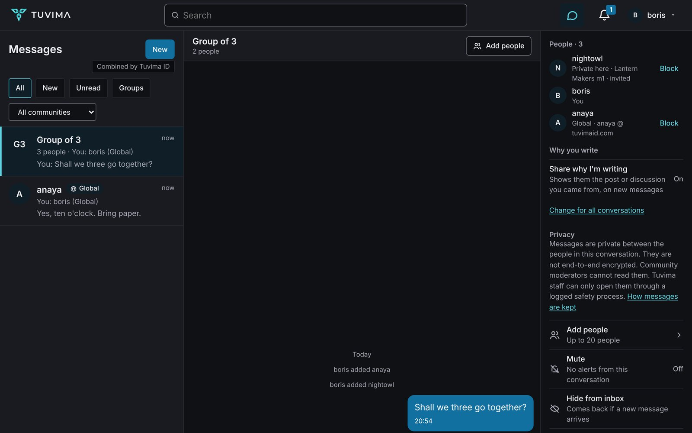
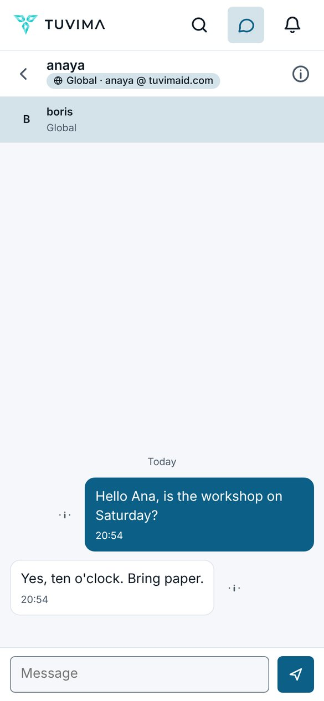
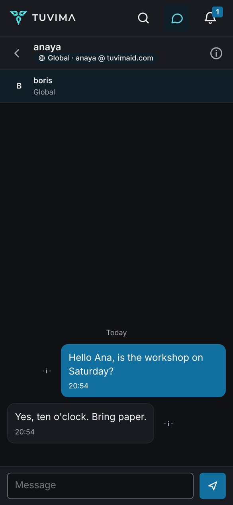

Private messages let you talk with one person, or a small group, away from the forums. A conversation belongs to the people in it, not to a community: you and another persona have one conversation, wherever either of you starts it.

<figure class="tv-screens">

<figcaption>On a computer and on a phone; select a picture to see it full size. Everyone shown is a made-up sample person.</figcaption>
</figure>

To talk live with everyone in a community, use its [chat channels](chat-channels.md) instead.

## Find your messages

Choose **Messages** (the speech bubble) in the menu. You see one inbox for every persona you use, and the box in the bottom corner shows which persona you are in the open conversation. A number on the button counts conversations with something new.

Narrow the list with:

- **All**: your ongoing conversations.
- **Unread** and **Groups**.
- **New**: first messages from people you have not talked with, and invites to groups. See [New](#new-first-messages-and-invites).
- **Community**: conversations that started from a community, or with someone whose private persona lives there.

## Start a conversation

You can message anyone who shares a community with you, from:

- **A person's card**, for example next to their post or in a community's member list. Choose **Message**.
- **New message** in your inbox. Start typing a name and pick from the people you share a community with, or choose **Pick from a community** to browse a community's members by role or by who was active recently. One name starts a two-person conversation; more names start a group.

If you two already have a conversation, it opens, wherever you started from. Tuvima never makes a second one.

If you see "You can't message this person right now", they are not taking new messages from you. Tuvima never says why, to protect their privacy.

To prevent spam, the number of new conversations you can start each day is limited, and it is lower while you are a [newcomer](newcomers.md). Replying in conversations you already have is not limited this way.

## Why a message shows where it came from

When you start a conversation from someone's post, a short grey line above your first message says why you are writing, so the other person is not left wondering who you are. For example:

- "Zoe saw your post **Fixing a bike chain** · Cyclists"
- "Zoe saw your comment in **Fixing a bike chain**"
- "Zoe was reading **Fixing a bike chain**, where you reacted"

You see your own version: "You found Sam through **Fixing a bike chain**". The title links to the post.

- The line only ever appears when it is true: the post really is theirs, or they really reacted there.
- Each person sees the title only if they can still open the post. If it was deleted or removed, or it sits somewhere they cannot read, the line says "a post that's no longer available".
- Phone alerts never include the title. They say "About your post" or "About your comment".
- Before you send, the message box shows "Sam will see you found them through …". Choose **Change** to leave the line out this once.
- To stop sharing why you write with one person, switch off **Share why I'm writing** in that conversation's info panel. To stop it everywhere, change the setting in Tuvima ID: see [who can message you](../../id/guides/who-can-message-you.md#share-why-im-writing).

A message started from a person's card, or from **New message**, carries no line.

## Global and private names in messages

You write as the persona you are using: your global persona, which is the same everywhere, or a private persona that belongs to one community.

- Messages between two global personas carry on whatever happens in any one community. Leaving a community, or being banned from it, does not end them. Only a block, or a suspension across all of Tuvima, does.
- A private persona only exists in its own community. If it leaves that community or is banned there, its conversations end: the others can still read what was said, but nobody can write, and it is taken out of its groups.
- Your private persona and your global persona are never put in one conversation, and nobody is told they belong to the same person.
- The first time you write as your global persona, a short note reminds you that the other person can see your Tuvima-wide name.

## New: first messages and invites

A first message from someone you have not talked with, and an invite to a group, wait under **New**, apart from your ongoing conversations. Open it and read it privately. The sender learns nothing until you reply: not that it arrived, and not that you read it.

- **Reply** (or **Join** for a group) moves it into your conversations.
- **Ignore** tidies it away quietly. The sender is not told, and nothing they write afterwards reaches you. A group you ignored cannot invite you again.
- **Spam** does the same, and also tells Tuvima. When several people mark the same sender as spam in a week, that sender cannot start new conversations for a while.

While a message waits in New you cannot react to it, and you are not sent phone alerts about it.

## In a conversation

- **Reply** to a particular message to quote it.
- **React** with an emoji.
- **Edit** your own message. It is marked as edited, and people in the conversation can see what it said before.
- You cannot unsend a message. Think of it like a letter: once it is delivered, the other person has it.
- Photos cannot be sent in messages yet.

## Groups

A group belongs to the people in it, not to a community, so it can bring together people from different communities. Start one from **New message** with several names, or choose **Add people** in a conversation. A group holds up to 20 people and can have a name.

- People you have talked with before join straight away. Anyone else gets an invite under **New**, and the group sees "joined" once they accept.
- Adding someone to a two-person conversation starts a new group. Your earlier one-to-one messages stay private between the two of you.
- When you add someone to a group, you choose how much earlier conversation they can see: all of it, the last 7 days, the last 30 days, or only what is said from now on.
- Anyone can **Leave** a group. The others see a short line saying so.

## Mute, hide and block

Open the **info** button at the top of a conversation.

- **Mute** stops alerts from that conversation. It still appears in your inbox.
- **Hide from inbox** tidies it away. It comes back if a new message arrives.
- **Block** stops that person from messaging you, and you from messaging them, in every conversation you have. They are not told.

To choose who may start a conversation with you in the first place, see [who can message you](../../id/guides/who-can-message-you.md). That choice lives in Tuvima ID because it covers all your personas.

## Messages from moderators

Moderators of a community can always reach a member there about a problem, whatever that member's settings. When they do, they write from the community's moderation screens: the message carries a **Moderator** tag and a line saying which post it is about, and the community's moderation record notes that a moderator contacted you. It never records what was said. When a moderator messages you the ordinary way, they are a member like anyone else: your settings and blocks apply, and there is no tag.

## Report a threat to Tuvima

Private messages belong to no community, so community moderators never see them, not even in a report. If a message threatens violence, suggests someone is in danger, or shares illegal content or anything that puts a child at risk, report it to Tuvima:

1. Open the message's menu and choose **Report a threat to Tuvima**.
2. You see exactly what Tuvima staff will see: that message and up to 5 messages before and after it. Nothing else from the conversation is shared.
3. Pick a reason, add a note if you like, and choose whether to block the person too.

Only Tuvima staff see the report, and the person you reported is not told. Every time staff open a report it is written to Tuvima's staff log. For anything else, such as someone being rude, use **Block** or **Ignore**. If someone is in immediate danger, contact your local emergency services first.

## How private is a private message?

We want to be plain about this.

- Messages are private between the people in the conversation.
- Community owners and moderators **cannot** read them, and reports about them never go to moderators.
- Messages are **not** end-to-end encrypted, the kind of protection where even the company running a service cannot read them. Tuvima staff can open messages only through a logged safety process: when someone reports a threat, when the law requires it, or when someone is in danger.
- The other person can always copy or screenshot what you send.

Read more in [your privacy on Tuvima](privacy.md).

## Alerts

A new message adds to the number on the **Messages** button. If you have switched on phone alerts, you get one saying who wrote, never what they wrote. Messages waiting under **New** do not send phone alerts. Messages do not appear in the bell. See [keep up with conversations](keep-up.md).
