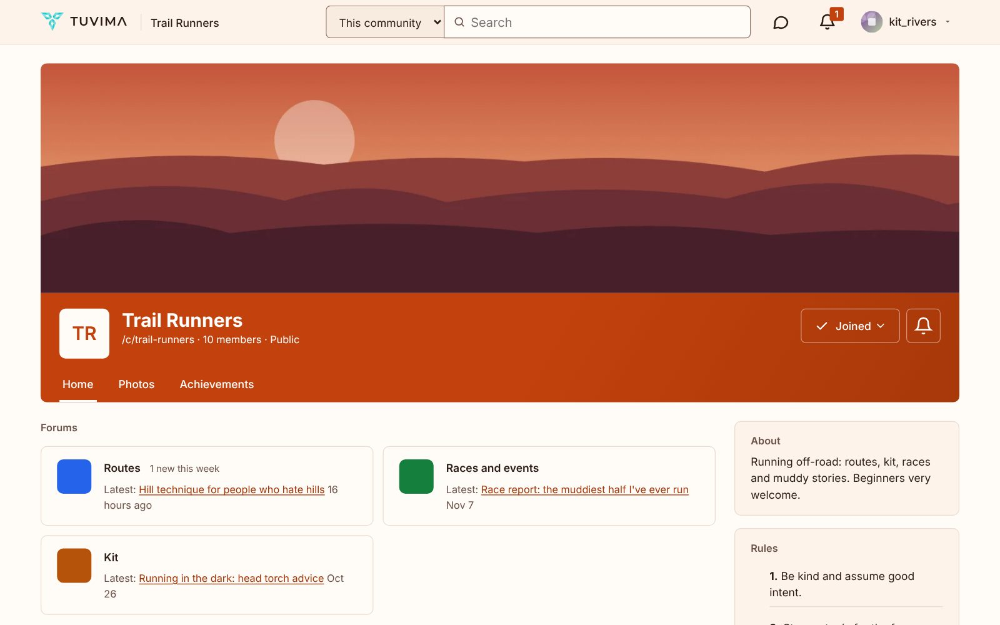
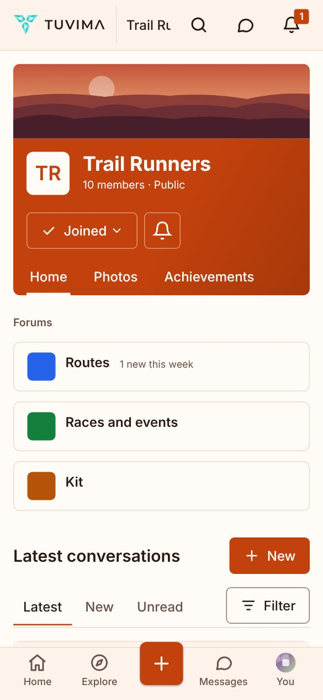

Some communities, and the Tuvima front page, ask new members to settle in before everything is switched on. It keeps out spam and gives people time to get to know the community. A community's owner decides whether to use it.

<figure class="tv-screens">

<figcaption>On a computer and on a phone. Everyone shown is a made-up sample person.</figcaption>
</figure>

## What is limited

While you are new, you can post a limited number of times an hour, for example 5 posts and 2 new conversations. If you reach the limit, Tuvima tells you when you can post again. Deleting a post does not give it back.

## Become a full member

A progress note shows how far you are, for example: "You're new here: 7 of 10 posts to become a full member".

- Make the number of posts the community asks for, usually 10, that are still showing. Each post that moderators hide or remove adds 5 more to go.
- Some communities also ask for a **sign of value from regulars**: an answer of yours accepted by a regular, or replies from 3 different regulars. A regular is a full member of that community.

An owner or admin can also make you a full member straight away. Progress counts only what you do in that community.

## Good to know

- If you leave and rejoin with the same persona, your progress is kept.
- A suspension starts your progress again.
