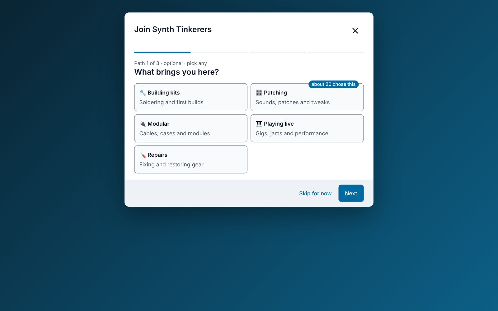
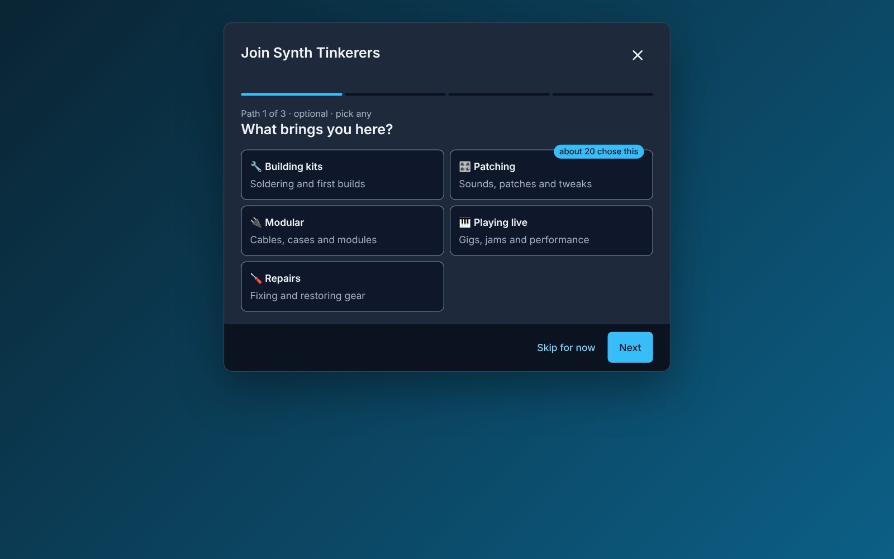
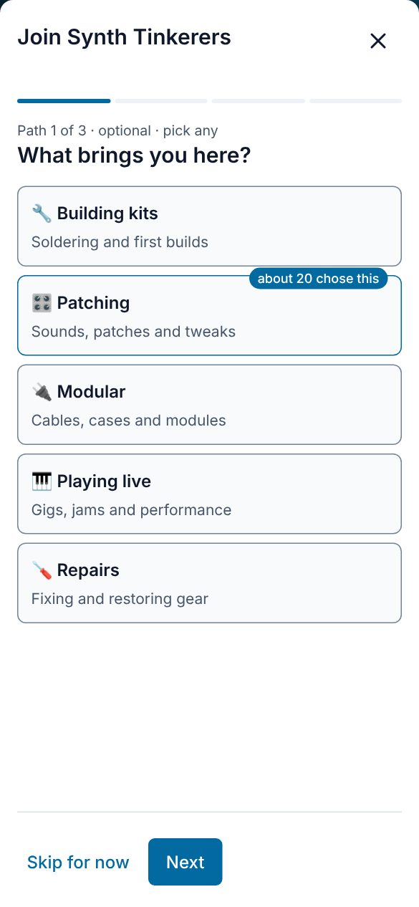
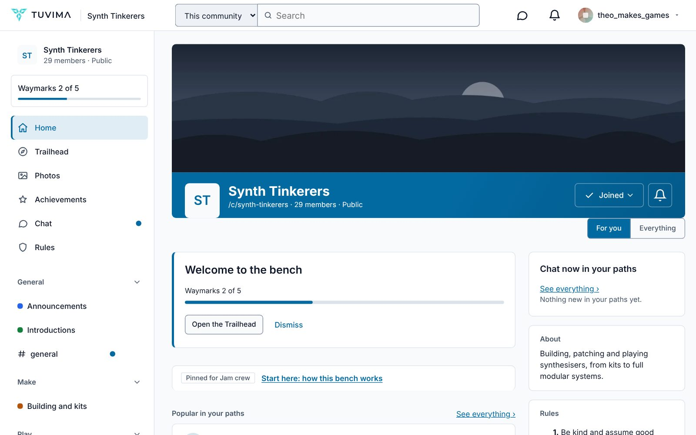
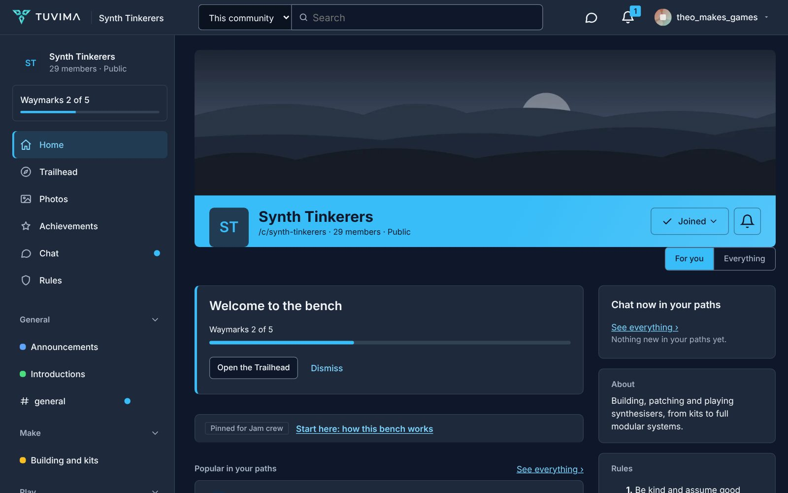
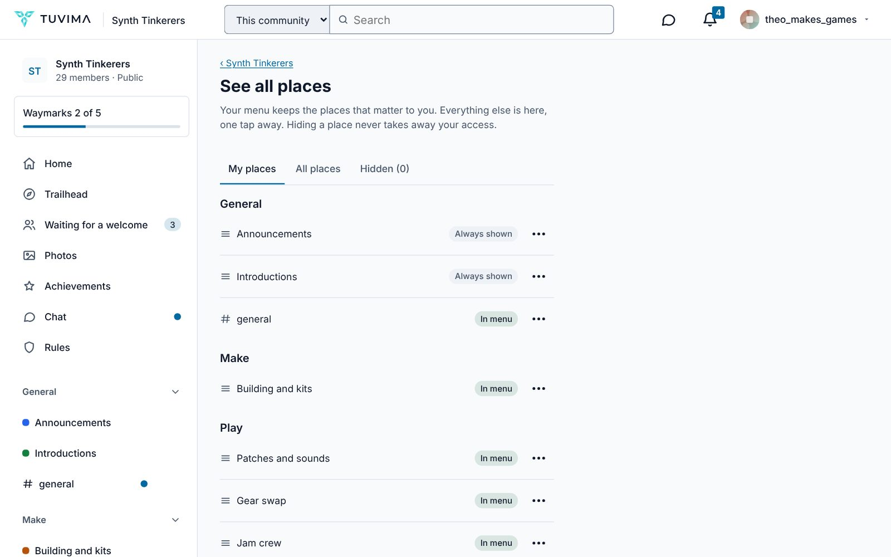
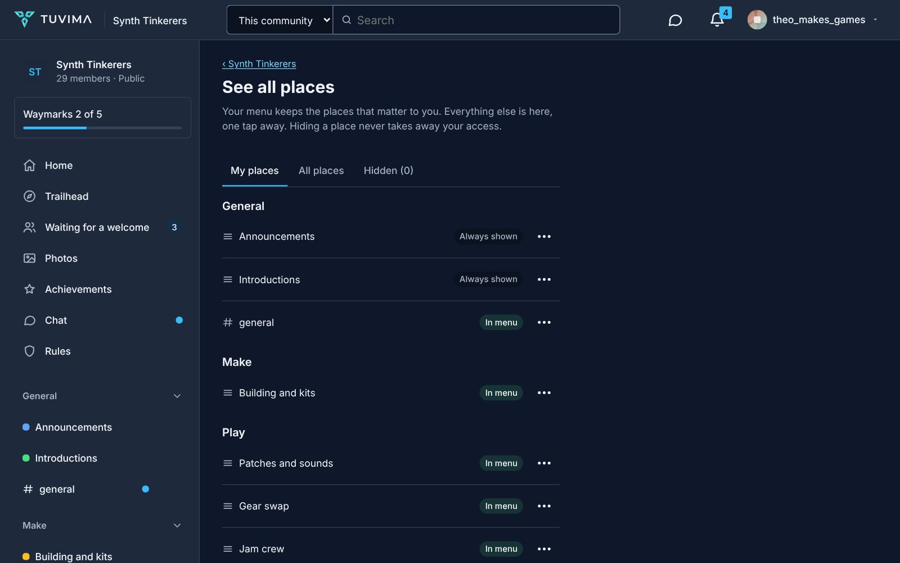
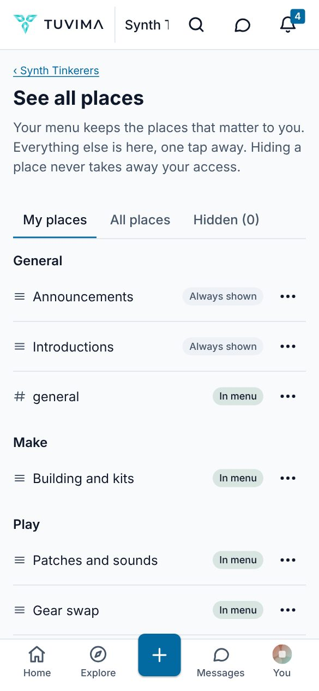
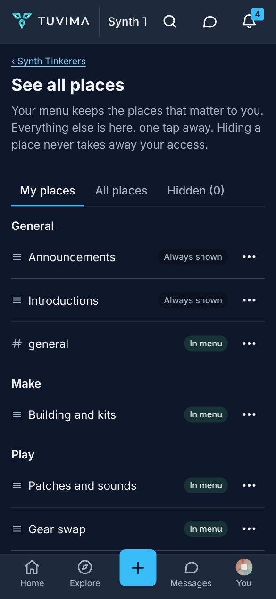

A busy community can have dozens of forums and chat channels. **Paths** let you say what you're into, so your menu shows the places you care about. Everything else stays one tap away under **See all places**, and you can hide what you never want to see.

<figure class="tv-screens">

<figcaption>On a computer and on a phone; select a picture to see it full size. Everyone shown is a made-up sample person.</figcaption>
</figure>

## Choose your paths when you join

When a community has set up paths, choosing **Join** takes you through a few short steps:

1. **Choose your paths.** Each step asks one question written by the community, such as "Where do you play?". Pick one answer, or several when the question says **Pick any**. Each answer shows what it's about, and popular answers show roughly how many people chose them.
2. The line at the bottom says exactly what your picks give you, for example "You'll get Switch players and # switch-players". Nothing happens that you weren't told.
3. Choose **Skip for now** to move on without answering. Some communities make a question required; then you need to pick an answer.
4. **One last step: house rules.** Read the community's rules, choose the persona you join as, and choose **Join**. Joining means you agree to the rules.

Use **Back** at any time to change an earlier answer. Nothing is saved until you choose **Join**, so closing the steps halfway doesn't join you.

If you joined before the community set up paths, a **Choose your paths** banner on the community offers **Choose** or **Not now**.

If the community asks people to be approved first, you see the rules and the community's questions with your request instead. Some of those questions can also be paths: once you're approved, your answer becomes your pick, and you can change it later on **Your paths**. You choose any other paths once you're in. A banner on the community offers **Choose your paths**.

## What a path gives you

Each answer is a **path role**: a role you pick yourself. Depending on how the community set it up, a path role can:

- put places (forums, chat channels or whole categories) in your menu,
- follow some places for you, so new conversations there reach your bell (never email),
- open a members-only place, such as a "Raid team" forum.

A path role can never give anyone moderator or staff powers.

**Your picks are private.** Other members don't see your paths, and the community's staff only see rounded totals, never names. The exception is a role the owner has chosen to show on member cards, such as "Raid team", where showing it is the point. The role's description says so before you pick it.

## Change your paths

Open the community menu and choose **Your paths**. Tap an answer to add or remove it; it saves straight away and tells you what changed, for example "Added Lore and theories to your menu". Under **Roles you can pick**, switch a role on or off.

Some forums and chat channels are **Opt-in**: they stay out of everyone's menu, and only members who pick them can open them. Each one has a role named after it under **Roles you can pick**. Switch it on to see the place.

Dropping a path role takes its places off your menu. Your posts there stay where they are.

## Your menu

Your menu in a community shows:

- the places the owners picked to **start here**,
- places that are **always shown**, such as Announcements,
- places from your paths and from any role, level or member tier you hold,
- places you added yourself.

Everything else is under **See all places**, with a count of how many more there are. Choosing a place you haven't added never asks you anything: you can read anything you are allowed to read, whether it's in your menu or not.

Communities that haven't set up paths show every place in the menu, as before.

When you're given a role, reach a new level or get a member tier that comes with places, your bell says **New paths opened** and the places appear in your menu.

## For you or Everything on the community's home

Once you've picked at least one path in a community, its home has a switch at the top: **For you | Everything**.

<figure class="tv-screens">

<figcaption>On a computer and on a phone; select a picture to see it full size. Everyone shown is a made-up sample person.</figcaption>
</figure>

- **For you** is where you start. **Popular**, **New photos**, **Latest** and **Chat now** come only from your places, the ones in your menu, and their headings say "in your paths". Places you've hidden never appear.
- **Everything** shows the whole community, as anyone sees it, including places you've hidden.
- Choose **See everything ›** beside any heading to switch to Everything. When a block has nothing new from your places, it says "Nothing new in your paths yet." with the same link.

Tuvima remembers your choice for that community, on every device, until you change it. Changing your paths doesn't reset it. The owner's featured conversations and announcements show in both views.

If you haven't picked any paths, or the community hasn't set them up, there's no switch: you see everything, as before.

### Pinned for your role

Owners can pin a conversation to the top of the home for the people who hold a role, level or member tier. You see it as a card marked **Pinned for** and the role's name, for example "Pinned for Jam crew", in both views. People who don't hold that role don't see it.

## Hide a place

Choose **···** beside a place in the community menu, then **Hide**. Hiding:

- takes the place off your menu,
- keeps its conversations off your [Home](home-feed.md),
- mutes its alerts.

A green note offers **Undo** straight away. Hiding never takes away your access: you can still open the place from a link or a search. Only you know what you've hidden; staff never see it.

You can also hide a forum from a card on your Home: choose **···** on the card, then **Hide** and the forum's name. To keep a whole community off your Home without leaving it, choose **Hide** and the community's name **from Home**.

Some places, such as Announcements, are **always shown**: the owner has decided everyone should see them, so they can't be hidden.

## See all places

Choose **See all places** at the bottom of the community menu. It has three tabs:

- **My places**: what's in your menu, with a label on each place: where it came from (such as "From the Raid team role", or a level or tier), **Always shown**, or **In menu**.
- **All places**: every place you can open, grouped by category, with **Add** to put one in your menu.
- **Hidden**: what you've hidden, with **Show again**.

<figure class="tv-screens">

<figcaption>On a computer and on a phone; select a picture to see it full size. Everyone shown is a made-up sample person.</figcaption>
</figure>

Showing a place again also brings back the alert setting it had before you hid it.

## Your first steps

After you join, the community's **Trailhead** welcomes you with a few first steps, called Waymarks, that tick themselves as you go. See [The Trailhead and Waymarks](trailhead-and-waymarks.md).

## Coming back

If you leave a community and come back later, you're greeted with "Well met again". Your paths and roles are as you left them. Choose **Review my picks first** to look at your paths after you rejoin.
