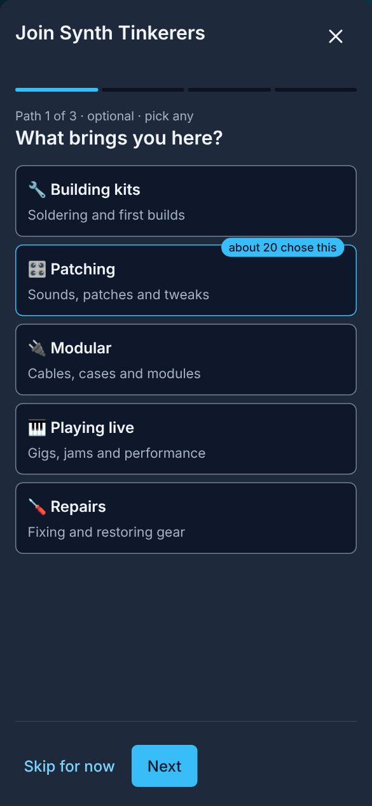
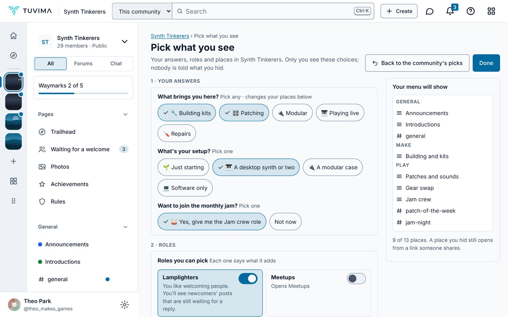
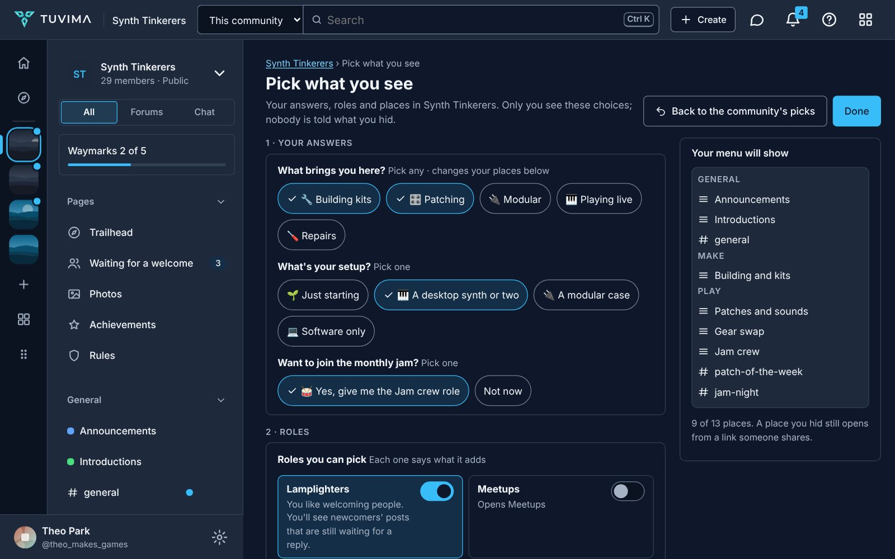
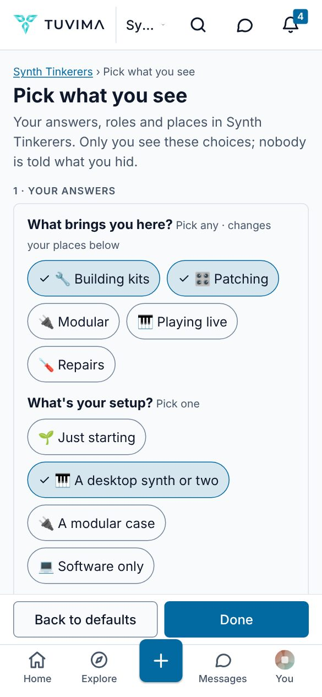
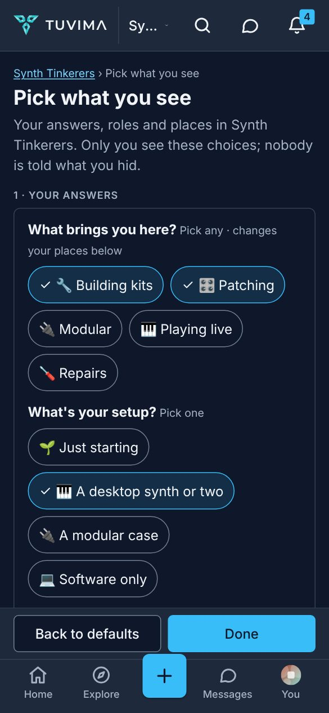
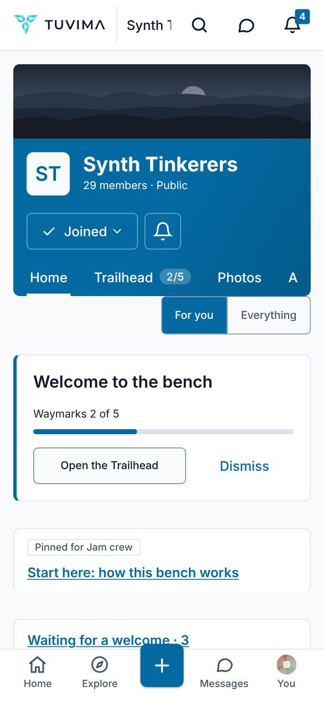
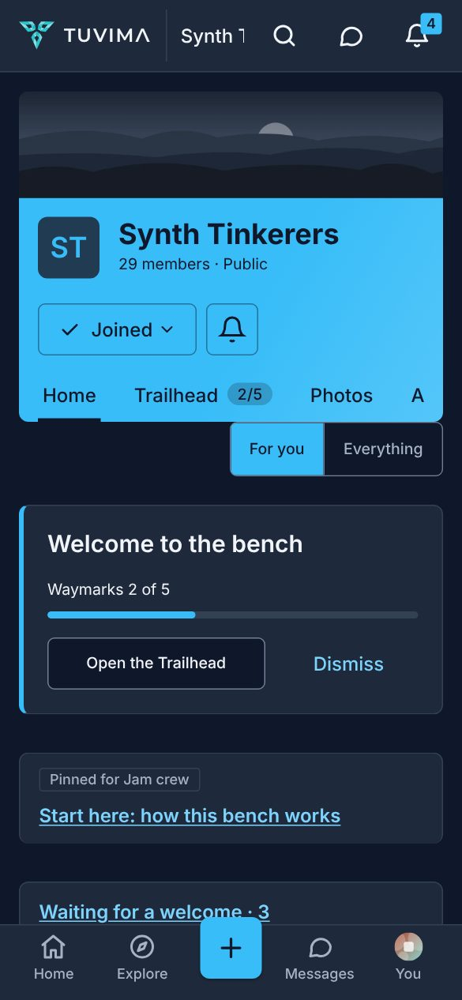

A busy community can have dozens of forums and chat channels. When you join, a community can ask a few questions about what you're into. Some answers add places to your menu, so it shows the places you care about. We call an answer like that a **path**. **Pick what you see** is one page where you change your answers, the roles you picked and which places are in your menu. Only you see these choices; nobody is told what you hid.

<figure class="tv-screens">

<figcaption>On a computer and on a phone; select a picture to see it full size. Everyone shown is a made-up sample person.</figcaption>
</figure>

## Answer the questions when you join

Each community asks its questions once, when you join. When a community lets anyone join and has questions, choosing **Join** takes you through a few short steps:

1. **Answer the questions.** Each step asks one question written by the community, such as "Where do you play?". Pick one answer, or several when the question says **Pick any**. Each answer shows what it's about, and popular answers show roughly how many people chose them.
2. The line at the bottom says exactly what your picks give you, for example "You'll get Switch players and # switch-players". Nothing happens that you weren't told.
3. Choose **Skip for now** to move on without answering. Some communities make a question required; then you need to pick an answer.
4. **One last step: house rules.** Read the community's rules, choose the persona you join as, and choose **Join**. Joining means you agree to the rules.

Use **Back** at any time to change an earlier answer. Nothing is saved until you choose **Join**, so closing the steps halfway doesn't join you.

If the community has no questions, you go straight to the rules and join in one step.

If the community asks people to be approved first, you see the rules and the community's questions together with your request, under **A few questions**. The community's team reads your answers with your request. Once you're approved, your answers to choice questions become your picks, so you get the places they add, and you can change them later on **Pick what you see**. You aren't asked again.

If you joined before the community wrote its questions, a **Choose your paths** banner on the community offers **Choose** or **Not now**. **Choose** opens Pick what you see.

## What a path gives you

An answer that adds places does it by giving you a **path role**: a role you pick yourself. Depending on how the community set it up, a path role can:

- put places (forums, chat channels or whole categories) in your menu,
- follow some places for you, so new conversations there reach your bell (never email),
- open a members-only place, such as a "Raid team" forum.

A path role can never give anyone moderator or staff powers.

**Your picks are private.** Other members don't see your paths, and once you're a member the community's staff only see rounded totals, never names. Where you asked to join, the people who reviewed your request may have seen your answers with it; those answers are deleted 90 days after the decision. The exception is a role the owner has chosen to show on member cards, such as "Raid team", where showing it is the point. The role's description says so before you pick it.

## Open Pick what you see

You need to be a member of the community. There are four ways in:

- Choose the community's name at the top of the page, then **Pick what you see**.
- At the foot of the community menu, choose **Pick what you see**. The numbers beside it, such as **6 of 9**, say how many places are in your menu out of all you could have.
- On a phone, open the community panel and choose **Pick what you see** (Your answers, roles and places here).
- On the community's home, under the list of forums, a line such as "3 places you haven't picked are not shown · Pick what you see" appears when there are Opt-in places you haven't added. Choose **Pick what you see**.

Older links to **Your paths** or **See all places** open Pick what you see.

## Change what you see

The page has three steps. Every change saves straight away, and a short line says what changed, for example "Added Lore and theories". Choose **Done** to go back to the community.

<figure class="tv-screens">

<figcaption>On a computer and on a phone; select a picture to see it full size. Everyone shown is a made-up sample person.</figcaption>
</figure>

1. **Your answers.** The community's questions, with your answers ticked. Tap an answer to add or remove it. A question marked **Pick one** takes one answer; **Pick any** takes as many as you like. A required question always keeps one answer, so to change it, tap a different one.
2. **Roles.** Under **Roles you can pick**, switch a role on or off. Each one says what it adds, for example "Opens Raid team · alerts for Raid nights".
3. **Places.** Every place you can open, grouped by category, with how many are in your menu, such as "6 of 9 in your menu". Set each place to **In menu** or **Hidden** (on a phone, a switch). A quiet line under each name says why it is where it is, such as "From the Raid team role", "You hid this" or "Not in your menu". On a computer, **All**, **In menu**, **Hidden** and **Opt-in** above the list show just those places.

Some places can't be changed:

- **Always shown** places, such as Announcements, stay in everyone's menu because the community keeps them there.
- If you hid a whole category, its places say "Hidden with its category". Choose **Show again** beside the category to bring it back.

On a computer, **Your menu will show** beside the steps shows your menu as it will look, with a count such as "6 of 9 places". On a phone the steps are one scroll, with **Done** at the bottom of the screen.

Dropping an answer or a role takes its places off your menu. Your posts there stay where they are.

### Opt-in places

Some forums and chat channels are **Opt-in**: they stay out of everyone's menu, and only members who add them can open them. In **Places** they're marked **Opt-in** with the line "Opt-in: only shows if you add it". Choose **Add** to put one in your menu. Once added it says "Opt-in: you added it", and you can hide it like any other place.

### Go back to the community's picks

Choose **Back to the community's picks** (on a phone, **Back to defaults**). Tuvima asks "Clear your answers, the roles you picked and your choices for each place?". Choose **Yes, go back** or **Cancel**.

Going back:

- puts every place back to how the community set it up, including places you hid,
- clears your answers, except an answer to a required question,
- turns off the roles you picked yourself.

Roles the community's staff gave you stay.

## Your menu

Your menu in a community shows:

- the places the owners picked to **start here**,
- places that are **always shown**, such as Announcements,
- places from your paths and from any role, level or member tier you hold,
- places you added yourself.

Everything else is on **Pick what you see**, where you can add it. Choosing a place you haven't added never asks you anything: you can read anything you are allowed to read, whether it's in your menu or not.

Communities that haven't set up paths show every place in the menu, as before.

When you're given a role, reach a new level or get a member tier that comes with places, your bell says **New paths opened** and the places appear in your menu.

## For you or Everything on the community's home

Once you've picked at least one path in a community, its home has a switch at the top: **For you | Everything**.

<figure class="tv-screens">

<figcaption>On a computer and on a phone; select a picture to see it full size. Everyone shown is a made-up sample person.</figcaption>
</figure>

- **For you** is where you start. **Popular**, **New photos**, **Latest** and **Chat now** come only from your places, the ones in your menu, and their headings say "in your paths". Places you've hidden never appear.
- **Everything** shows the whole community, as anyone sees it, including places you've hidden.
- Choose **See everything ›** beside any heading to switch to Everything. When a block has nothing new from your places, it says "Nothing new in your paths yet." with the same link.

Tuvima remembers your choice for that community, on every device, until you change it. Changing your paths doesn't reset it. The owner's featured conversations and announcements show in both views.

If you haven't picked any paths, or the community hasn't set them up, there's no switch: you see everything, as before.

### Pinned for your role

Owners can pin a conversation to the top of the home for the people who hold a role, level or member tier. You see it as a card marked **Pinned for** and the role's name, for example "Pinned for Jam crew", in both views. People who don't hold that role don't see it.

## Hide a place

Choose **···** beside a place in the community menu, then **Hide**, or set it to **Hidden** on Pick what you see. Hiding:

- takes the place off your menu,
- keeps its conversations off your [Home](home-feed.md),
- mutes its alerts.

A green note offers **Undo** straight away. Hiding never takes away your access: you can still open the place from a link or a search. Only you know what you've hidden; staff never see it.

You can also hide a forum from a card on your Home: choose **···** on the card, then **Hide** and the forum's name. To keep a whole community off your Home without leaving it, choose **Hide** and the community's name **from Home**.

Some places, such as Announcements, are **always shown**: the owner has decided everyone should see them, so they can't be hidden.

To show a place again, set it to **In menu** on Pick what you see. Showing a place again also brings back the alert setting it had before you hid it.

## Your first steps

After you join, the community's **Trailhead** welcomes you with a few first steps, called Waymarks, that tick themselves as you go. See [The Trailhead and Waymarks](trailhead-and-waymarks.md).

## Coming back

If you leave a community and come back later, you're greeted with "Well met again". Your paths and roles are as you left them. Choose **Review my picks first** to open Pick what you see after you rejoin.
