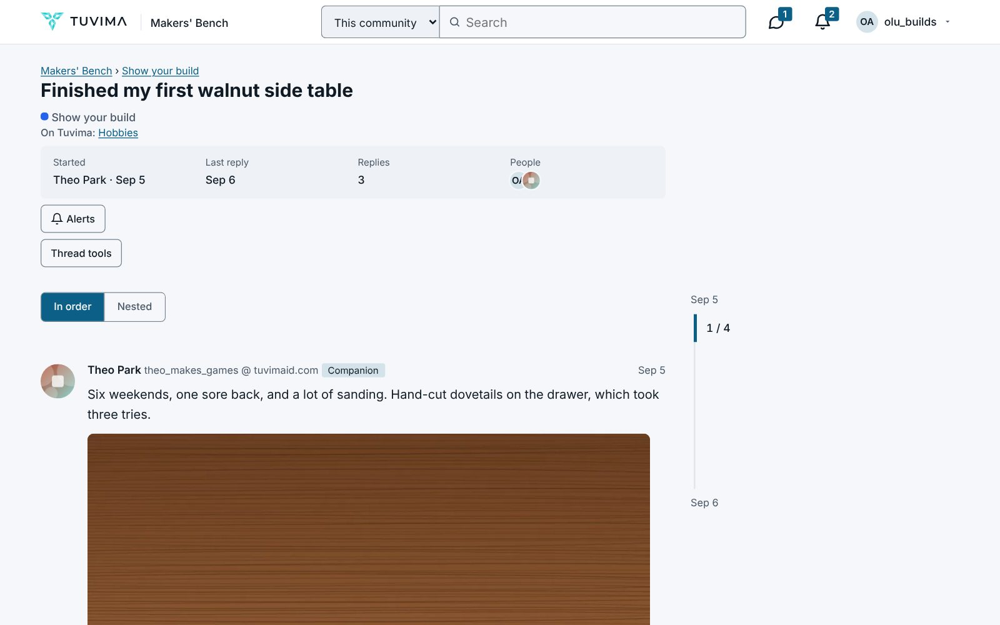
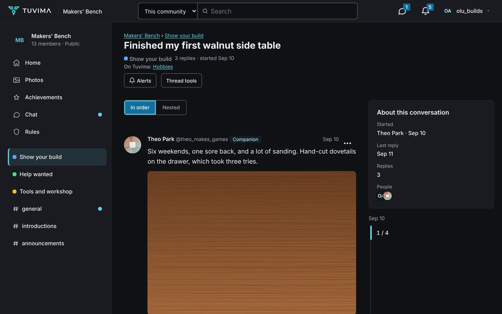
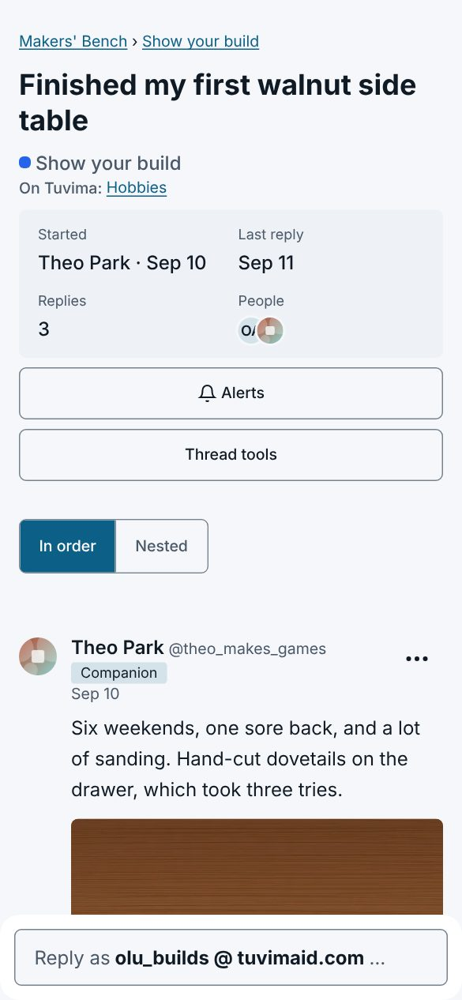
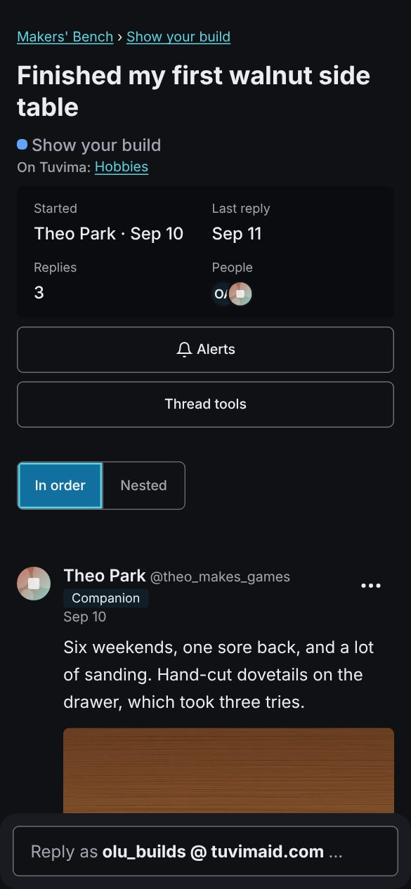

Inside a community you can start a conversation or reply to one. You need to be a member, though in most public communities you can also [reply as a visitor](visitor-replies.md) without joining.

<figure class="tv-screens">

<figcaption>On a computer and on a phone; select a picture to see it full size. Everyone shown is a made-up sample person.</figcaption>
</figure>

## Start a conversation

1. Open the community and choose to start a new conversation.
2. Write a title and your post. You can also [add photos](photos.md).
3. Pick the community's category for it, if it has categories.
4. Choose **Post**.

## Save a draft

You do not need to save anything. Tuvima saves your draft to your persona about 2 seconds after you stop typing.

- Your draft follows you to any device where you use that persona.
- Drafts are private. Only you can see them.
- Find them under **You**, then **Drafts**.
- A draft disappears when the post goes out.

## Start from a template

Some forums offer **post templates**, which fill the editor with a starting layout. A template never replaces what you have already typed. Owners set them up; see [add-ons for your community](../owners/add-ons.md#post-templates).

## Add a poll

In forums where the community has the Polls add-on, you can add a poll to your post. Choose whether people pick one answer or up to a number of answers, and set a closing date if you like. You also choose whether votes are public or private. See [add-ons for your community](../owners/add-ons.md#polls) for how voting works.

## Look for a group

In forums where the owner allows it, you can mark your post as **Looking for group**. People answer **I'm in** or **Maybe**. When the seats are taken, the post shows **Full**, and you are told when someone joins and when it fills. See [add-ons for your community](../owners/add-ons.md#looking-for-group).

## If your post is waiting or blocked

Some communities hold certain posts for a moderator to look at first, such as a newcomer's first posts or posts with particular words. You see **Your post is waiting for a moderator to look at it. It will appear once it's approved.**

A community can also block some words. Then your post isn't posted, and you see the community's message saying why. Change your words and try again. Nothing you wrote is lost.

## Reply

Open a conversation and write in the reply box at the bottom, which says **Write a reply…**. On a computer the reply box is a single line until you select it, then it opens with the formatting bar. On a phone the reply box stays at the bottom of the screen, in place of the usual bottom bar, and opens the full editor when you tap it. Choose how you read replies:

- **Classic** shows replies one after another, oldest first. On a wide screen each reply has an author column beside it. **N replies** under a post opens the replies to it in a panel, and a **Replying to** chip on a reply opens the post it answers.
- **Compact** shows who replied to whom, in branches. Sort them by **Best**, **New** or **Old**. In a very big conversation the sort applies to the replies loaded so far. A long branch folds into one line you can open, and **Continue this thread** takes you further into a deep branch.

A community's owner sets which one a forum opens on. Once you pick your own, Tuvima uses yours and remembers it on that device.

On long conversations, the **Reading position** bar shows where you are and lets you jump. Members also see **Jump to where you left off** and a **New since your last visit** line.

## Read a big conversation

A conversation with more than 200 replies opens on **Catch up**, so you can see what matters without scrolling through everything.

- **Highlights**: up to 30 of the replies people voted up most, in the order they were written, plus every accepted answer and every post marked **From the moderators**. **See it in the thread** takes you to that reply with the replies around it.
- **Folded branches**: a long run of replies to one post folds into one line, such as **+399 replies in this branch · 6 people · Sam, Jo, Mira and 3 others**. Choose it to open the branch in place.
- **New replies since your last visit**: members see a bar at the top that jumps to the first reply they haven't seen.

Choose **Classic** or **Compact** at any time to read every reply. Replies load about 50 at a time, and every reply keeps its own link, so a shared link still opens on the right reply.

The **Timeline** beside the conversation shows how busy each day was. Choose a day to jump to its first reply, or use **Back to top**, **Where you stopped**, **Busiest day** and **Jump to newest**. On a phone, conversations with more than 20 replies show a small button above the reply box, such as **Reply 31 of 40 · Jump**. Choose it to go to the start, the busiest moment, the newest reply, a date or a reply number.

Nothing is hidden or removed by Catch up. It only changes where the conversation opens.

### Turn big thread mode off

If you'd rather every conversation open in the usual way, open **You** from your account menu, choose **Edit** beside your name, and under **Reading** switch off **Big thread mode**. It applies to every community. The **Turn it off in your settings** link under the highlights goes to the same place.

## Questions and answers forums

In a **Questions and answers** forum, a question opens on **Top answers**: the accepted answer first, then the answers people voted up most. When two answers have the same votes, the newer one comes first. Each answer shows its first few replies, and **Show all replies** opens the rest. Choose **Classic** to read everything by time instead.

## Format your post

The **Formatting** bar offers **Bold**, **Italic**, **Link**, **Bulleted list**, **Numbered list**, **Quote** and **Code**. You can also press Ctrl+B or Ctrl+I (Cmd on a Mac). What you see as you type is what readers will see.

## Share links

Put a web address on its own line and it becomes a small **preview card**, with a title and picture. Tuvima's own servers fetch the preview, so readers' browsers do not contact the other site just by reading.

Cards for video, music and social posts show a **Play** or **Load post** button. Nothing loads from the other site until a reader presses it. From then, that site's cookies and terms apply. A post can have up to 10 cards.

## Add a content warning

Turn on **Content warning** and add a short label, such as "Spoilers". Readers see the post blurred until they choose **Show**. Some community categories add a warning to every post automatically. If you quote a post with a warning, the quote keeps it.

## Quote someone

Select text in a post and choose **Quote selection**, or open the post's **···** menu and choose **Quote** to pick text with the keyboard. A post can have up to 10 quotes.

## Mention someone

Type `@` and a handle to mention a person. They get a notice. Mentions keep working if the person later changes their handle.

## A post's buttons

Each post keeps only the buttons you use most in view: the up and down votes, **React** and **Reply**. The reactions people added show as a small summary at the end of the row. Everything else is in the **···** menu at the top corner of the post: **Quote**, **Save**, **Copy link**, **Edit**, **Delete**, **Report**, and, for the person who asked the question, **Mark as accepted answer**. Moderators also find their tools there.

## Edit or delete

- **Edit** your post at any time. It shows **Edited · see history**, and readers can open the **Edit history** unless the community's owner has hidden it. You and the community's moderators can always see it.
- **Delete post** removes it from view. If people replied to it or quoted it, a "Deleted by the author" note stays in its place so the conversation still makes sense. Deleting cannot be undone.

## When a button is missing

Sometimes a place doesn't let you do something. You may not see **Start a conversation**, the reply box or the reaction buttons, or you may be told **You can't do that here**. Your community's owner sets what each role can do in each category, forum and chat channel, so it can differ from one place to the next. Nothing is wrong with your account. If you think it is a mistake, ask a moderator or the owner. They can see the reason. See [permissions for a place](../owners/place-permissions.md).

## Locked threads and slow mode

Moderators can lock a conversation. You can still read it, but you cannot reply. The lock shows its reason.

Moderators can also turn on **slow mode** for a conversation. You can then post only once every so often, from 30 seconds to 1 hour. Tuvima tells you when you can post again. Slow mode does not slow moderators, and it can end on a date the moderators choose. See [pins and thread tools](../owners/moderator-tools.md).

## Good to know

- In the community's home, members can sort by **Latest**, **New** or **Unread**. Moderators can pin a conversation to the top, and a community can feature up to 4 conversations on its home.
- The person who started a conversation, or a moderator, can choose **Mark as accepted answer** on the most helpful reply.
- Moderators can tick **Mark as from the moderators** when they reply. The reply shows a **From the moderators** label and always appears in Catch up, so everyone sees it. Use it for guidance about the conversation itself, such as "Please keep this on topic".
