The **Trailhead** is a community's welcome page. It holds the owner's welcome, your first steps (the **Waymarks**), and a few things worth reading first (the **Lore**). Open it any time from **Trailhead** in the community menu.

<figure class="tv-screens">
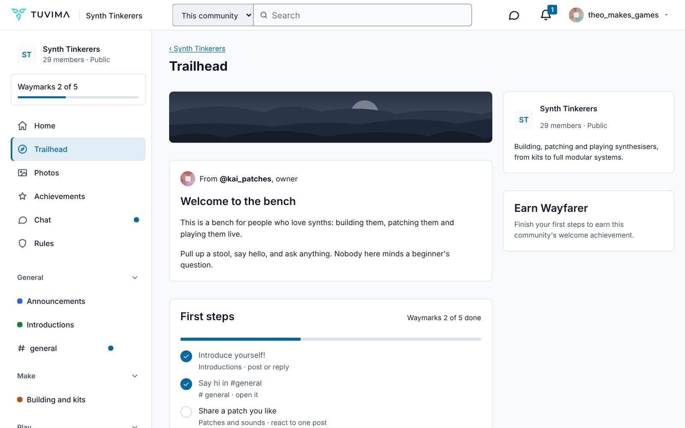
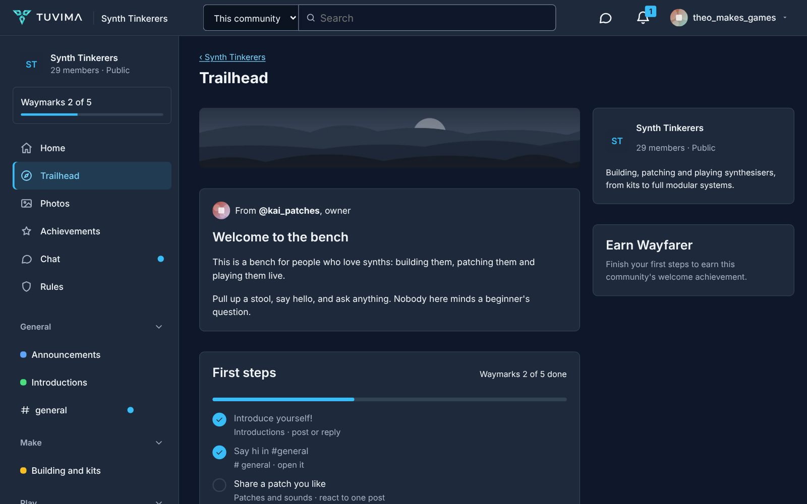
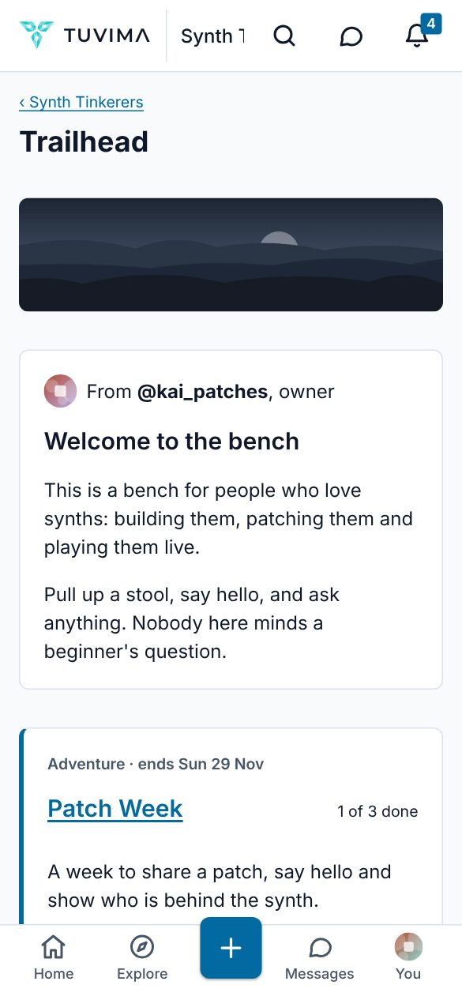
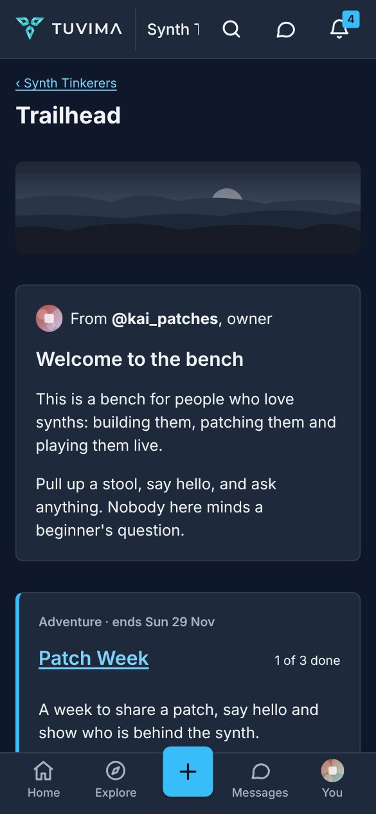
<figcaption>On a computer and on a phone; select a picture to see it full size. Everyone shown is a made-up sample person.</figcaption>
</figure>

## Waymarks: your first steps

Waymarks are short first steps written by the community, for example "Introduce yourself!" or "Say hi in #general". Each one points at a place, so you can go straight there.

- **They tick themselves.** Do the thing and the Waymark ticks the next time you open a page in the community. You never tick them by hand.
- **"Waymarks 2 of 4"** sits at the top of the community menu, with a small progress bar, until you've done them all. Then it goes away. The Trailhead stays.
- **Some are just for you.** A community can add a Waymark for people who chose a certain path, such as "Sign up for jam night" for the Jam crew. Other members don't see it, and it isn't counted for them.
- **A tick stays.** If a post you made is later removed, the Waymark it ticked stays ticked.

What can tick a Waymark:

| The Waymark asks you to | It ticks when you |
|---|---|
| Post or reply somewhere | start a conversation or reply in that forum |
| React to a post somewhere | react to any post in that forum (or anywhere in the community, if it names no forum) |
| Vote on a post (front page) | vote or react on any post on the front page |
| Join a community (front page) | are a member of any community other than the front page |
| Open a chat channel | open that channel |
| Read a pinned conversation | open that conversation |
| Read the rules | open the community's Rules page (agreeing when you joined doesn't count) |
| Set a profile picture | have a picture on the persona you use here |

### Wayfarer

Some communities give the **Wayfarer** achievement when you finish their first Waymarks. The Trailhead says so with an **Earn Wayfarer** card. It works like any other [achievement](achievements.md): it shows on your profile and you get one notice in the bell.

### Introduce yourself

If a Waymark asks you to introduce yourself, choosing it opens a new conversation that has already been started for you from your [paths](paths-and-places.md). For example: "Hi all, I'm Mira. I'm here for Patching and Modular." Change anything, or clear it and write your own. **Nothing is posted until you choose Start the conversation.**

## The road goes on

Below your first steps, the Trailhead keeps going:

- **Finding your feet** appears while you're a [newcomer](newcomers.md) in a community that has newcomer limits. It shows how close you are to becoming a full member, for example "Share 10 posts that stay up: 7 of 10".
- **Further along** appears in communities that use levels. It shows your next [level](reputation.md), what it opens, what you still need, and one or two achievements the community suggests.

**Only you can see your Waymarks** and your progress. Owners and moderators never see who has done what; later, owners will only see rounded totals.

## Lore

**Lore** is up to six things the community thinks you should read first: a pinned conversation, the rules, or a short page the owners wrote.

## On the community home

Until you've finished your Waymarks, the community home shows a small **Trailhead** card with your progress and **Open the Trailhead**. Choose **Dismiss** to hide the card. The Trailhead and the menu item stay.

## The front page's Trailhead

The front page has its own Trailhead too, with a welcome and three first steps: **Vote on a post**, **Join a community** and **Set your picture**. You see it as the last step of your first visit, and any time at the front page's **Trailhead**.

<figure class="tv-screens">
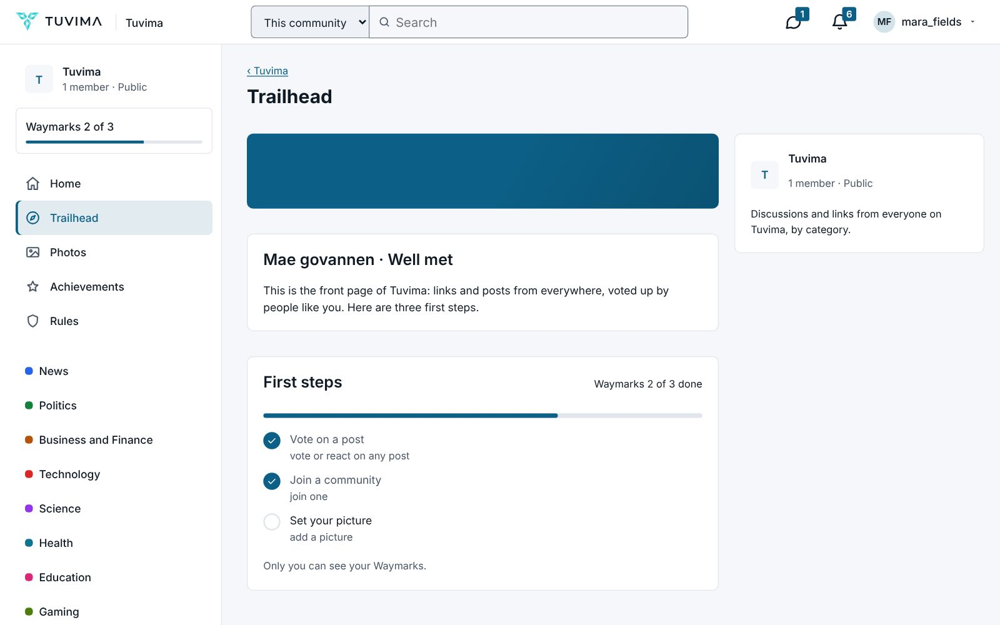
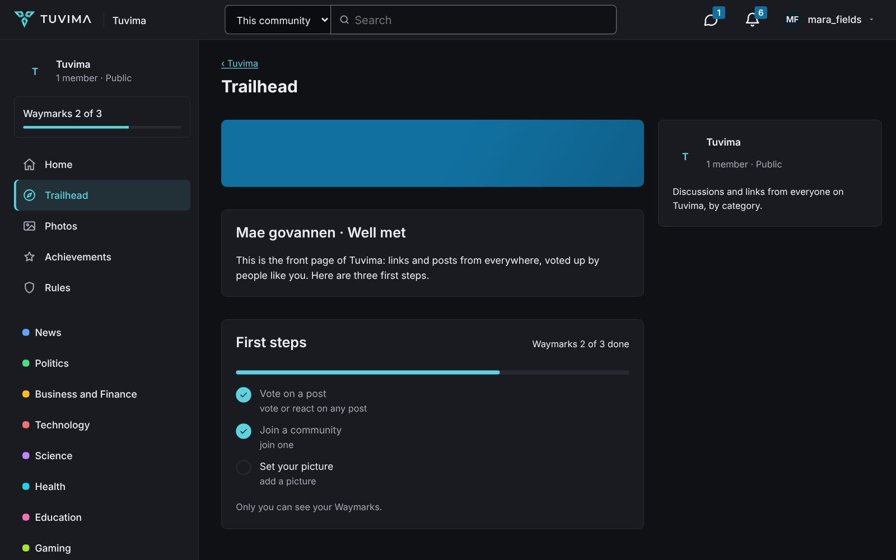
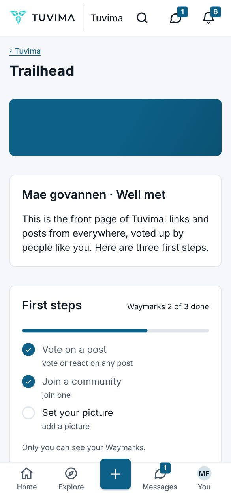
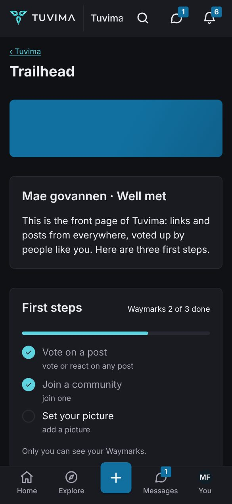
<figcaption>On a computer and on a phone; select a picture to see it full size. Everyone shown is a made-up sample person.</figcaption>
</figure>

Its Waymarks start once you've agreed to the [front page guidelines](front-page-guidelines.md). Until then it shows **Agree to the guidelines to start ticking these off**.

## Visiting before you join

If you haven't joined, the Trailhead shows the welcome and the Lore, with a link to join. Waymarks start once you're a member.

## Related

- [Your paths and places](paths-and-places.md)
- [Joining a community](join-a-community.md)
- [Being new to a community](newcomers.md)
- [Achievements](achievements.md)
- [Front page guidelines](front-page-guidelines.md)

## Adventures

While a community runs an Adventure, such as "Frost Week", it shows on the Trailhead above the Waymarks. Its steps tick themselves like Waymarks, but only for what you do while it runs. See [Adventures](adventures.md).

## Fellowships on your paths

If the community uses **Looking for group**, the Trailhead shows **Fellowships on your paths**: up to three groups looking for people this week, from Looking for group posts in the places your paths gave you. Each card says how many places are left and who posted it.

<figure class="tv-screens">
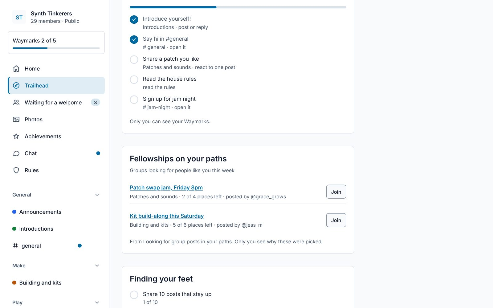
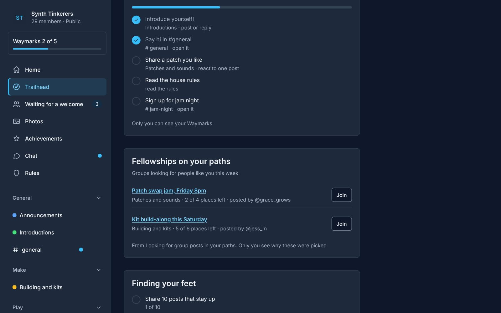
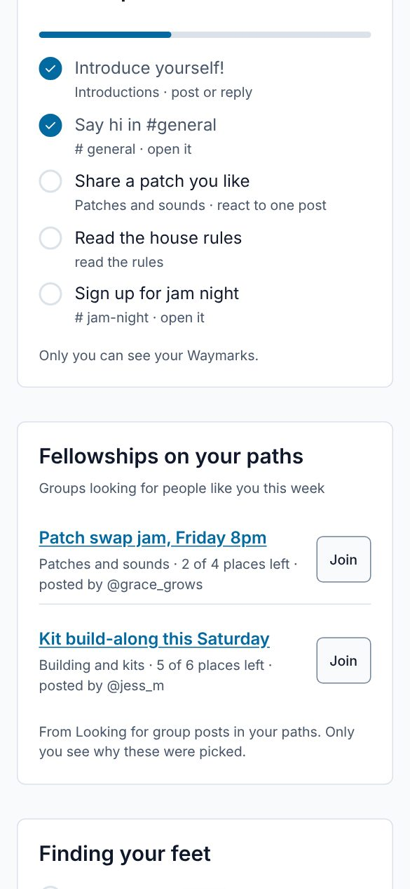
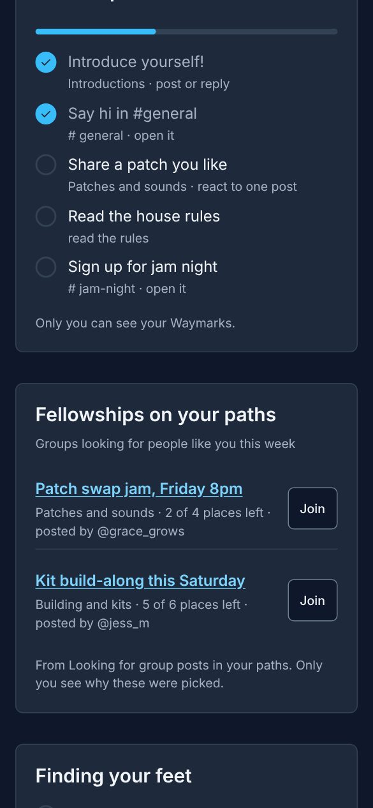
<figcaption>On a computer and on a phone; select a picture to see it full size. Everyone shown is a made-up sample person.</figcaption>
</figure>

Choose **Join** to say you're in, exactly as if you'd answered on the post itself; the organiser is told as usual. A group with no places left shows **Full**. Groups you started or already joined aren't shown. Only you see why these groups were picked.

## Welcoming others

Once you've found your feet, you can help the next newcomers. If the community has Lamplighters switched on, pick the Lamplighters role on **Your paths** to see posts still waiting for a welcome. See [Lamplighters](lamplighters.md).
