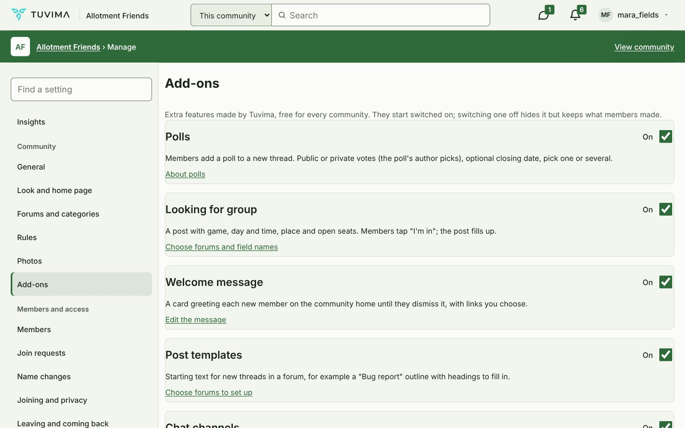
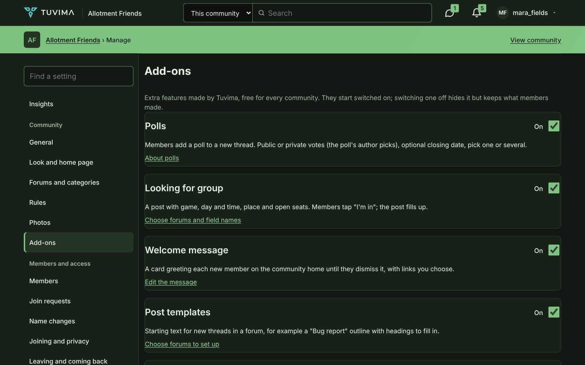
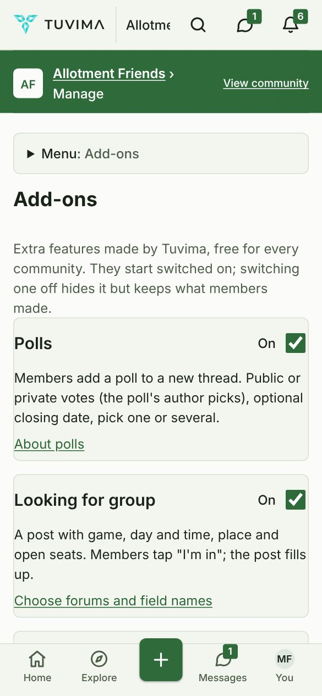
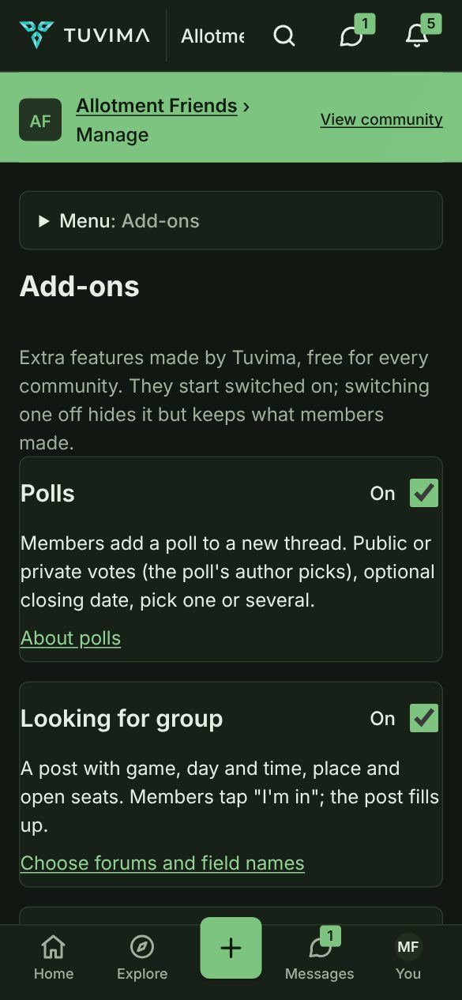

Add-ons are extra features a community can use. Tuvima's built-in add-ons start **on** for every community.

<figure class="tv-screens">

<figcaption>On a computer and on a phone; select a picture to see it full size. Everyone shown is a made-up sample person.</figcaption>
</figure>

If you switch an add-on off, it is hidden and nobody can start new uses of it. What members already made stays.

## Polls

Members can add a poll to a post.

- The author picks whether people choose **one** answer or **up to a number** of answers.
- A closing date is optional.
- The poll's author chooses whether votes are **public** or **private**.
- Results show once you have voted, or once the poll closes.
- You can change your vote until the poll closes.

## Looking for group

Members can ask others to join them, for example for a game night.

- You can rename the fields to fit your community.
- You choose which forums allow it.
- People answer **I'm in** or **Maybe**.
- When the seats are taken, the post shows **Full**.
- The author is told when someone joins and when it fills.

## Welcome message

A short message for new members.

- Members who join after you wrote it see it, until they dismiss it.
- It can have up to 3 links.
- A link to a place a member cannot open is left out for that member.

## Post templates

A template fills the editor with a starting layout.

- Each forum can have up to 5.
- A template never replaces what someone has already typed.

## Coming later

- An events calendar.
- A member directory.
- Reference pages.

## Next steps

- [Run your community](run-your-community.md)
- [Post and reply](../guides/posting.md), to see how members use them
