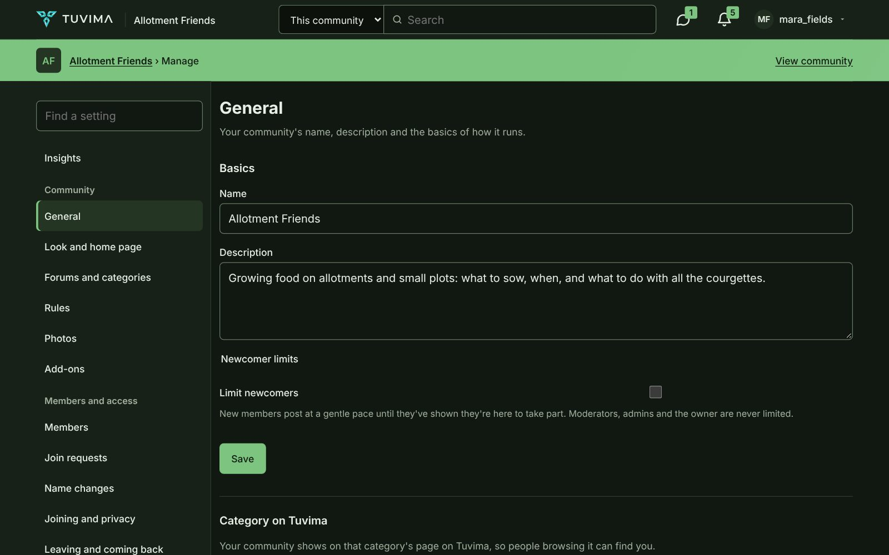
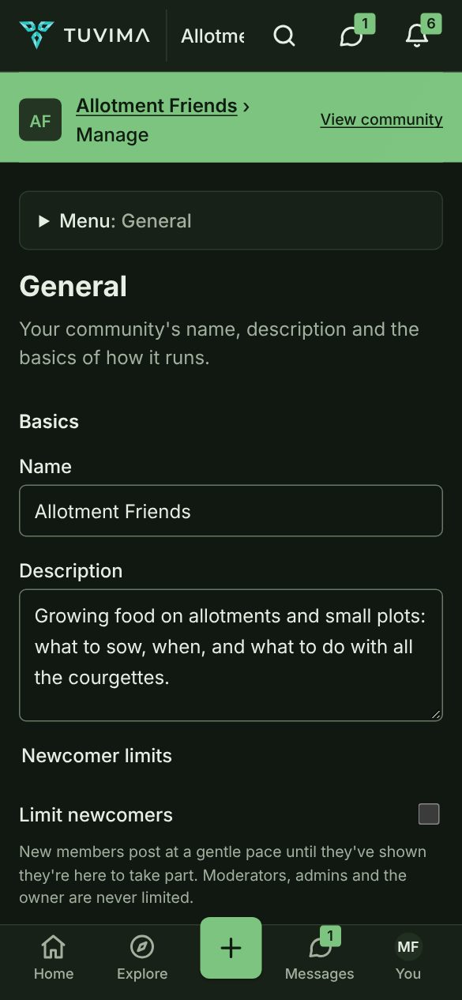

Everything you use to run your community lives in one place. Choose **Manage** at the top of your community's page. It opens the first page your roles let you use.

<figure class="tv-screens">

<figcaption>On a computer and on a phone; select a picture to see it full size. Everyone shown is a made-up sample person.</figcaption>
</figure>

## The menu

The menu down the side has four groups, with 14 pages in all. Each page has tabs across the top. You only see the pages and tabs your roles allow, so a moderator sees a shorter menu than the owner.

| Group | Page | Tabs |
| --- | --- | --- |
| **Overview** | **Overview** | **Needs you** (what is waiting for you, things that need attention, and your launch checklist) and **Numbers** ([how your community is doing](run-your-community.md#numbers)) |
| **Community** | **Profile and look** | **Profile**, [**Address**](community-address.md), **Colours and banner**, **Home page**, **Menu** |
| | **Forums and channels** (**Chat channels**, for someone who only manages chat) | **All places**, **Label history** |
| | **Rules** | **Community rules**, **Forum guidelines** |
| | **Features** | **Photos and albums**, **Polls**, **Looking for group**, **Add-ons** |
| **People** | **Members** | **All**, **Removed**, **Invites** |
| | **Joining and leaving** | **Privacy**, **How people join**, **Leaving and coming back** |
| | **Onboarding** | **Overview**, **Questions**, **Start here**, **Trailhead**, **Adventures**, **Lamplighters** |
| | **Newcomers** | **Limits**, **What they can use**, **Waiting for a welcome** |
| | **Roles and permissions** | **Roles**, **Access by forum**, **Check a person** |
| | **Levels and recognition** | **Levels**, **Achievements**, **Member tiers** |
| **Safety** | **Approval queue** | One page, with its own tabs for each kind of item |
| | **Moderation rules** | **Warnings**, **Word filters**, **Photo checks**, **Member moderation**, **Notices** |
| | **Moderation history** | **Log**, **Removed posts**, **Past reports**, **Member cases** |

A number next to **Approval queue** shows how many posts, requests, reports, name changes and photos are waiting for you. The same number shows on **Overview**.

### Where things moved

- **Newcomer settings** are now under **People**, on **Newcomers**.
- **Edit history and moderation notices** are on **Moderation rules**, on the **Notices** tab.
- **Adult and violent photo handling** is on **Moderation rules**, on the **Photo checks** tab.
- **Join requests**, **name changes** and **photos waiting for a moderator** have no pages of their own. They wait in the **Approval queue**, each on its own tab.
- **Insights** is now **Numbers**, on **Overview**.

## Find a setting

Type into **Find a setting** at the top of the menu. It finds single settings as well as pages, so typing "unlisted" finds the **Unlisted** setting on **Joining and leaving**, and typing "banned words" finds the word list on **Moderation rules**. Choose a result and Tuvima opens that page and takes you to the setting, which flashes so you can see it. Settings that belong to one forum or channel, such as slow mode or holding newcomers' first posts, are found too: the result tells you to open that forum or channel and names the tab.

## Save your changes

Every settings page has one save bar. As soon as you change something, the bar lists what you changed, with two buttons: **Cancel** puts everything back as it was, and **Save changes** saves it all at once. Nothing is saved until you choose **Save changes**.

If you try to leave with changes you have not saved, Tuvima asks first, so you can stay and save, or leave and drop them.

## On a phone

The menu folds into a **Menu** button above the page, which also says which page you are on.

## Next steps

- [Run your community](run-your-community.md)
- [Look after members](members.md)
- [Warnings, word filters and the approval queue](warnings-and-filters.md)
