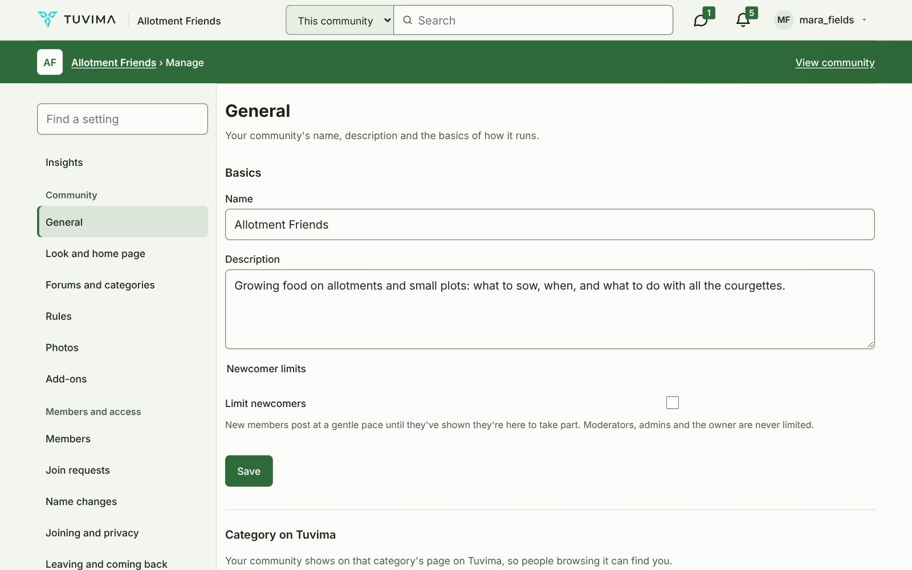
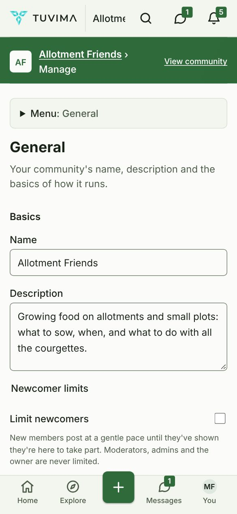

Everything you use to run your community lives in one place. Choose **Manage** at the top of your community's page. It opens the first page your roles let you use.

<figure class="tv-screens">

<figcaption>On a computer and on a phone. Everyone shown is a made-up sample person.</figcaption>
</figure>

## The menu

The menu down the side has four groups. You only see the pages your roles allow, so a moderator sees a shorter menu than the owner.

| Group | Pages |
| --- | --- |
| **Insights** | **Insights**: how your community is doing, counted each night. See [Insights](run-your-community.md#insights). |
| **Community** | **General** (name, description, newcomer limits, category on Tuvima, edit history, removal notices, launch checklist), **Look and home page**, **Forums and categories** (or **Chat channels**, for someone who only manages chat), **Rules**, **Photos** and **Add-ons**. |
| **Members and access** | **Members**, **Join requests**, **Joining and privacy**, **Roles and permissions**, **Levels**, **Achievements**, **Member tiers** and **Invites**. |
| **Safety** | **Approval queue** (held posts, join requests and reports), **Photo reports**, **Removed posts**, **Warnings and word filters** and **Moderation log**. |

A number next to **Approval queue** shows how many posts, requests and reports are waiting.

## Find a setting

Type into **Find a setting** at the top of the menu. It looks at page names and at the settings on each page, so typing "unlisted" finds **Joining and privacy**, and typing "banned words" finds **Warnings and word filters**. When a setting matches, its name shows under the page.

## On a phone

The menu folds into a **Menu** button above the page, which also says which page you are on.

## Next steps

- [Run your community](run-your-community.md)
- [Look after members](members.md)
- [Warnings, word filters and the approval queue](warnings-and-filters.md)
