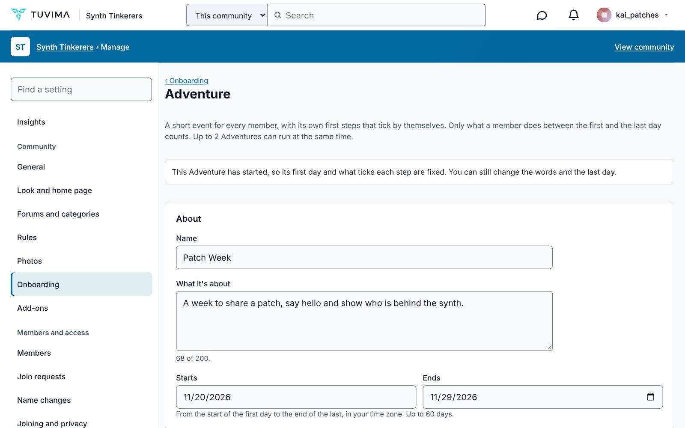
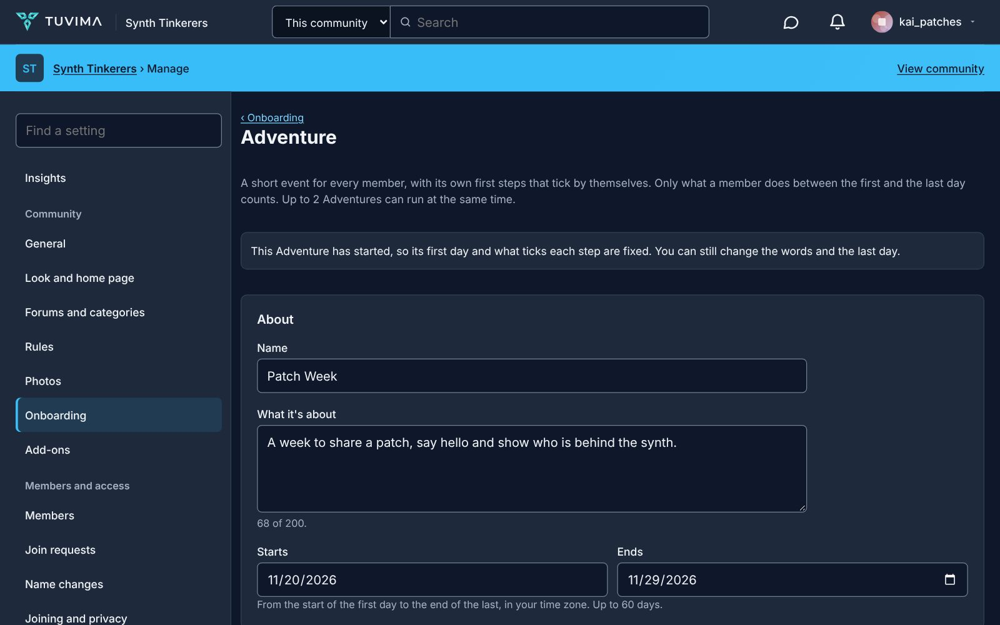
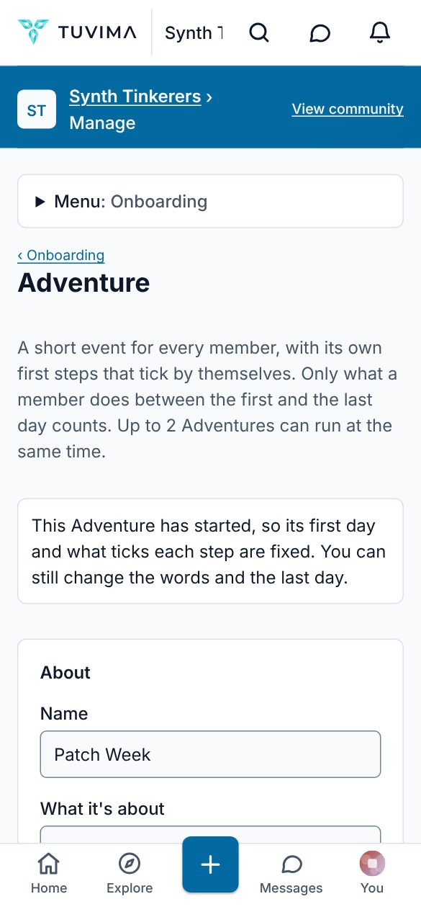
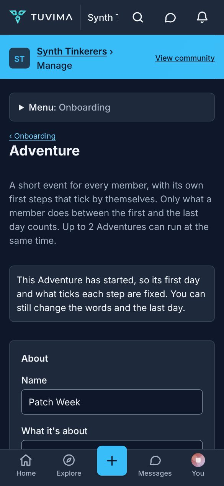

**Adventures** let you run events and seasons without bots or extra tools: a few first steps, like Waymarks, but for every member and only for a while. For example, a "Frost Week" with three steps and a "Frostbound" achievement for finishing.

<figure class="tv-screens">

<figcaption>On a computer and on a phone; select a picture to see it full size. Everyone shown is a made-up sample person.</figcaption>
</figure>

## Plan an Adventure

1. Open **Manage**, then **Onboarding**.
2. Under **Adventures**, choose **Plan an Adventure**.
3. Fill in:
   - **Name** (up to 60 characters) and **What it's about** (up to 200).
   - **Starts** and **Ends**: the first and last day. An Adventure runs from the start of its first day to the end of its last, and can last up to 60 days.
   - **Steps**: 1 to 5. Each has a short line, what ticks it (post or reply, react, open a chat channel, read a pinned conversation, read the rules, set a picture) and where, chosen the same way as [Waymarks](trailhead.md).
   - **Achievement** (optional): switch on **Give an achievement for finishing all the steps**, and give it a name and description.
4. Choose **Save**.

You need the **Manage onboarding** permission (Admins and the owner, to begin with).

Up to 2 Adventures can run at the same time, so they stay special. Tuvima refuses a third that would overlap.

## Once it has started

Members see it on the Trailhead and in their Home, and every member gets one bell alert when it starts (unless they've muted your community). You can still:

- change the name, the description and each step's line,
- move the end date earlier or later.

You can't change what ticks a step or where once the Adventure has started, so nobody's ticks become wrong.

## Your list

The **Adventures** part on the Onboarding page lists what's running, coming up and ended in the last 30 days, with **Edit** and **Delete**. Deleting an Adventure removes it and everyone's ticks; achievements people already earned stay theirs.

## What you can see

Members' progress is private. Members see roughly how many people are taking part once at least 20 are, rounded to the nearest 5. You see the same.

## Next steps

- [Set up onboarding](onboarding.md)
- [Adventures, for members](../guides/adventures.md)
