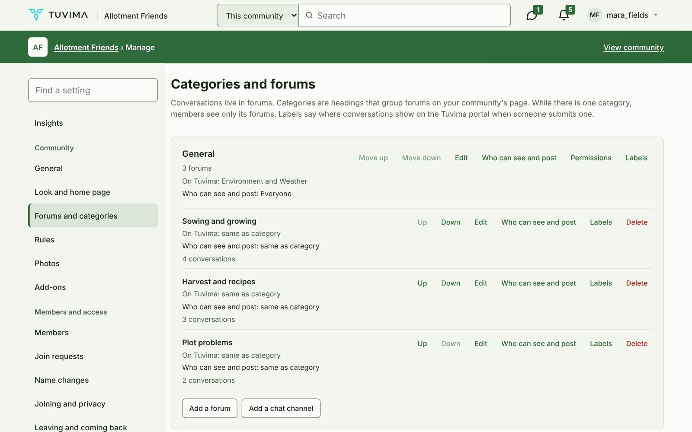
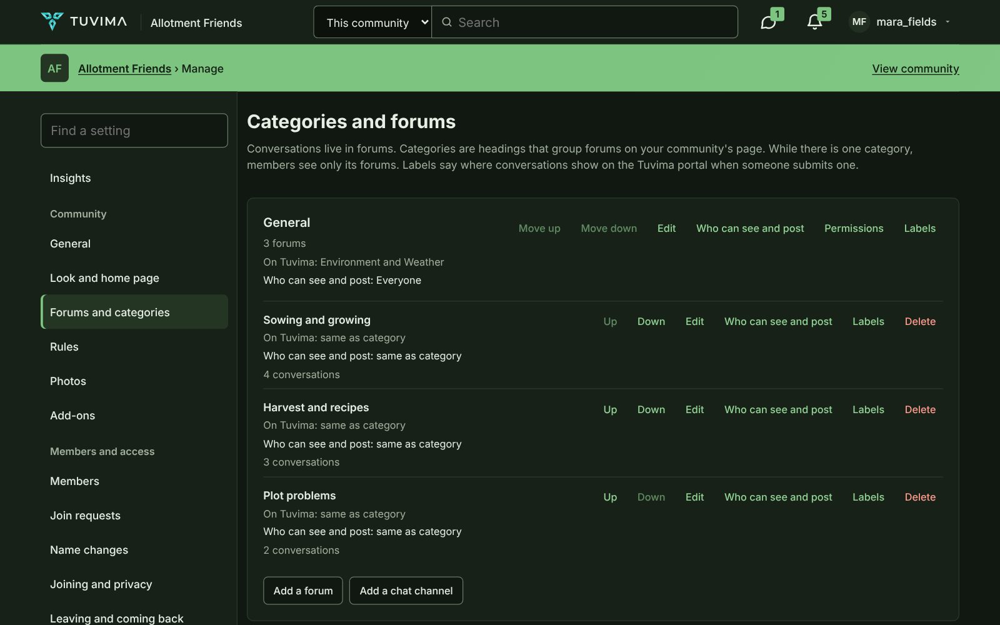
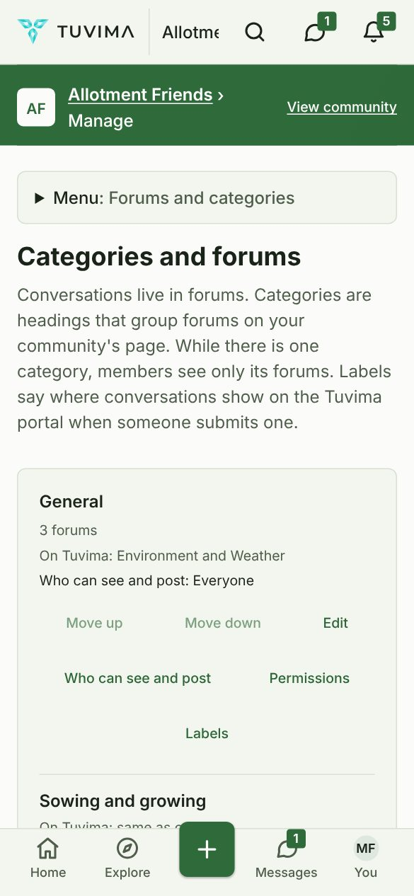
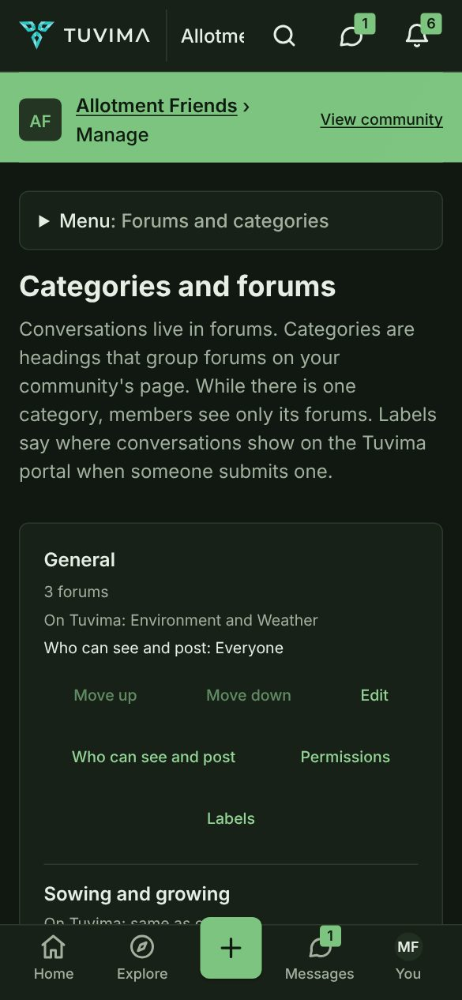
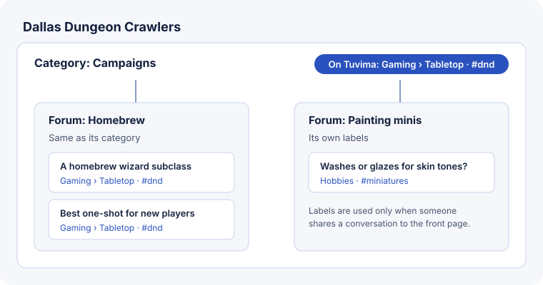

Conversations in your community live in **forums**. **Categories** are headings that group forums on your community's page. **Labels** say where your conversations belong on the Tuvima front page (the Tuvima portal), so that a conversation someone shares there lands with the right subject and tags.

<figure class="tv-screens">

<figcaption>On a computer and on a phone; select a picture to see it full size. Everyone shown is a made-up sample person.</figcaption>
</figure>

Owners and admins manage all of this in **Manage**, then **Forums and channels** under **Community**.

## Categories and forums

- A new community starts with one category, **General**, holding the forums you chose when you created it.
- While there is only one category, members see just its forums, so a small community stays simple. Add a second category and members see one card per category on the community home, with its forums and how many conversations started there this week. Each category also gets its own page. See [find your way around a community](../guides/community-pages.md).
- A community can have up to 20 categories and 50 forums.
- A forum belongs to a category, and a chat channel sits under its category's forums.
- **Who can see and post** makes a category, forum or channel members-only, or opens it only to some members. It lives on the **Access** tab. See [choose who can see and post in each area](area-access.md).
- Roles can work differently in one place, for example a role that can't post in one forum. That is also on the **Access** tab, under **Role exceptions here**. See [set permissions for a place](place-permissions.md).
- To delete a forum, first choose where its conversations go. They move with every reply, and nothing else is deleted. A category can be deleted once it is empty.

## The forums and channels tree

**Manage**, then **Forums and channels**, shows everything as one tree: each category, then its forums, then its chat channels. Each row has:

- a **grip** (a handle you hold to move the row),
- the name,
- small chips that tell you how the place is set, such as **Start here**, **Always shown** or **Some members**,
- a count line, and
- a **···** menu with **Move up**, **Move down**, **Move to…**, **Open settings** and **Delete**.

Choose the arrow on a category to fold it. **Collapse all** and **Expand all** fold every category at once. The filter above the tree shows **All**, **Forums** or **Chat**. **Add a category**, **Add a forum** and **Add a chat channel** add new rows.

**Start here** and **Always shown** are switches on a forum's settings. They save the moment you change them, without waiting for **Save changes**.

### Change the order

- **Mouse:** drag the grip and drop the row where you want it.
- **Phone:** hold the grip until the row lifts, then move it. Or choose **···** then **Move to…**.
- **Keyboard:** press Tab until the grip has focus, press Space to lift the row, use the arrow keys to move it, then press Space to drop it. Press Esc to cancel.
- **Buttons:** **Move up** and **Move down** in the **···** menu do the same without dragging, and work well with a screen reader.

A forum moves among forums, and it can also move into another category. A chat channel moves among channels. A category moves among categories. Each move saves at once and shows **Your last move was saved** with **Undo**. If it can't be saved, the row goes back to where it was and Tuvima says so.

Someone who holds only **Manage chat channels** sees and moves only the chat channels.

## Open a place's settings

Choose a row, or **Open settings** in its **···** menu.

- **On a computer**, the settings open beside the tree, so you can keep the list in view.
- **On a phone**, they open on their own page.

The tabs depend on the place:

| Place | Tabs |
| --- | --- |
| Forum | **Basics**, **Access**, **Rules and templates**, **On Tuvima** (called **Labels** when the community isn't listed on Tuvima) |
| Chat channel | **Basics**, **Access** |
| Category | **Basics**, **Access**, **On Tuvima** |

Changes on a place's tabs (other than labels) share the page's one save bar: **Save changes** keeps them and **Cancel** puts everything back. **View forum** opens the forum as members see it, and **Close** shuts the settings.

- **Basics** renames the place and adds a description. For a forum it also holds:
  - **Forum type**: **Discussion** (replies in time order, for chat, news and show-and-tell), **Questions and answers** (best answers rise, and the asker or a moderator accepts one, which shows first) or **Link to another page** (shows in the list like a forum but opens a web page you choose, such as your shop or wiki; it holds no conversations). A forum that already has conversations can't become a link.
  - **Opening view**: **Classic** (replies in time order) or **Compact** (replies in branches). The forum opens this way for everyone until a reader picks their own view. See [post and reply](../guides/posting.md#reply).
  - In a **Questions and answers** forum, whether **new unanswered questions show first** for a day, and whether **the asker can accept an answer** or only moderators can.
  - **Hold newcomers' first posts here** for a moderator to approve, even when the community doesn't hold first posts everywhere.
- **Access** is covered in [choose who can see and post in each area](area-access.md) and [set permissions for a place](place-permissions.md).
- **Rules and templates**, for a forum, holds its own rules, its post templates, and an automatic content warning, such as "Spoilers".
- **On Tuvima** holds the labels, below.

:::tip
**Find a setting** in the Manage menu finds these per-place settings too, for example slow mode or holding newcomers' first posts. It tells you to open a forum or channel and names the tab to look on.
:::

Members see the category and forum in a breadcrumb on every conversation, for example **Dallas Dungeon Crawlers › Campaigns › Homebrew**. They can filter the conversation list and search by category and by forum.

## Labels on Tuvima

Each category carries:

- one **front-page category**, such as Gaming,
- optionally a **subtopic** under it, such as Tabletop,
- and up to **3 tags**, such as `dnd`.

When you create a community, the place you chose for it on Tuvima becomes the labels of its first category, and every new category starts with the same labels. To change them, open the category's settings and choose **On Tuvima**.

On a forum's **On Tuvima** tab, it either uses **Same as its category**, which is the normal choice, or sets **Its own labels**. For example, a "Painting minis" forum in a gaming community could use Hobbies with the tag `miniatures`.

Every conversation carries its forum's labels from the moment it starts, and shows them under its title:

> On Tuvima: Gaming › Tabletop · #dnd

Each part links to that subject or tag on the front page.

:::note
Labels do not put anything on the front page. A conversation reaches the front page only when someone shares it there, and then it uses these labels. Owners label conversations; they cannot keep a public conversation from being shared, and nobody can pay to reach the front page. Sharing a community conversation to the front page is coming next.
:::

## Changing labels

Before anything is saved, Tuvima checks what the change would do and tells you, for example:

> 4 conversations not yet on the Tuvima portal will move to the new labels. 1 conversation already on the portal will keep its labels.

Choose **Save labels** to go ahead, or **Back** to change your mind. Labels have their own Save button, separate from the page's save bar.

- Conversations that are **not yet on the front page** move to the new labels.
- Conversations **already shared to the front page keep their labels**, so their place there and their links never change.
- Conversations started after the change get the new labels.

Moving a forum to another category, by dragging or **Move to…**, gives its conversations that category's labels, and moving conversations out of a deleted forum gives them their new forum's labels. Conversations already on the front page keep theirs in both cases.

The **Label history** tab of **Forums and channels** lists every saved change: who made it, what it changed from and to, and how many conversations moved or kept their labels. Only owners and admins see it.

## Finding conversations by label

The conversation list and search have a **Label** filter with the subjects and tags your community uses. Choose one to see only the conversations that carry it.

## Unlisted communities

An [unlisted community](start-a-community.md#check-the-result) can set labels too, but its conversations never reach the front page. There the tab is called **Labels** instead of **On Tuvima**, and the line under a conversation says **Labels** instead of "On Tuvima", and its links open your own community's list filtered by that label.

## Next steps

- [Set permissions for a place](place-permissions.md)
- [Run your community](run-your-community.md)
- [How the front page works](../guides/front-page.md)
