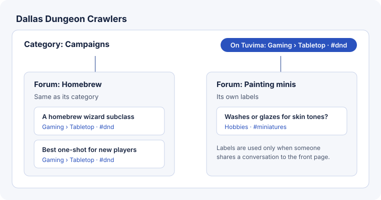

Conversations in your community live in **forums**. **Categories** are headings that group forums on your community's page. **Labels** say where your conversations belong on the Tuvima front page (the Tuvima portal), so that a conversation someone shares there lands with the right subject and tags.

Owners and admins manage all of this in **Community settings**, then **Manage categories and forums**.

## Categories and forums

- A new community starts with one category, **General**, holding the forums you chose when you created it.
- While there is only one category, members see just its forums, so a small community stays simple. Add a second category and members see the forums grouped under the headings.
- A community can have up to 20 categories and 50 forums.
- Use **Move up** and **Move down** to change the order, and **Move to…** then **Move** to put a forum in another category. These are buttons rather than dragging, so they work the same on a phone, with a keyboard or with a screen reader.
- **Edit** renames a category or forum, adds a description, or gives a forum an automatic content warning, such as "Spoilers".
- To delete a forum, first choose where its conversations go. They move with every reply, and nothing else is deleted. A category can be deleted once it is empty.

Members see the category and forum in a breadcrumb on every conversation, for example **Dallas Dungeon Crawlers / Campaigns / Homebrew**. They can filter the conversation list and search by category and by forum.

## Labels on Tuvima

Each category carries:

- one **front-page category**, such as Gaming,
- optionally a **subtopic** under it, such as Tabletop,
- and up to **3 tags**, such as `dnd`.

When you create a community, the place you chose for it on Tuvima becomes the labels of its first category, and every new category starts with the same labels. Choose **Labels** next to a category to change them.

Each forum either uses **Same as its category**, which is the normal choice, or sets **Its own labels**. For example, a "Painting minis" forum in a gaming community could use Hobbies with the tag `miniatures`.

Every conversation carries its forum's labels from the moment it starts, and shows them under its title:

> On Tuvima: Gaming › Tabletop · #dnd

Each part links to that subject or tag on the front page.

:::note
Labels do not put anything on the front page. A conversation reaches the front page only when someone shares it there, and then it uses these labels. Owners label conversations; they cannot keep a public conversation from being shared, and nobody can pay to reach the front page. Sharing a community conversation to the front page is coming next.
:::

## Changing labels

Before anything is saved, Tuvima checks what the change would do and tells you, for example:

> 4 conversations not yet on the Tuvima portal will move to the new labels. 1 conversation already on the portal will keep its labels.

Choose **Save labels** to go ahead, or **Back** to change your mind.

- Conversations that are **not yet on the front page** move to the new labels.
- Conversations **already shared to the front page keep their labels**, so their place there and their links never change.
- Conversations started after the change get the new labels.

Moving a forum to another category gives its conversations that category's labels, and moving conversations out of a deleted forum gives them their new forum's labels. Conversations already on the front page keep theirs in both cases.

**Label changes**, at the bottom of the page, lists every saved change: who made it, what it changed from and to, and how many conversations moved or kept their labels. Only owners and admins see it.

## Finding conversations by label

The conversation list and search have a **Label** filter with the subjects and tags your community uses. Choose one to see only the conversations that carry it.

## Unlisted communities

An [unlisted community](start-a-community.md#check-the-result) can set labels too, but its conversations never reach the front page. There the line under a conversation says **Labels** instead of "On Tuvima", and its links open your own community's list filtered by that label.

## Next steps

- [Run your community](run-your-community.md)
- [How the front page works](../guides/front-page.md)
