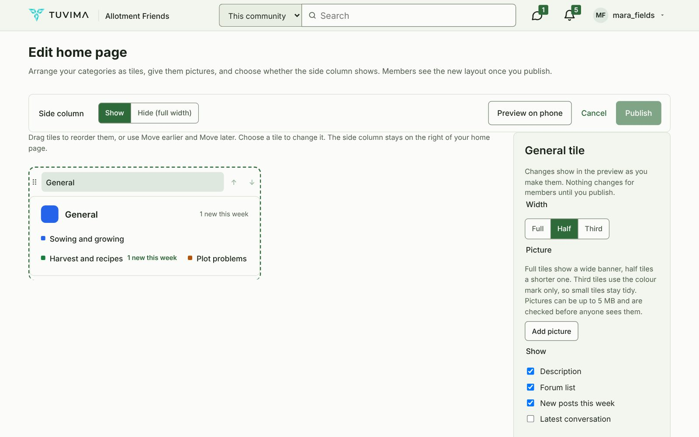
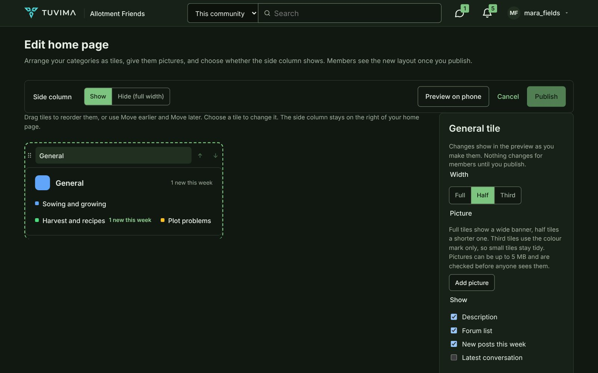
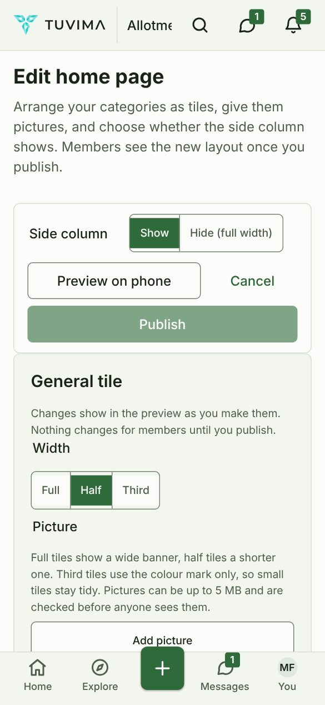
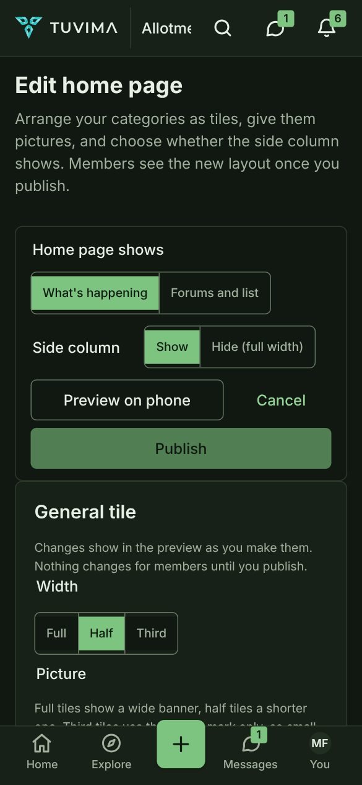

Your community's home is the first thing members see. You choose one of four layouts, then arrange it right on the page. Fonts, the top bar and the list of conversations stay the same in every community, so members always know where things are. For colours, header and icons, see [Change your community's look](look-and-feel.md). You need to be the owner or an admin.

<figure class="tv-screens">

<figcaption>On a computer and on a phone; select a picture to see it full size. Everyone shown is a made-up sample person.</figcaption>
</figure>

## Choose a layout

Open **Manage**, then **Look and home page**, or use **Arrange home** on the home page itself. Choose one of four:

- **Forums and latest** (the starting choice): your forums grouped by category, with the latest conversations beside or below them.
- **Forums only**: just the forum list, for a quiet, classic forum.
- **What's happening**: the week's popular conversations, new photos, who is chatting and recent achievements, then your forums. It helps a community feel lively from the first visit.
- **Tiles**: your categories as tiles of different sizes, with pictures. See [Tiles](#tiles) below.

Members can always reach the classic forum list by choosing a forum. [What members see on the home](../guides/community-pages.md) depends on the layout you pick.

## Arrange home on the page

Choose **Arrange home** on your home page. The page itself becomes the editor, so you see what members will see while you work.

- **Drag** a block or category to a new place by its handle.
- **Keyboard:** focus the handle, then use the arrow keys to move it. A **Move** menu does the same without dragging.
- **On a phone**, each item has **Up** and **Down** buttons.
- **Preview as a member** shows the home exactly as members see it, without the editing controls.
- **Undo** takes back your last change, one step at a time.
- **Save** makes your arrangement live. Nothing changes for members until you save. If you leave without saving, Tuvima asks first so you don't lose your changes.

You can move blocks such as **About**, **Rules**, **Links** and **Welcome**, and the order of your categories. The order you choose is your categories' order everywhere in the community. To add, rename or remove a category, use [Forums and categories](categories-and-forums.md).

## Tiles

With the **Tiles** layout, each category is one tile. Choose a tile to change it, then pick its **width**:

- **Full**: the whole width of the page. Good for your main category.
- **Half**: two side by side. This is how every category starts.
- **Third**: three side by side. Small and tidy, so a third tile shows its colour mark but no picture.

On phones, every tile takes the full width, one under another, in the same order.

Full and half tiles can have a larger picture, with the category's name on top of it. Tuvima darkens the bottom of the picture so the name is always easy to read.

- Use a JPEG, PNG or WebP picture. Large phone photos are shrunk on your device first; what is sent can be up to 5 MB.
- The picture is cropped from the middle to fit.
- **Describe the picture** in a few words before you save. People using screen readers hear this description instead of seeing the picture.
- Every picture goes through the same safety checks as photos in posts before anyone sees it, and hidden details such as location are removed. Until the checks finish, the tile shows without its picture. If the checks find a picture unsuitable, it is never shown and you are asked to choose another.

A picture on a category that only some members can see is only shown to those members. In a private community, pictures are only shown to members.

For each tile, tick what it shows: **Description**, **Forum list** (each forum with how many new conversations it has this week), **New posts this week** and **Latest conversation**.

## Hide the side column

The side column holds your About, Rules and other blocks. Choose **Side column: Hide (full width)** so the page uses the whole width. Choose **Show** to bring it back. Your blocks are kept either way.
