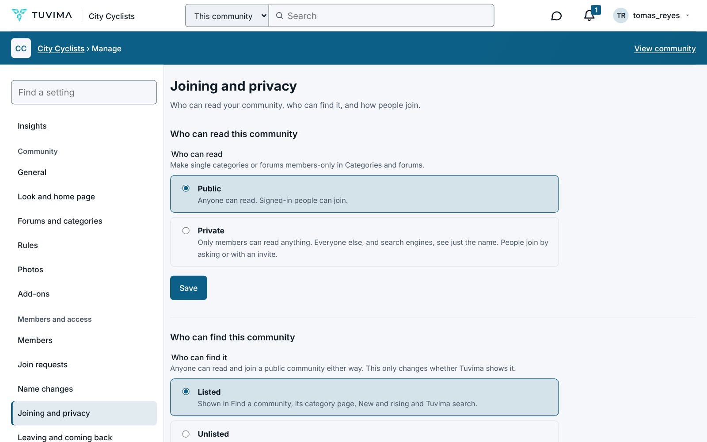
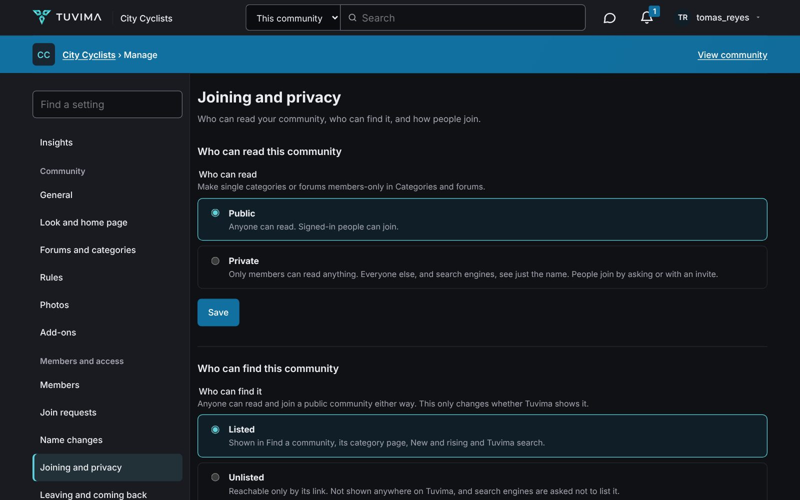
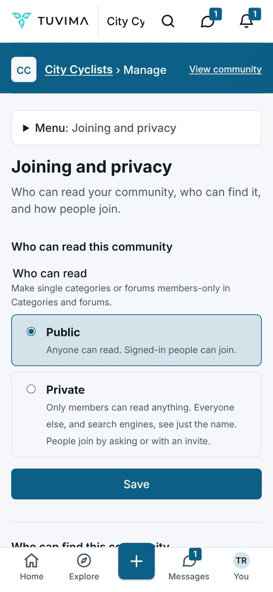
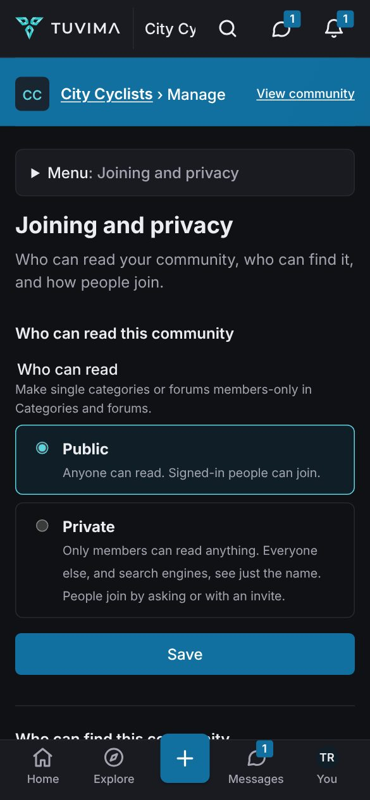

How people join is its own setting, for public and private communities alike. A public community can be readable by anyone and still ask people to be approved before they take part.

<figure class="tv-screens">

<figcaption>On a computer and on a phone; select a picture to see it full size. Everyone shown is a made-up sample person.</figcaption>
</figure>

Owners and admins choose it in **Manage**, then **Joining and privacy**.

## The three ways in

| Choice | What happens |
| --- | --- |
| **Anyone can join** | Signed-in people agree to the rules and join straight away. |
| **Ask to join** | People answer your [join questions](join-questions.md), if you have any, and send a request. A moderator, admin or the owner [approves or declines](join-requests.md) it (or anyone whose role lets them review requests). |
| **Invite only** | Only people with an [invite link or code](invites.md) can join. |

[Invites](invites.md) always work, whatever you choose here.

Each kind of community starts with a usual choice:

- Public: **Anyone can join**.
- Private and listed: **Ask to join**.
- Private and unlisted: **Invite only**.

Changing who can read or who can find the community sets this back to the usual choice for the new setting. You can then change it again.

## Sudden rush of new members

**Slow down joining during a rush** is on unless you switch it off. If far more people than usual join within an hour, Tuvima switches new people to asking to join for 24 hours and tells you in your notifications. Their requests wait on the **Requests** tab. Invites keep working.

While it runs, the settings page says **Joining is slowed down**. Choose **End the slow-down** to go back to your normal choice early.

## Limits on joining many communities

To slow down spam accounts, each Tuvima ID account can join only a few communities an hour and a day, counted across all its personas, with lower limits in an account's first week. Someone over the limit sees "You can't join more communities right now. Try again later." You do not need to set anything up for this.

## Next steps

- [Join questions](join-questions.md)
- [Review join requests](join-requests.md)
- [Invite people with a link, code or QR code](invites.md)
