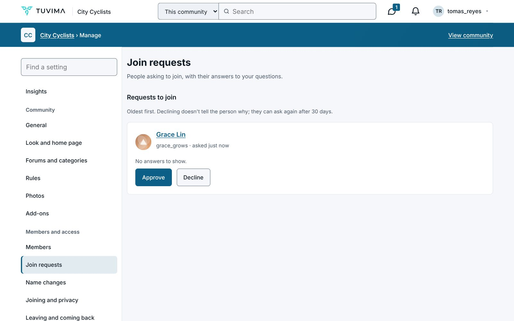
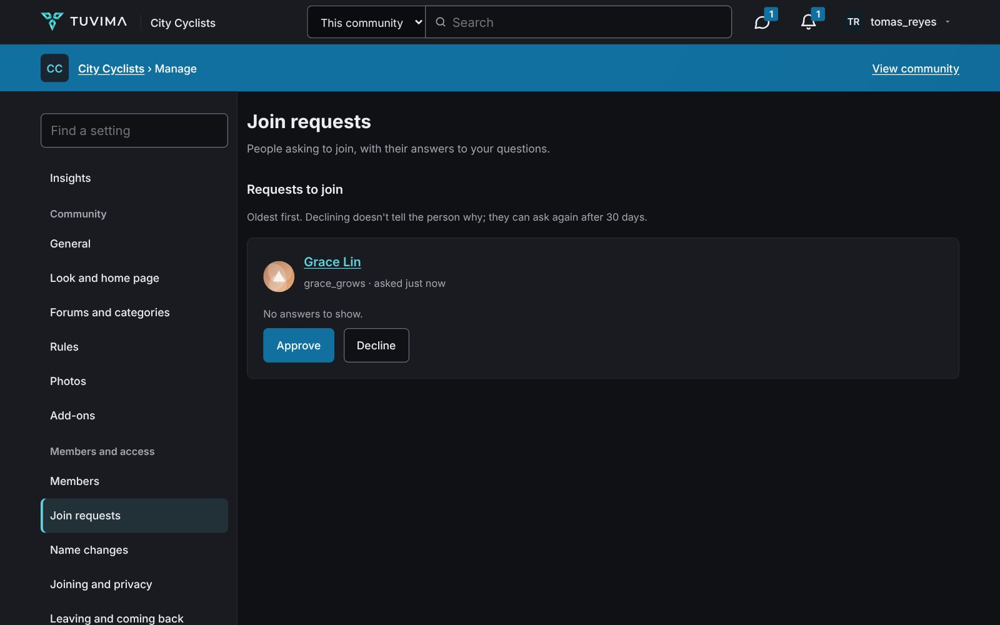
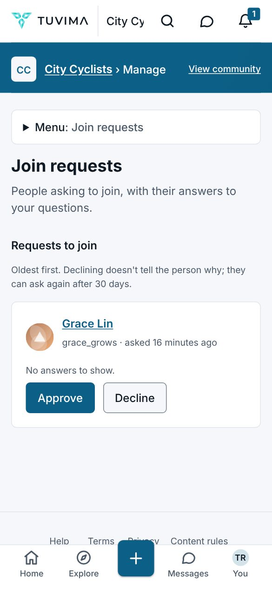
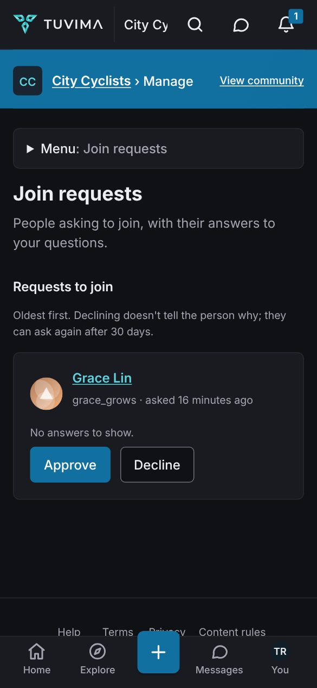

When your community uses **Ask to join**, or during a [slow-down](how-people-join.md#sudden-rush-of-new-members), requests wait for someone to decide. Moderators, admins and the owner can review them, along with any [role](roles.md) given **Review requests to join**.

<figure class="tv-screens">

<figcaption>On a computer and on a phone; select a picture to see it full size. Everyone shown is a made-up sample person.</figcaption>
</figure>

## Approve or decline

1. Open **Manage**, then **Approval queue** under **Safety**. Join requests wait there with held posts and reports. The oldest come first.
2. Each request shows the persona that asked, when, and their answers to your [questions for approving people](onboarding-questions.md).
3. Choose **Approve** or **Decline**.

When you approve, the person becomes a member straight away and is told in their notifications. Your newcomer limits apply to them as to anyone who joins.

When you decline, the person is not told why. Their community page shows **Not approved**, with the date they can ask again: **30 days** after the decline.

Occasionally Tuvima ID's own checks stop a person joining. The approval then stops and the request is declined. Tuvima ID never says why.

## Take a closer look

Some requests carry a small **Take a closer look** label. Tuvima ID adds it when something about the account suggests checking a little more carefully, such as a very new account. It gives no reasons, so the persona stays unconnected to its account. Treat it as a hint, not a verdict.

## Old requests

- A request nobody decides closes by itself after **30 days**.
- The person can **Withdraw** their request while it waits.
- Answers are deleted 90 days after the decision.

## Next steps

- [Invite people with a link, code or QR code](invites.md)
- [Run your community](run-your-community.md)
