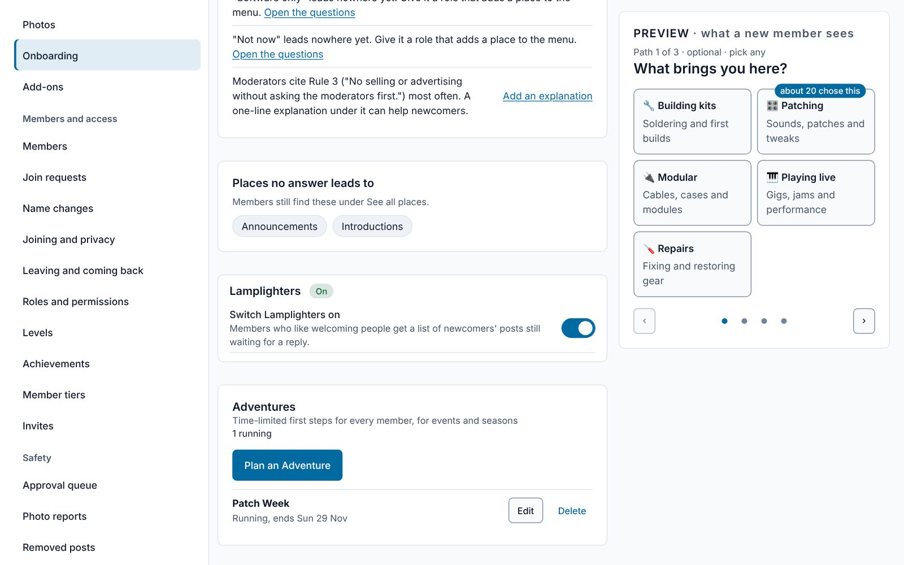
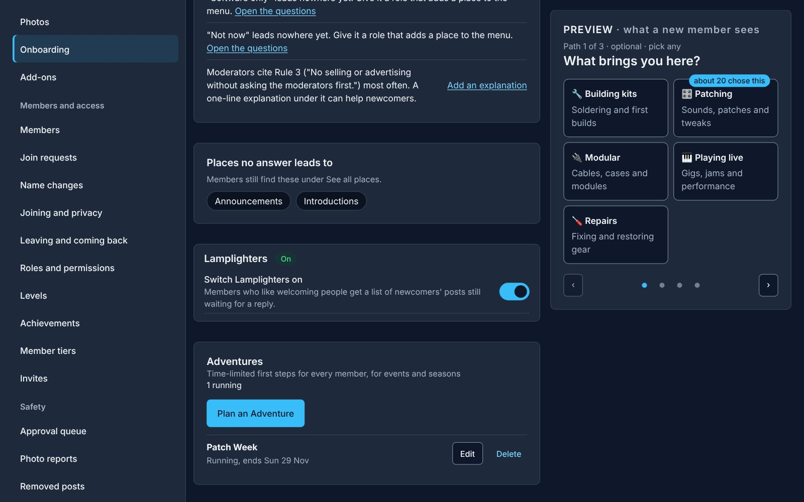
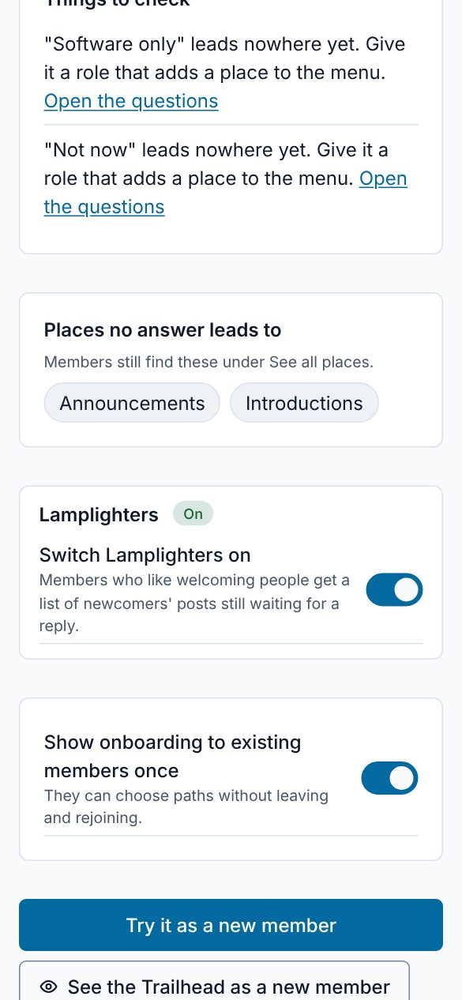
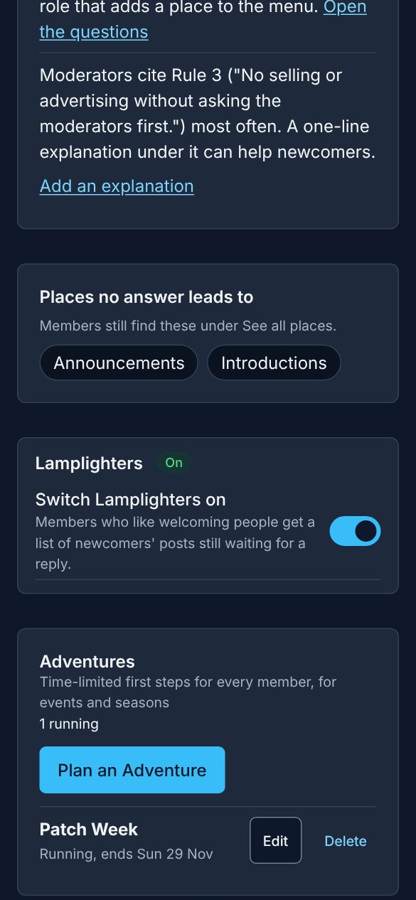

**Lamplighters** makes sure no newcomer's first post goes unanswered. Members who like welcoming people pick the Lamplighters role and get a short list of newcomers' posts that are still waiting for a reply.

<figure class="tv-screens">

<figcaption>On a computer and on a phone; select a picture to see it full size. Everyone shown is a made-up sample person.</figcaption>
</figure>

## Switch it on

1. Open **Manage**, then **Onboarding**.
2. Under **Lamplighters**, switch on **Switch Lamplighters on**.

You need the **Manage onboarding** permission (Admins and the owner, to begin with).

Switching it on:

- creates a **Lamplighters** role that members can pick on **Pick what you see**. It shows on member cards and posts, so newcomers can see who's welcoming them. If you already have a pick-yourself role called Lamplighters, Tuvima uses it.
- creates the **Lamplighter** achievement: "Welcome 10 newcomers who stay on to post again." You can edit or switch it off in **Achievements** like any other.

Switching Lamplighters off stops the list and the alerts. The role and the achievement stay; delete or change them under [Roles](roles.md) and Achievements if you like. Deleting the role switches Lamplighters off.

## What Lamplighters see

Holders of the role get a **Waiting for a welcome** page, with a count in the community menu and on the home. It lists conversations started in the last 7 days by newcomers that nobody but the author has replied to. It only shows posts they can already read, never posts waiting for approval. After 2 hours, each Lamplighter gets one bell alert per waiting post, at most 3 a day. Members can switch the alerts off. See [Lamplighters](../guides/lamplighters.md) for the member's view.

Moderators see the same list under **Manage › People › Newcomers › Waiting for a welcome**, if they can hide or remove posts, so the team can step in too.

Who counts as a newcomer follows your [newcomer settings](run-your-community.md): someone is new until they've passed your newcomer steps.

## What you can see

You see how many people hold the Lamplighters role, like any role. Lamplighters' progress towards the achievement is private to them until they earn it.
