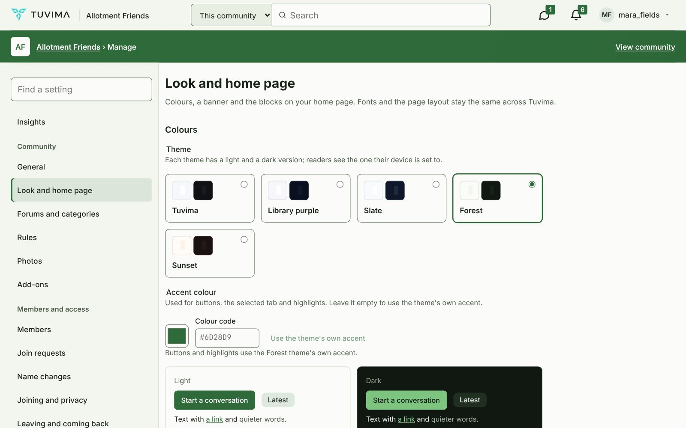
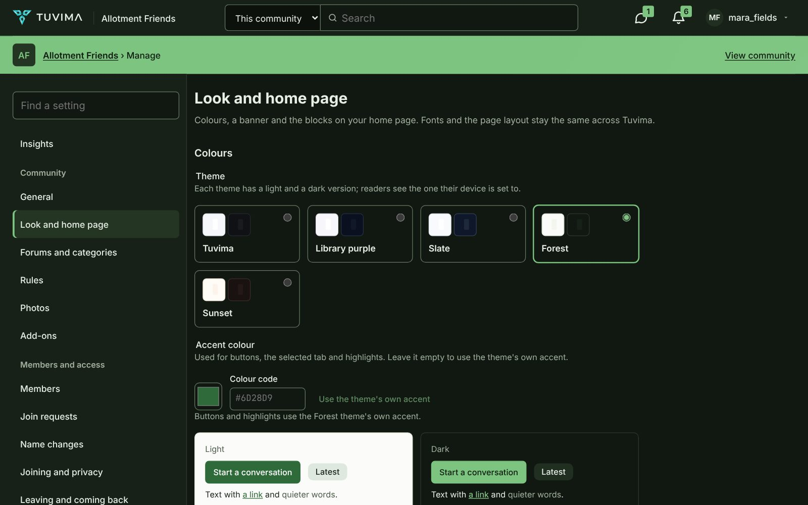
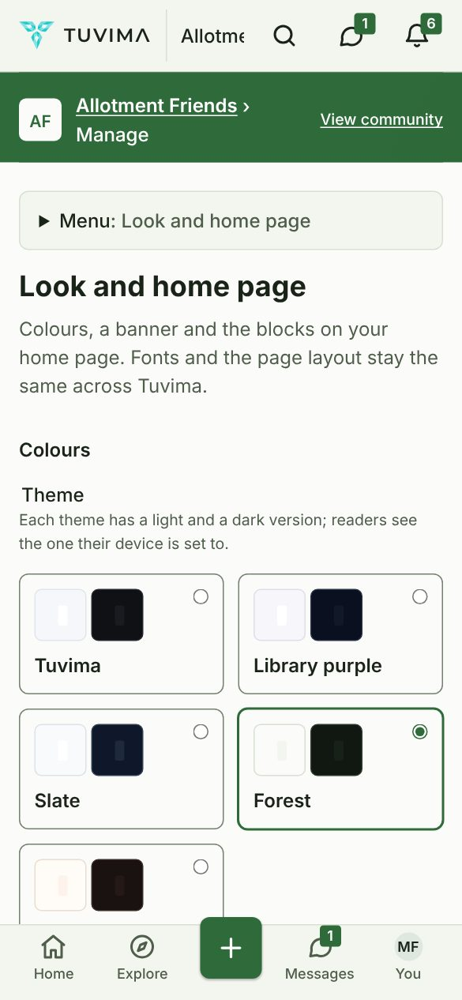
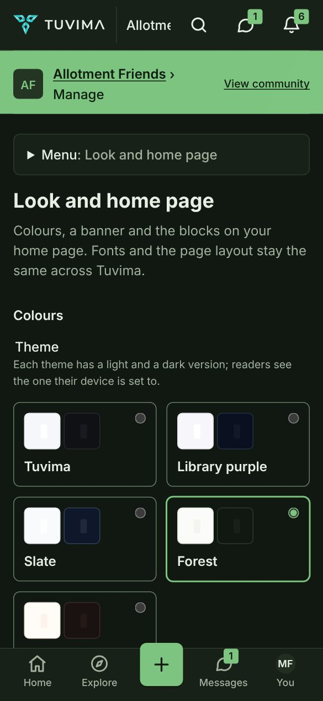

Every community can have its own colours, header and icons, while fonts and layout stay the same across Tuvima so members always know where things are. Text is always set in Inter, the same typeface as the rest of Tuvima, so a community looks the same on every phone and computer. Open **Manage**, then **Profile and look**, then **Look**. Every part of the Look editor is free. To move things around on the home page, see [Choose a home layout and arrange your home](home-tiles.md).

<figure class="tv-screens">

<figcaption>On a computer and on a phone; select a picture to see it full size. Everyone shown is a made-up sample person.</figcaption>
</figure>

## Colours

- Pick one of **12 colours**, or choose **Custom** and enter your own with the picker or a colour code.
- Tuvima checks every colour for both light and dark mode. If a colour would be hard to read in either one, it uses the nearest readable shade automatically, so buttons and links stay clear for everyone.
- A new community starts with the Tuvima colour: Harbor blue, with a near-black dark mode.

## Header

The header is the band across the top of your community. Choose one of:

- **A picture.** Upload a JPEG, PNG or WebP file up to 2 MB, then drag the **focus point** to the part that matters, such as a face. Tuvima keeps that part in view on wide screens and on phones.
- **A colour wash.** A soft blend of your colour.
- **A pattern.** One of 8 patterns, drawn in your colour.

Then choose its height: **Slim** or **Tall**.

## Community icon

Upload a small picture as your community's icon. If you don't, Tuvima shows your community's **initials** on a block of your colour.

## Forum symbols

Each forum can have its own symbol, so members spot it at a glance. Choose one of **32 symbols** in one of **12 colours**, or upload a small picture instead. Forums without one keep a neutral symbol.

## What stays the same

Fonts, the layout and the top bar are the same in every community. Only colours, the header, icons and symbols are yours to change.

## Home page blocks

The side column of the home page can hold blocks: **About**, **Rules**, **Links** (up to 10) and **Welcome**. Add, remove and move them with **Arrange home** on the home page. See [Choose a home layout and arrange your home](home-tiles.md).
