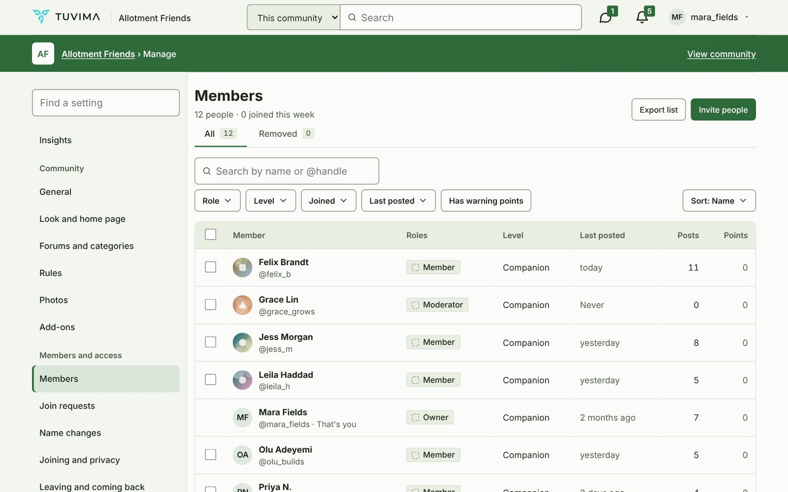
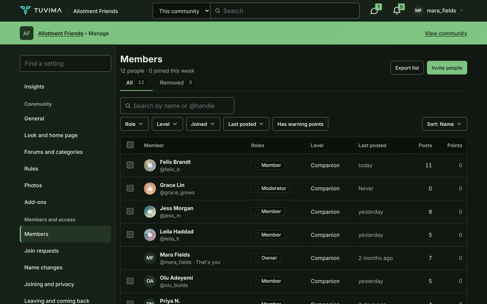
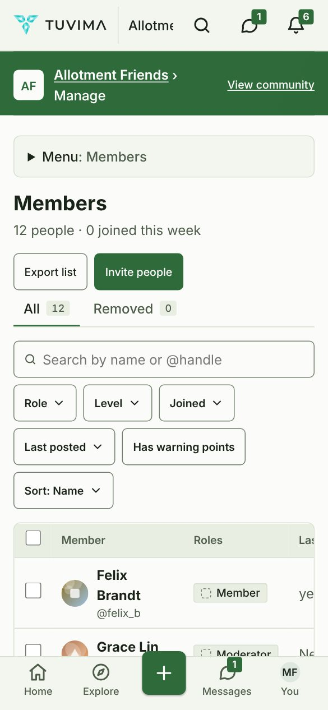
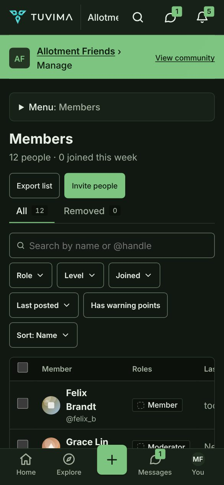

Open **Manage**, then **Members** under **People**. Moderators, admins and the owner can see this page.

<figure class="tv-screens">

<figcaption>On a computer and on a phone; select a picture to see it full size. Everyone shown is a made-up sample person.</figcaption>
</figure>

## The members table

Each row shows a member's name, their roles and any newcomer, suspended or banned mark, their level, when they joined, when they last posted and how many posts they have written. A line above the table says how many people match and how many joined this week. Use **Show more** for the next page.

"Last posted" and post counts only count posts in forums you can open yourself. Someone who only posts in a private forum you can't see shows as never having posted.

Each name also has a small chip saying what kind of persona it is:

- **Global**: the member's own persona used across Tuvima, with its full address, such as **amara_speaks @ tuvimaid.com**.
- **Private here**: a persona the member made only for this community. Nobody, including you, can see which Tuvima persona it belongs to.

Above the table, **All**, **Global** and **Private** show each kind on its own, with how many there are.

### Search, filter and sort

- **Search** by name or handle.
- **Filter** by role, by status (such as newcomer or suspended), by level, by when they joined (this week or this month) and by when they last posted (this week, this month, over a month ago, or never).
- **Has warning points** shows only people with points still counting. You only see this filter if your role can read the moderation record.
- **Sort** by name, newest members, last posted, most posts, most points or level. Most points is only there if you can read the moderation record.

## Act on several people at once

Tick the people you want, up to 100 at a time. A bar appears at the bottom of the screen saying how many are ticked.

- **Give role** and **Take role**: for anyone whose role allows **Give roles**.
- **Warn**: for anyone whose role allows **Suspend and ban**. See [warnings](warnings-and-filters.md#warnings).
- **Remove from community**: for anyone whose role allows **Suspend and ban**. See [remove someone](#remove-someone-from-the-community).

The same rules apply as when you act on one person: you can't act on yourself, or on anyone whose role is as high as yours or higher. Each person is changed in turn. Afterwards a summary lists who was done, and who wasn't and why. Everyone who could be changed still is.

## Remove someone from the community

Removing is for someone who doesn't fit your community, without banning them. It needs the **Suspend and ban** permission, and you can't remove anyone whose role is as high as yours or higher.

Choose **Remove from community** on a member's page, or tick several people and use the bar at the bottom. Then:

1. Pick a reason: **Spam**, **Off-topic or not a fit**, **Inactive** or **Other**. For **Other**, write a short note for them.
2. For spam only, you can tick **Also remove their posts**. Their posts written before the removal are removed in the background.
3. Read **What happens** and confirm.

Their persona stays, and so do their posts unless you removed them for spam. They get a notice with the reason, but not who removed them. Every removal is kept in the moderation record.

Whether they can come back depends on your [Leaving and coming back](leaving-and-coming-back.md) settings. By default a moderator approves their return in the [approval queue](warnings-and-filters.md#the-approval-queue). An invite lets them straight back in.

### Removed members

The **Removed members** tab on the Members page lists people who were removed, with the date, the reason and who removed them. Choose **Let back in** to approve their waiting request, or, if they haven't asked, to let them straight back the next time they join. They then leave the list.

To keep someone out for good, ban them instead. Bans always stop someone coming back.

## Members who switched persona

A member can [switch between a private and a global persona](../guides/switch-persona.md) without leaving. While the community's name history shows, their page says "formerly @old", and the moderation record shows "as @old" on earlier entries. Their warnings, notes and level follow them. See [Name history](leaving-and-coming-back.md#name-history).

## Unsuitable names

A member with a private persona can't rename themselves; they [ask the admins](name-changes.md). If a name is unsuitable, open the member's side panel or page and use **Unsuitable name**:

- **Change the name now** replaces the handle with a neutral one such as `member_4821`, which you can edit. Their posts, level and achievements stay. Members are not shown "formerly".
- **Mark as offensive** hides the name from members, who see **Name hidden**, and you then choose a follow-up: **Mute for 7 days**, **Suspend**, **Ban** or **Warn only**. This needs the **Suspend and ban** permission.
- **Show the name again** undoes a hidden name.

You need the **Approve and change member names** permission, and you can't act on someone whose role is as high as yours or higher. For a global persona the section only explains that its name is Tuvima-wide, and you use Warn, Suspend or Ban. Everything is explained on [Name changes](name-changes.md).

## Export the list

Owners and admins can choose **Export list** to download the members list as a spreadsheet (a CSV file, which opens in any spreadsheet app).

- It holds exactly what is on screen: the same search and filters. Change the filters first to export a smaller group.
- For each person: name, handle, roles, level, when they joined, when they last posted and how many posts they have written. Warning points are included only if you can read the moderation record.
- Email addresses and sign-in details are never included. They stay in Tuvima ID.
- An export can hold up to 50,000 people.
- Every export is kept in the moderation record, with who made it.

## A member's side panel

Choose **Details** on a row. A panel opens beside the list, so you keep your place. It shows:

- their roles and level, with **Open member page** and **Change roles**,
- their posts, when they joined and when they last posted,
- their **warnings**, with the points still counting (if you can read the moderation record),
- their answers to your [questions for approving people](onboarding-questions.md) (if you can review requests to join),
- private **moderator notes** (see below),
- **Warn**, **Suspend** and **Ban**, if your role allows them.
- **Message**, if you hold a moderation permission. It starts a [private message](../guides/messages.md) to the member as a moderator: it carries a **Moderator** tag, reaches them whatever their message settings, and is noted in the moderation record (never what was said).

Email addresses and sign-in details are never shown here. They stay in Tuvima ID.

The same warnings and notes are on the member's own page under **Warnings and notes**.

## Moderator notes

Notes are a private record for your team, such as "Explained the trading rule, seemed fine."

- Moderators and up can read and add notes, if their role allows **Moderator notes**.
- The member never sees notes about them, and nobody can read or write notes about themselves.
- The person who wrote a note, admins and the owner can delete it.
- A note can be up to 1,000 characters.

## Next steps

- [Roles: ready-made and your own](roles.md)
- [Warnings, word filters and the approval queue](warnings-and-filters.md)
