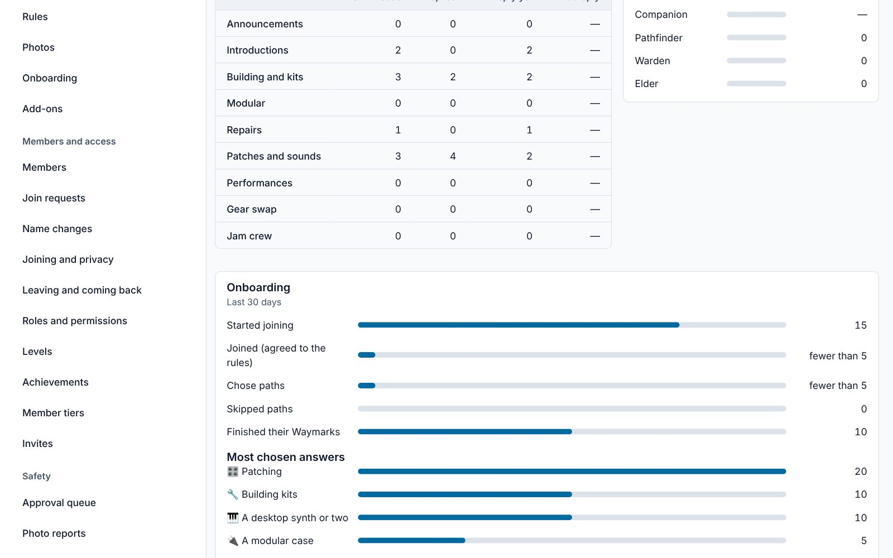
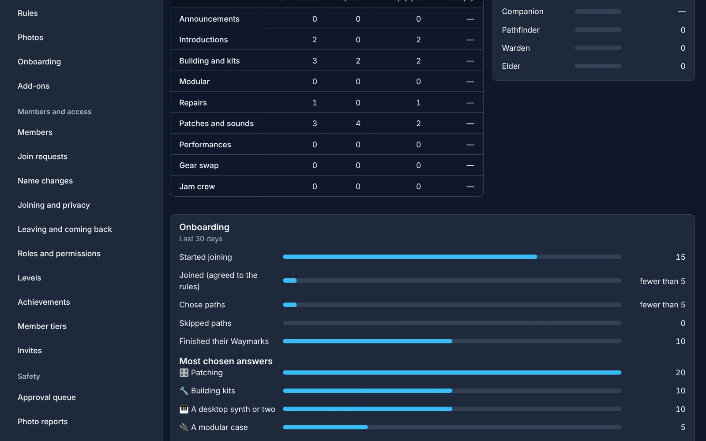
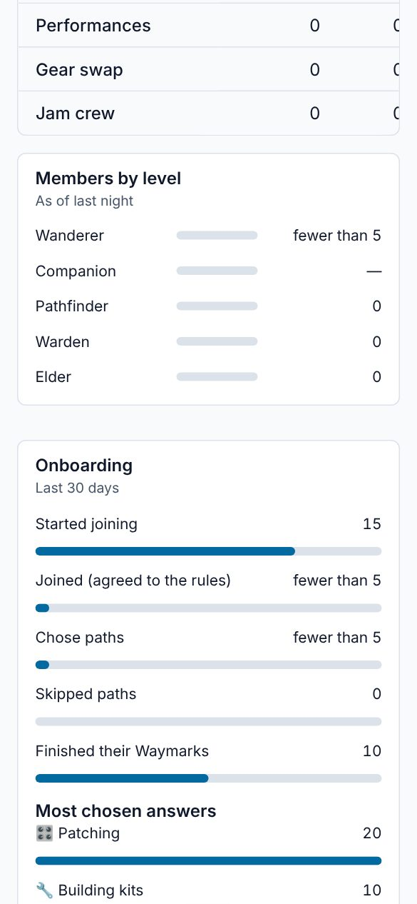
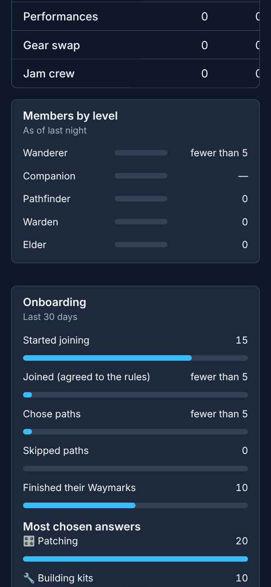

Once you've set up [onboarding](onboarding.md), **Manage › Overview › Numbers** shows an **Onboarding** card. It tells you whether people get through your join steps, without ever showing who picked what. You see it if your role has the **See the numbers** permission, and only when your community has choice questions (Pick one, Pick any or Yes or no), or Waymarks.

<figure class="tv-screens">

<figcaption>On a computer and on a phone; select a picture to see it full size. Everyone shown is a made-up sample person.</figcaption>
</figure>

## What each number means

The card follows the period you pick at the top of Numbers (7, 30, 90 or 365 days).

- **Started joining**: people who opened your join steps while signed in, and not yet members. Each device counts once in the period, however often it opens them and whichever persona is signed in.
- **Joined (agreed to the rules)**: people who became members in the period, including any who have left since. Someone who [switches persona](../guides/switch-persona.md) here also counts as joining again.
- **Chose paths**: of those who joined, how many picked at least one answer.
- **Skipped paths**: of those who joined, how many saw your questions and picked nothing.
- **Finished their Waymarks**: members who ticked every Waymark they could see. Adding Waymarks later doesn't undo this: it counts the set they had.
- **Most chosen answers**: up to five answers with the most current members holding them, shown only from 5 people.

A big gap between **Started joining** and **Joined** usually means the steps are too long or the rules put people off. Many **Skipped paths** can mean the questions aren't clear. Use [Try it as a new member](try-onboarding.md) to walk through it yourself.

## Rounding and privacy

Every number is rounded to the nearest 5. From 1 to 4 it shows **fewer than 5**, and nothing shows as 0 unless it really is 0. The card never names anyone and never shows one person's picks. The "started joining" count keeps only a day and a random number for the device, never who was signed in. These numbers are worked out when you open the page, unlike the rest of Numbers, which is counted once a night.

**Set up onboarding** at the bottom of the card takes you to the [Onboarding page](onboarding.md) if you're allowed to change it.

## Next steps

- [Questions when people join](onboarding-questions.md)
- [Try it as a new member](try-onboarding.md)
