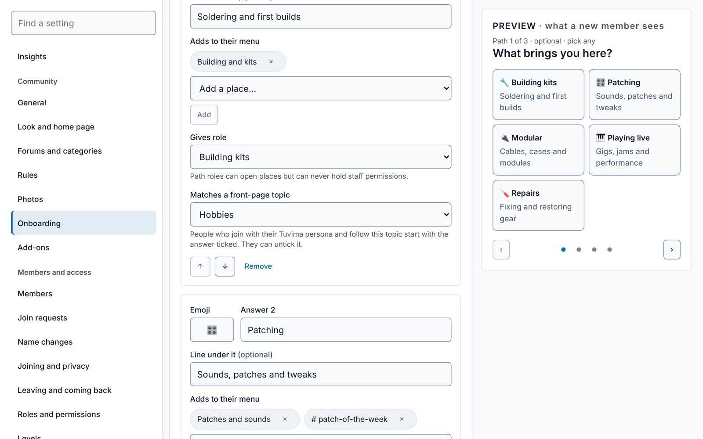
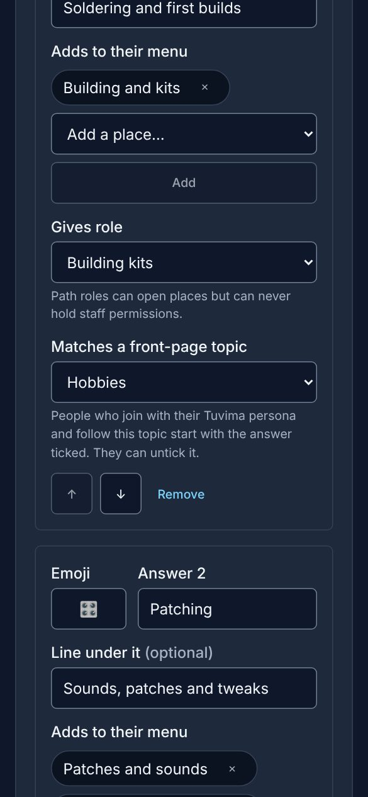

Everything new members choose for themselves is on one page: open **Manage**, then **Onboarding**, on the **Member choices** tab. It has three parts:

1. **Questions when people join**, on this page.
2. **Roles members can pick**: see [path roles](path-roles.md#roles-members-can-pick).
3. **How each place starts**: see [how each place starts](start-here-places.md).

Your questions are one short list. Each question is asked once, when someone joins. An answer can also add places to the new member's menu, such as a forum or a chat channel, so their menu starts with what they care about. An answer that adds nothing is simply information.

<figure class="tv-screens">

<figcaption>On a computer and on a phone; select a picture to see it full size. Everyone shown is a made-up sample person.</figcaption>
</figure>

## How many questions

You can have up to **5** questions. The line above the list shows how many you have, for example **2 of 5**. Every question is optional for people unless you switch on **Required**.

If you have no questions, joining takes one tap: people choose **Join** (or **Ask to join**) and agree to your rules, with no form to fill in.

## When each question is asked

It depends on [how people join](how-people-join.md):

- **Ask to join**: people answer the whole list with their request, under the heading **A few questions**. When the request is approved, their answers to choice questions become their picks, so they get the places those answers add. They aren't asked again.
- **Anyone can join**: people answer only the choice questions (**Pick one**, **Pick any** and **Yes or no**), one at a time, before your rules. Written and number questions are never asked, because nobody would read the answers. The editor shows the hint **Asked only when people request to join** on those questions.

If you add a question after someone has already asked to join, they get that question once they are in.

## Add a question

1. Choose **Add question**.
2. Write the **Question**, such as "What brings you here?" or "Where do you play?".
3. Pick an **Answer type**:

   | Answer type | What people give | Can add places |
   | --- | --- | --- |
   | **Pick one** | One answer from your list. | Yes |
   | **Pick any** | Any number of answers from your list. | Yes |
   | **Yes or no** | A simple yes or no. | Yes |
   | **Short answer** | One line. | No |
   | **Long answer** | A few sentences. | No |
   | **Number** | A number, like an age or a year. | No |

   **Pick one**, **Pick any** and **Yes or no** are the choice questions. Only their answers can add places.
4. Switch on **Required** if people have to answer before they can join. Leave it off for most questions.
5. For a choice question, leave **Moderators see the answers** on or switch it off (see [who sees the answers](#who-sees-the-answers)).
6. Add the answers (see below), then choose **Save**.

Don't ask for anything private, such as an email address, a phone number or a real name.

For a **Pick one** question, **Show as a drop-down list** shows the answers as a list on a request to join. Where people join straight away, answers always show as tiles.

Use the arrow buttons to change the order of questions and answers, and **Remove** to delete one. Removing a question or an answer doesn't take anything away from people who already picked it: they keep their places and role.

## An answer that adds places

Each answer to a choice question has:

- **Emoji** (optional) and a title, such as 🔧 Building kits.
- **Line under it** (optional): a few words that explain it, such as "Soldering and first builds".
- **Adds to their menu**: the forums, chat channels or whole categories this answer puts in the member's menu. Choosing a category adds everything in it. Up to 20 places per answer. Leave it empty if the answer shouldn't add anything.
- **Gives role**: the role that carries those places. Choose **Create a role named after this answer** (the usual choice), or pick an existing role that members can pick. These roles can open places but can never hold staff permissions. They are listed as [path roles](path-roles.md).
- **Matches a front-page topic** (optional): a topic from the Tuvima front page, such as Synths. People who follow that topic find this answer already ticked when they join. Leave it at **None** if no topic fits.

Picking an existing role loads the places it already adds; **Create a role named after this answer** starts with an empty menu. The places belong to the answer's role, so you also see them on that role's **What holders get** tab.

An answer with a role that adds nothing shows under **Things to check** on the Onboarding **Overview**, in case you meant to point it somewhere. If it's only there for information, you can leave it.

## Who sees the answers

**Where people ask to join:**

- The owner and admins always see every answer with the request.
- Moderators and others who review requests see the answers to choice questions while **Moderators see the answers** is on. It is on for every new question. Switch it off for a question whose answers moderators don't need.
- Answers to written and number questions are always shown to whoever reviews the request. That's what they're for, so they have no switch.
- Answers are deleted **90 days after the request is decided**. The places a member picked stay with them as their own choices, and only they see those. Editing a question later doesn't change answers already given.

**Where anyone can join:** nobody sees individual answers, you included. You see only rounded totals, such as how many picked a role, never names.

Other members never see anyone's answers.

## Who can change the questions

You need the **Manage onboarding** permission to open **Member choices** and edit the questions. Changing **Moderators see the answers** also needs **Manage rules and settings**, which admins and the owner have. Without it the switch is read-only, a new question keeps it on, and the editor says **Only admins and the owner can change who sees the answers.**

## Answers ticked from front-page topics

When someone joins with their global persona, answers that match a topic they follow on the front page start ticked, with the line **Ticked from the topics you follow on Tuvima**. They can untick anything, and nothing is saved until they choose **Join**. People joining with a [private persona](../guides/switch-persona.md) never get this: Tuvima doesn't look at their global persona's topics, so nothing links the two.

<figure class="tv-screens">

<figcaption>On a computer and on a phone; select a picture to see it full size. Everyone shown is a made-up sample person.</figcaption>
</figure>

## Saving

Nothing changes for members until you choose **Save**. If you try to leave with changes that aren't saved, your browser asks first. If something can't be saved, the message appears on the question or answer it's about.

## Answer counts

**Show how many chose each answer** adds "about 40 chose this" to popular answers. Counts only appear once 20 or more members chose an answer, and they are rounded, so nobody can work out who picked what. Switch it off to hide the counts.

## Writing good questions

- Keep it short. One or two questions is often enough, and every extra one loses a few people.
- Ask about what people want to do, not who they are.
- Keep answers short and distinct. Five to eight answers per question is easy to scan.
- An answer can be a way out, such as "Just browsing for now". Point it at your general places, or at nothing.
- Check **Things to check** on the Onboarding **Overview** after saving.

## Changing their answers later

Members change their answers at any time on **Pick what you see**. Their menu follows. See [paths and Pick what you see](../guides/paths-and-places.md).

## Next steps

- [How each place starts](start-here-places.md)
- [Review join requests](join-requests.md)
- [Try it as a new member](try-onboarding.md)
- [What members see when they join](../guides/paths-and-places.md)
