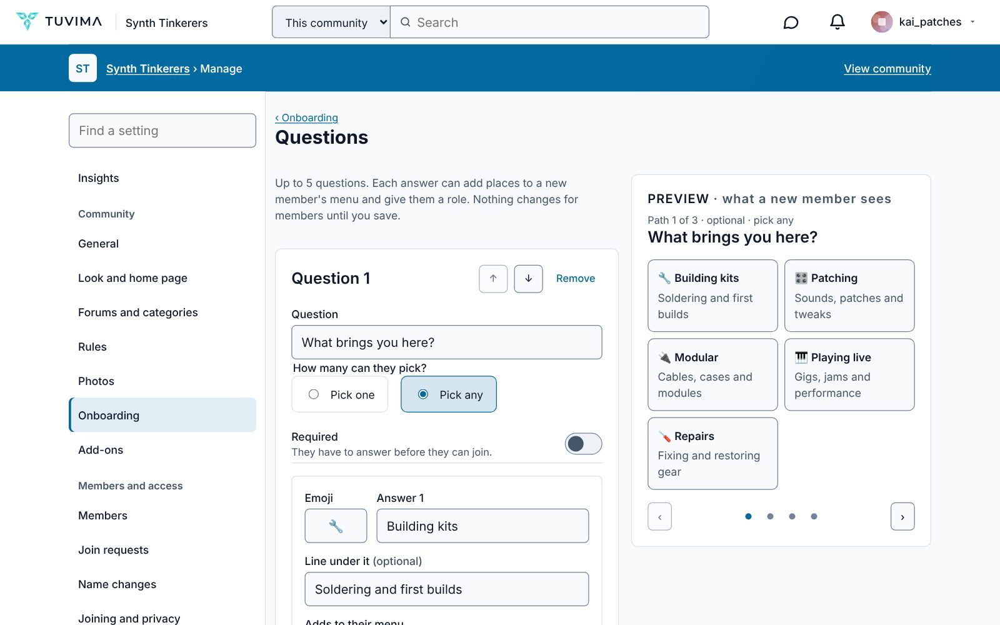
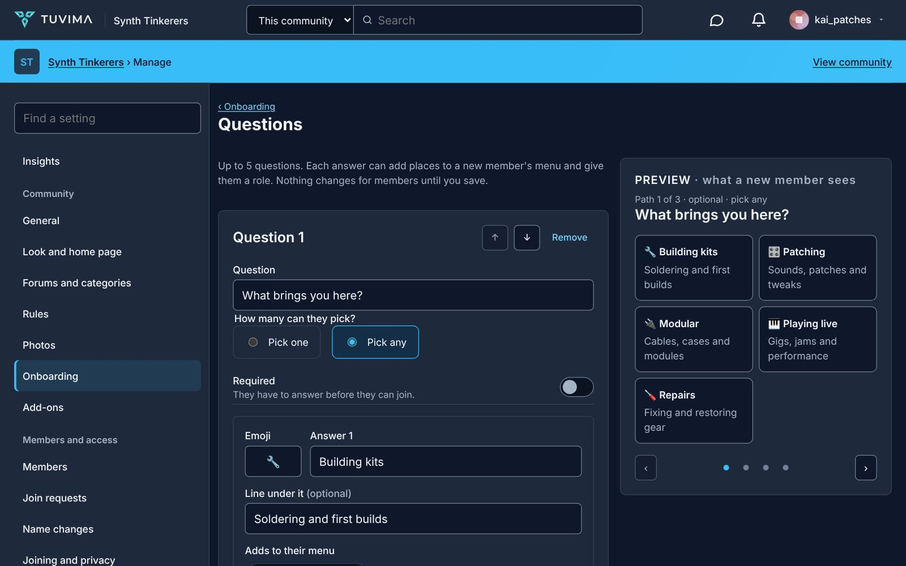
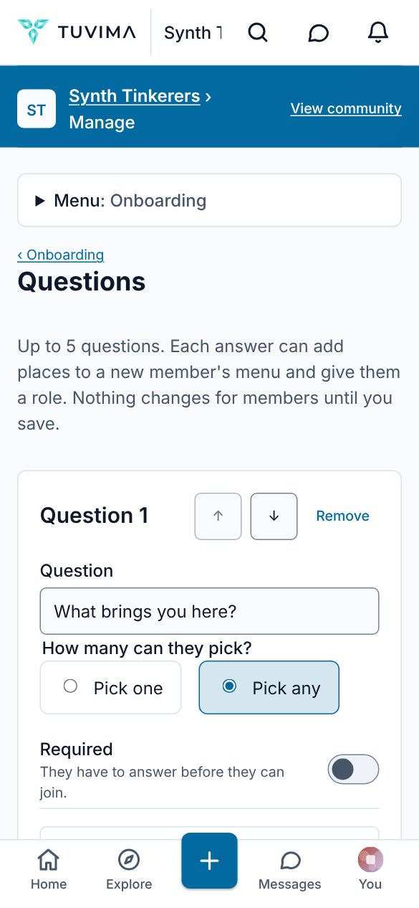
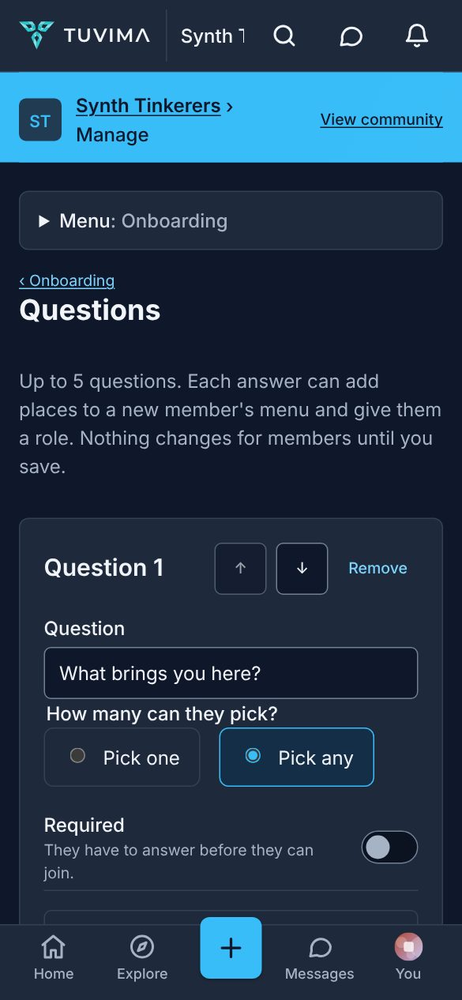
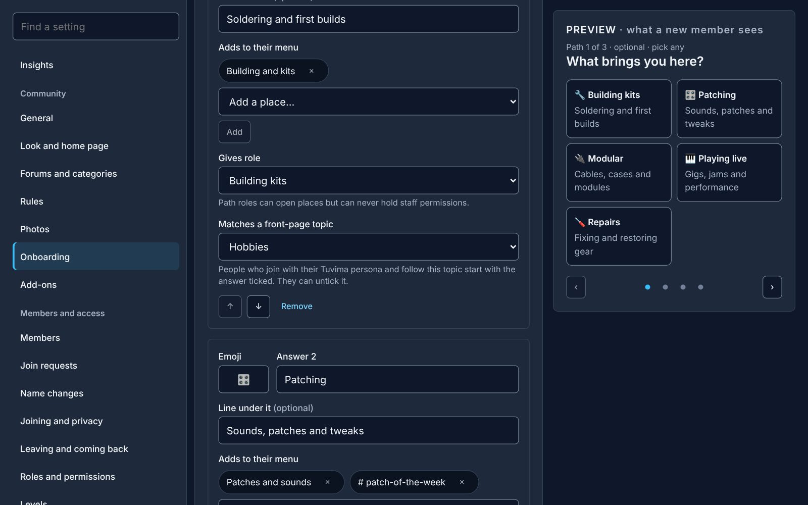
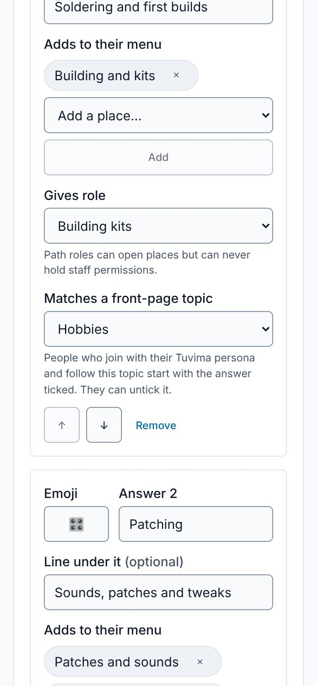

Everything new members choose for themselves is on one page: open **Manage**, then **Onboarding**, on the **Member choices** tab. It has three parts:

1. **Questions for new members**, on this page.
2. **Roles members can pick**: see [path roles](path-roles.md#roles-members-can-pick).
3. **How each place starts**: see [how each place starts](start-here-places.md).

Your questions are one list. Each question is used for **Approving people**, for **Choosing paths**, or for both.

- **Approving people**: the people who review requests to join see the answer with each request. These questions are only asked when your community uses **Ask to join** (see [how people join](how-people-join.md)).
- **Choosing paths**: each answer can add places to a new member's menu and give them a role, so their menu starts with the places they care about.

<figure class="tv-screens">

<figcaption>On a computer and on a phone; select a picture to see it full size. Everyone shown is a made-up sample person.</figcaption>
</figure>

## How many questions

You can have up to **3** questions for approving people and up to **5** for choosing paths. A question used for both counts toward both. The line above the list shows where you are, for example "2 of 3 for approving people · 4 of 5 for choosing paths".

## Add a question

1. Choose **Add question**.
2. Under **Used for**, tick **Approving people**, **Choosing paths**, or both.
3. Write the **Question**, such as "What brings you here?" or "How did you hear about us?".
4. Pick an **Answer type**:

   | Answer type | What people give | Can choose paths |
   | --- | --- | --- |
   | **Pick one** | One answer from your list. | Yes |
   | **Pick any** | Any number of answers from your list. | Yes |
   | **Yes or no** | A simple yes or no. | Yes |
   | **Short answer** | One line. | No |
   | **Long answer** | A few sentences. | No |
   | **Number** | A number, like an age or a year. | No |

   Only **Pick one**, **Pick any** and **Yes or no** questions can choose paths, because only their answers can give a role.
5. Switch on **Required** if people have to answer before they can join. Leave it off for most questions.
6. Add the answers (see below), then choose **Save**.

For a **Pick one** question used for approving people, **Show as a drop-down list** shows the answers as a list on the request to join. Path answers always show as tiles.

Use the arrow buttons to change the order of questions and answers, and **Remove** to delete one. Removing a question or an answer doesn't take anything away from people who already picked it: they keep their places and role.

## An answer that chooses a path

When a question is used for choosing paths, each answer has:

- **Emoji** (optional) and a title, such as 🔧 Building kits.
- **Line under it** (optional): a few words that explain it, such as "Soldering and first builds".
- **Adds to their menu**: the forums, chat channels or whole categories this answer puts in the member's menu. Choosing a category adds everything in it. Up to 20 places per answer.
- **Gives role**: the [path role](path-roles.md) the answer gives. Choose **Create a role named after this answer** (the usual choice), or pick an existing role that members can pick. Path roles can open places but can never hold staff permissions.
- **Matches a front-page topic** (optional): a topic from the Tuvima front page, such as Synths. People who follow that topic find this answer already ticked when they join. Leave it at **None** if no topic fits.

Picking an existing role loads the places it already adds; **Create a role named after this answer** starts with an empty menu. The menu places belong to the answer's role, so you also see them on that role's **What holders get** tab.

## A question used for both

In a community where people ask to join, a question used for both is asked once, with the request to join. The reviewers see the answer with the request. When the request is approved, the answer becomes the new member's pick, so it gives them its role and places. They aren't asked it again, and they can change it later on **Pick what you see**.

The other questions for choosing paths come after the request is approved, once the person is in.

In a community where anyone can join straight away, people are only asked the questions for choosing paths, as part of joining. Questions only for approving people are never asked.

## Who sees the answers

- **Answers for approving people**: only the people who review requests see them, by default moderators, admins and the owner. Answers are deleted **90 days after the request is decided**. Editing a question later doesn't change answers already given.
- **Path picks are private**: other members never see them. You and your staff see only rounded totals, such as how many picked a role, never names.

Don't ask for anything private in a question for approving people, such as an email address, a phone number or a real name.

## Who can change the questions

You need the **Manage onboarding** permission to open **Member choices**. Questions used for approving people also need **Manage rules and settings**. Without it, those questions are read-only for you, and you can add and change only questions for choosing paths.

## Answers ticked from front-page topics

When someone joins with their global persona, answers that match a topic they follow on the front page start ticked, with the line **Ticked from the topics you follow on Tuvima**. They can untick anything, and nothing is saved until they choose **Join**. People joining with a [private persona](../guides/switch-persona.md) never get this: Tuvima doesn't look at their global persona's topics, so nothing links the two.

<figure class="tv-screens">

<figcaption>On a computer and on a phone; select a picture to see it full size. Everyone shown is a made-up sample person.</figcaption>
</figure>

## Saving

Nothing changes for members until you choose **Save**. If you try to leave with changes that aren't saved, your browser asks first. If something can't be saved, the message appears on the question or answer it's about.

## Answer counts

**Show how many chose each answer** adds "about 40 chose this" to popular path answers. Counts only appear once 20 or more members chose an answer, and they are rounded, so nobody can work out who picked what. Switch it off to hide the counts.

## Writing good questions

- Ask about what people want to do, not who they are.
- Keep answers short and distinct. Five to eight answers per question is easy to scan.
- An answer can be a way out, such as "Just browsing for now". Point it at your general places.
- Check **Things to check** on the Onboarding **Overview** after saving.

## Next steps

- [How each place starts](start-here-places.md)
- [Review join requests](join-requests.md)
- [Try it as a new member](try-onboarding.md)
- [What members see when they join](../guides/paths-and-places.md)
