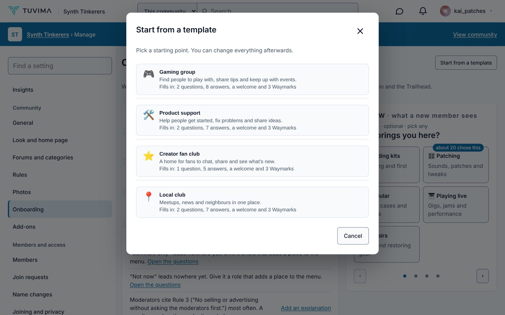
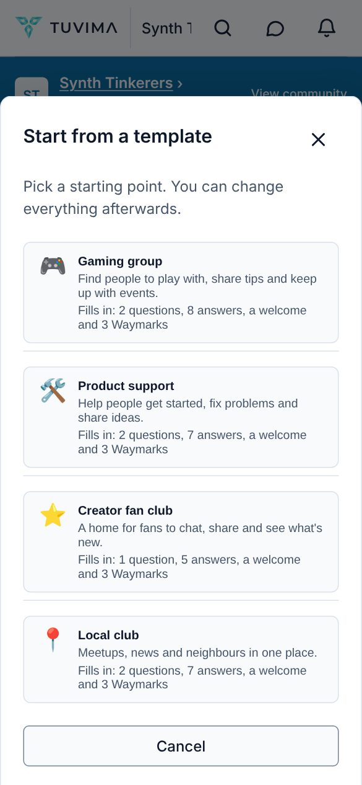
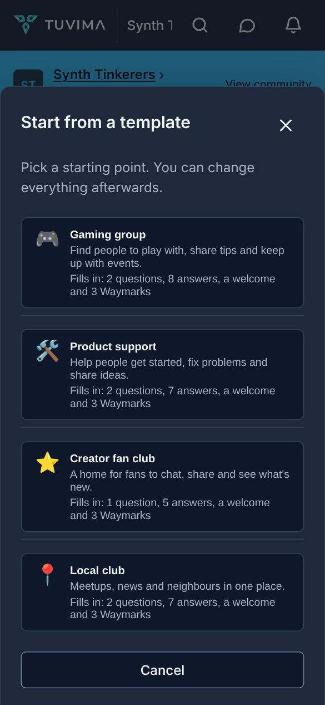

A **template** fills in your [onboarding](onboarding.md) in one go: a couple of questions with answers, a Trailhead welcome and three Waymarks. It's the quickest way to start; you can change every word afterwards. You need the **Manage onboarding** permission, which the Owner and Admin roles have.

<figure class="tv-screens">

<figcaption>On a computer and on a phone; select a picture to see it full size. Everyone shown is a made-up sample person.</figcaption>
</figure>

## The templates

| Template | Questions it asks | Waymarks |
|---|---|---|
| 🎮 **Gaming group** | What brings you here? Where do you play? | Read the rules, Set your picture, Introduce yourself! |
| 🛠️ **Product support** | What do you need help with? How do you use it? | Read the rules, Set your picture, Ask your first question |
| ⭐ **Creator fan club** | What are you into? | Read the rules, Set your picture, Say hello |
| 📍 **Local club** | What would you like to do? How often can you join in? | Read the rules, Set your picture, Introduce yourself! |

Each template also writes a short welcome for your [Trailhead](trailhead.md). The third Waymark (**Introduce yourself!**, **Ask your first question** or **Say hello**) points at your first forum where every member can read, reply and start conversations. If you don't have one, that Waymark is left out. **Gaming group** and **Creator fan club** also switch on the [introduction draft](trailhead.md#introduce-yourself), which starts a newcomer's first post from the answers they picked.

## Use a template

1. Choose **Manage**, then **Onboarding**.
2. Choose **Start from a template** next to the page title.
3. Pick one.
4. If you already have questions, a welcome or Waymarks, you're asked first: "This replaces your questions, welcome and Waymarks. People who already picked answers keep their places and roles." Choose **Use this template** to go ahead, or **Back** to pick another.

A template replaces only your choice questions (**Pick one**, **Pick any** and **Yes or no**). Your **Short answer**, **Long answer** and **Number** questions stay. They come after the template's questions. If together they would be more than 5, you're asked to remove one first.

You can also pick a template while you [create a community](start-a-community.md): the **Welcome new members** step offers the same four, or **Not now**.

## After you apply it

Each answer gets its own role named after it, but it doesn't add anything to the menu yet. So the Onboarding page shows warnings that answers **lead nowhere**. That's expected: open [the questions](onboarding-questions.md) on **Member choices** and point each answer at the forums and channels it should add to a new member's menu. When every answer leads somewhere, the warnings go away. If you already had a pick-yourself role with the same name as an answer, the answer uses it, so it may already lead somewhere.

## What a template doesn't change

- Your rules, Lore links, start-here places and highlighted achievements stay as they are.
- Members who already picked answers keep the places and roles they have. Their old picks are removed with the old questions, so they don't count under **Answered the questions** in [the numbers](onboarding-numbers.md).
- Trying a different template later reuses the roles an earlier one made with the same names, so your roles list doesn't fill up with copies. Roles no answer uses any more stay until you delete them on the Roles page.

## Next steps

- [Write your questions](onboarding-questions.md) and point each answer at places
- [Try it as a new member](try-onboarding.md)
