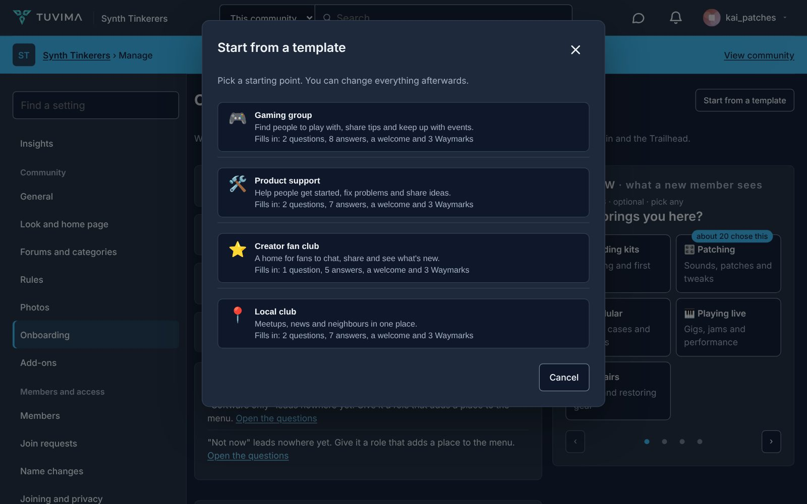

A **template** fills in your [onboarding](onboarding.md) in one go: a couple of questions with answers, a Trailhead welcome and three Waymarks. It's the quickest way to start; you can change every word afterwards. You need the **Manage onboarding** permission, which the Owner and Admin roles have.

<figure class="tv-screens">

<figcaption>On a computer and on a phone; select a picture to see it full size. Everyone shown is a made-up sample person.</figcaption>
</figure>

## The templates

| Template | Questions it asks | Waymarks |
|---|---|---|
| 🎮 **Gaming group** | What brings you here? Where do you play? | Read the rules, set your picture, introduce yourself |
| 🛠️ **Product support** | What do you need help with? How do you use it? | Read the rules, set your picture, ask your first question |
| ⭐ **Creator fan club** | What are you into? | Read the rules, set your picture, say hello |
| 📍 **Local club** | What would you like to do? How often can you join in? | Read the rules, set your picture, introduce yourself |

Each template also writes a short welcome for your [Trailhead](trailhead.md). The "introduce yourself" kind of Waymark points at your first forum that every member can post in. If you don't have one, that Waymark is left out.

## Use a template

1. Choose **Manage**, then **Onboarding**.
2. Choose **Start from a template** next to the page title.
3. Pick one.
4. If you already have questions, a welcome or Waymarks, you're asked first: the template **replaces your questions, welcome and Waymarks**. Choose **Use this template** to go ahead, or **Back** to pick another.

You can also pick a template while you [create a community](start-a-community.md): the **Welcome new members** step offers the same four, or **Not now**.

## After you apply it

Each answer gets its own role named after it, but it doesn't add anything to the menu yet. So the Onboarding page shows warnings that answers **lead nowhere**. That's expected: open [the questions](onboarding-questions.md) and point each answer at the forums and channels it should add to a new member's menu. When every answer leads somewhere, the warnings go away.

## What a template doesn't change

- Your rules, Lore links, start-here places and highlighted achievements stay as they are.
- Members who already picked answers keep the places and roles they have. Their old picks are removed with the old questions, so they don't count under **Chose paths** in [the numbers](onboarding-numbers.md).
- Trying a different template later reuses the roles an earlier one made with the same names, so your roles list doesn't fill up with copies. Roles no answer uses any more stay until you delete them on the Roles page.
