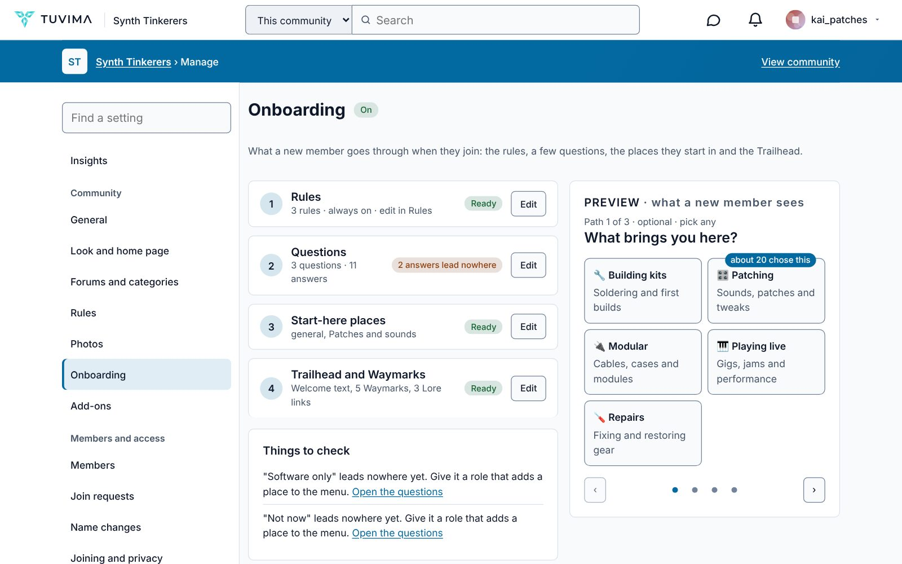
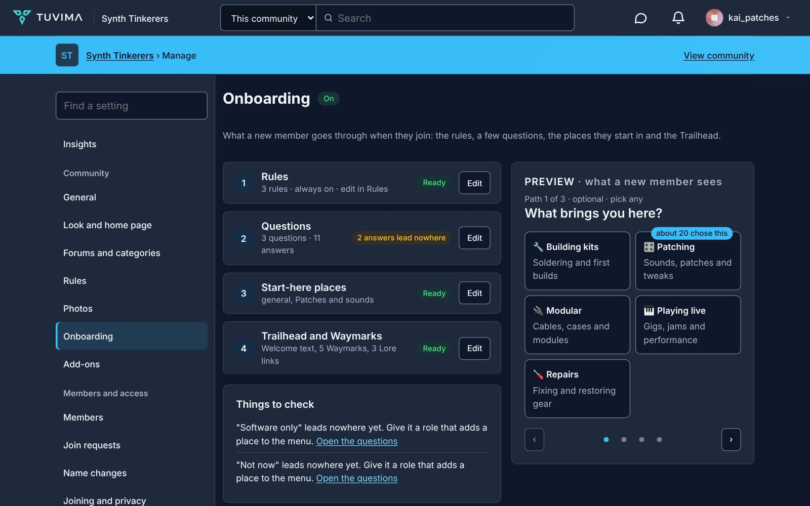
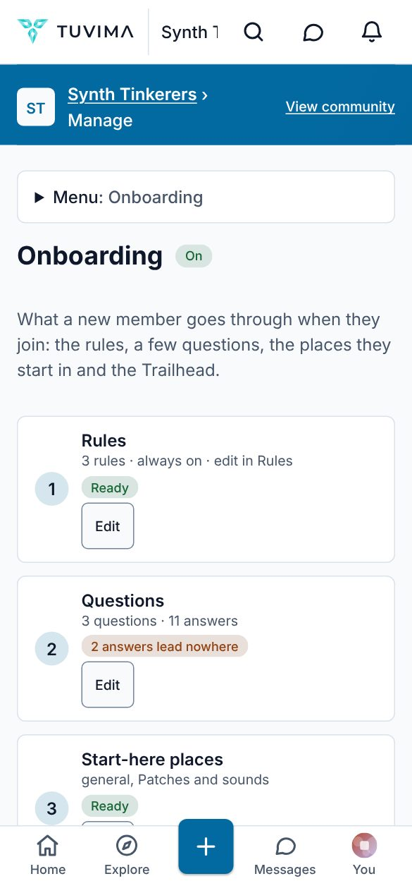
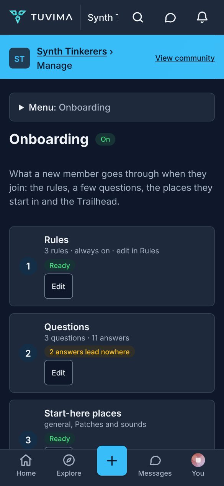

**Onboarding** is what a new member goes through when they join your community: they answer a few questions, agree to your rules and land on your Trailhead with a tidy menu of places picked for them. You build all of it on one page: **Manage › Onboarding**. You need the **Manage onboarding** permission, which the Owner and Admin roles have.

<figure class="tv-screens">

<figcaption>On a computer and on a phone; select a picture to see it full size. Everyone shown is a made-up sample person.</figcaption>
</figure>

## The four parts

The page shows four numbered parts. Each one has a short summary, a label and an **Edit** button.

1. **Rules.** Your community rules. They are always on: everyone agrees to them when they join. You change them on the [Rules](run-your-community.md#rules) page.
2. **Questions.** Up to five questions with answers to pick, such as "What brings you here?". Each answer can add places to the new member's menu and give them a role. See [Write your path questions](onboarding-questions.md).
3. **Start-here places.** Places every new member gets in their menu, whatever they pick. See [Start-here and always-shown places](start-here-places.md).
4. **Trailhead and Waymarks.** Your welcome page and the first steps that tick themselves. See [Set up the Trailhead and Waymarks](trailhead.md).

Next to the page title, **On** means you have set up questions or a Trailhead. **Off** means new members only see your rules when they join.

## What the labels mean

- **Ready**: this part is set up and nothing looks wrong.
- **Not set up** or **None yet**: you haven't used this part. That's fine; it's optional.
- **A warning in amber**: something will not work the way you probably expect. Common ones:
  - **An answer leads nowhere**: picking it adds nothing to the menu and gives no role that does anything.
  - **A place new members can't open**: an answer, a start-here place, a Waymark or a Lore link points at a place that a new member isn't allowed into, such as a members-only forum. They won't see it.
  - **A required question needs two answers**: a question people must answer has only one answer to pick.
  - **Needs rules**: your community has no rules yet.

  The list under **Things to check** names each one and takes you to the right editor.

## Places no answer leads to

When you have questions, the page lists the places that no answer and no start-here choice puts in anyone's menu. These are not hidden: members still find them under **See all places** in their menu. Use the list to spot a forum you forgot to point an answer at.

## The preview

**Preview · what a new member sees** shows your questions the way a newcomer sees them, one at a time, then your rules. Use the arrows to step through. To go through the whole thing yourself, use [Try it as a new member](try-onboarding.md).

## Members who joined before you set this up

**Show onboarding to existing members once** is on unless you switch it off. Members who joined before you wrote your questions see a one-time **Choose your paths** banner, so they can pick paths without leaving and rejoining. Switch it off if you'd rather not ask them. New members always see your questions when they join.

## Before you start

- Keep it short. Every extra step loses a few people. Two or three questions is usually plenty.
- Point every answer somewhere useful.
- Try it yourself before you tell your members about it.
- Optionally, turn away brand-new accounts during a raid: see [Account age](how-people-join.md#account-age).

## Next steps

- [Write your path questions](onboarding-questions.md)
- [Start-here and always-shown places](start-here-places.md)
- [Set up the Trailhead and Waymarks](trailhead.md)
- [Try it as a new member](try-onboarding.md)
- [Path roles and what holders get](path-roles.md)
