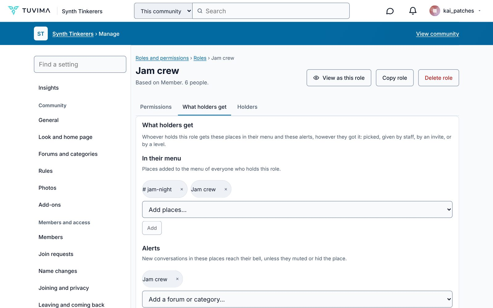
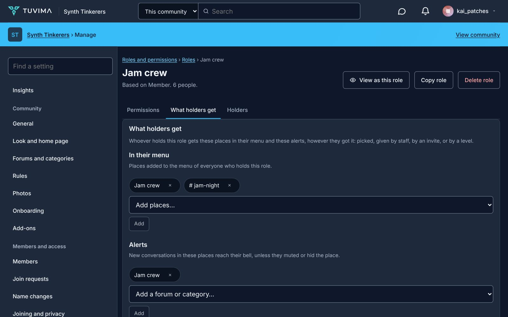
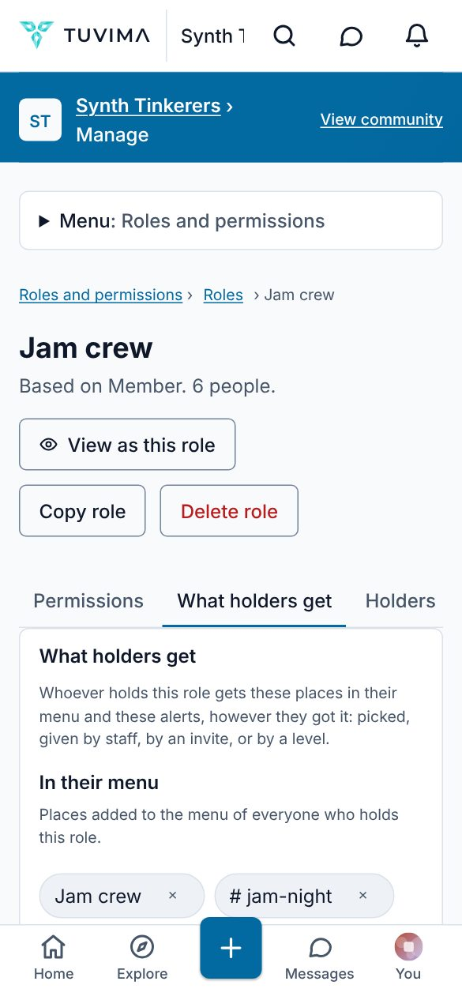
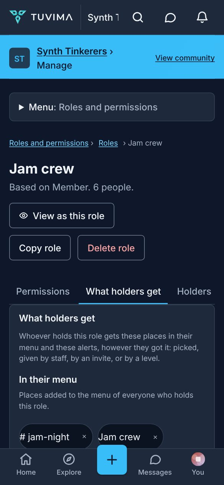
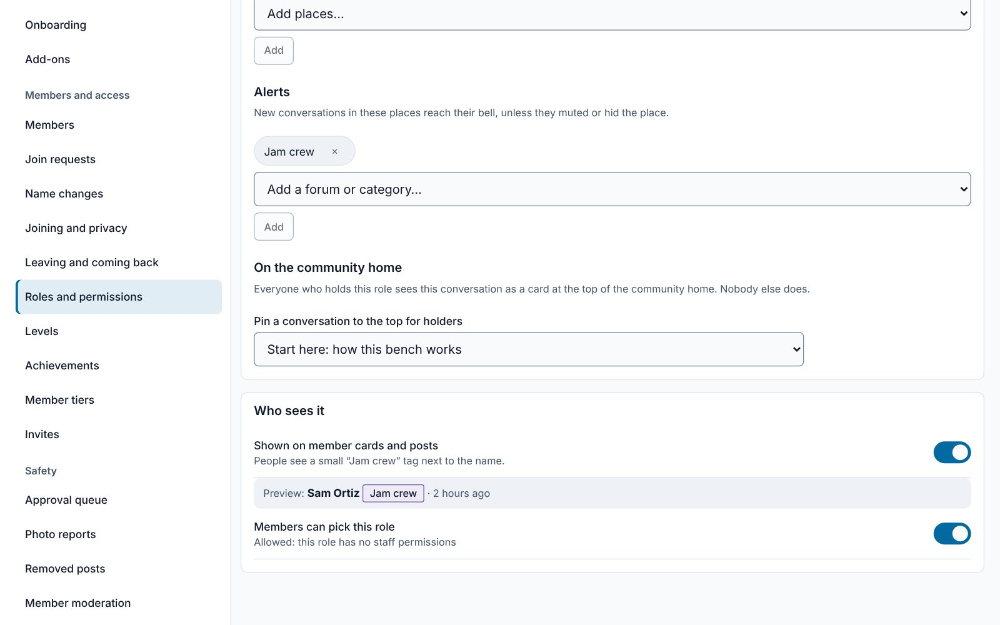
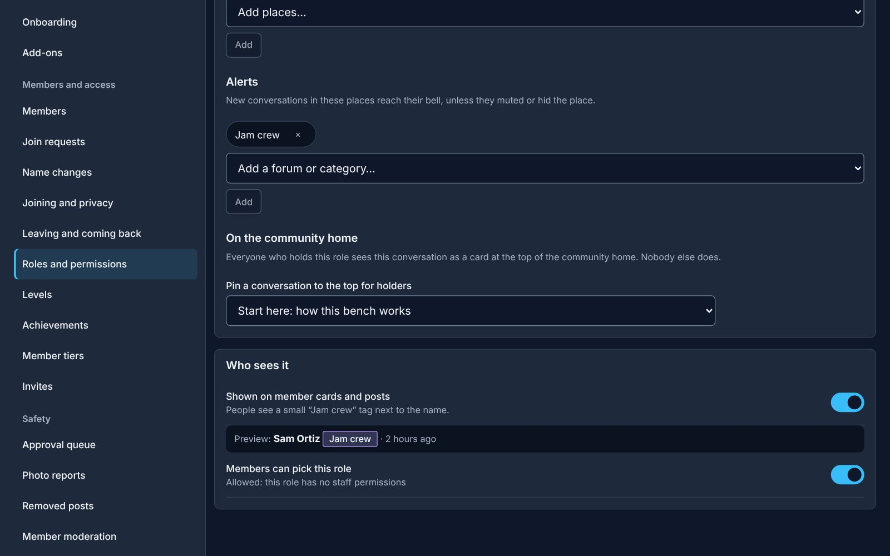
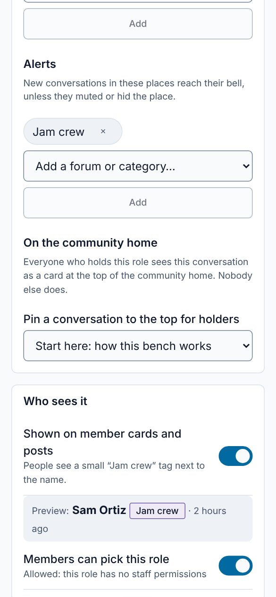
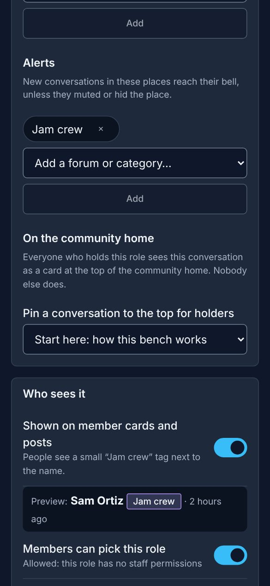

Roles already decide what people can do and which members-only places they can open (see [roles](roles.md) and [members-only areas](area-access.md)). They can also decide what people **see**: which places sit in their menu and which places they follow. This page shows how to set that up.

<figure class="tv-screens">

<figcaption>On a computer and on a phone; select a picture to see it full size. Everyone shown is a made-up sample person.</figcaption>
</figure>

## Three groups of roles

**Manage**, then **Roles and permissions** lists every role in three groups:

- **Staff**: Owner, Admin, Moderator and your copies of them. They are ranked and can act on other members.
- **Members**: roles you or your staff give, an invite gives, or a level gives, such as "Veterans".
- **Paths**: roles members pick for themselves, when they join or later on [Your paths](../guides/paths-and-places.md).

It is still one list, and every role works the same way. The groups are there so you can see at a glance which roles carry powers and which only shape what people see.

## Let members pick a role

1. Open a role that has no staff permissions, or choose **New role** and tick **Members pick this role**.
2. On **What holders get**, switch on **Members can pick this role**.

A role members can pick can never hold staff or moderation permissions. Tuvima refuses the switch while a role has any, so nobody can hand themselves moderator powers by accident. To let members pick a role that opens a members-only place, give the role access to that place in its [area settings](area-access.md); picking the role then opens it.

Members find roles they can pick on **Your paths**, under **Roles you can pick**. When your community has path questions, each answer gives its own path role. You write the questions on [Manage › Onboarding](onboarding-questions.md).

## Choose what holders get

Every role has a **What holders get** tab. Member [levels](run-your-community.md#levels) and [member tiers](member-tiers.md) have the same section in their settings.

- **In their menu**: places (forums, chat channels or whole categories) added to holders' menus.
- **Alerts**: forums or categories holders follow, so new conversations there reach their bell. Email always stays a separate choice each member makes. Members can change or mute any alert you set up for them.

For path roles, people with **Manage onboarding** can set **In their menu** and **Alerts** too, so admins can build onboarding without being able to change other roles.

It works however someone got the role: picked it, was given it by a moderator or an invite, reached the level or holds the tier. When it isn't their own pick, they get a **New paths opened** notice in their bell, and the places appear in their menu. When the role ends, its places leave their menu; their posts stay.

For example, give your **Veterans** level the Trading forum, and everyone who reaches it finds Trading in their menu the moment they do.

## Pin a conversation to the home for holders

On a role's **What holders get** tab, and the same section of a level or member tier, **On the community home** lets you pin one conversation to the top of your community's home for that role's holders. For example, pin "This month's jam" for **Jam crew**.

<figure class="tv-screens">

<figcaption>On a computer and on a phone; select a picture to see it full size. Everyone shown is a made-up sample person.</figcaption>
</figure>

1. Under **Pin a conversation to the top for holders**, choose a conversation. The list shows the conversations your moderators have pinned in this community, the same list the Trailhead uses for its reading step.
2. Choose **None** to take the pin away.

Holders see a card marked **Pinned for** and the role's name at the top of the home, whether they're on For you or Everything. Each holder sees up to 3 pins, from the roles, levels and tiers they hold, with the most active conversation first. People who don't hold the role never see the pin and aren't told it exists. If the conversation is deleted or removed, or a holder can't open it, the pin quietly stops showing.

A pin adds nothing to menus or alerts; it's only the card on the home.

## Private or shown on member cards

Path roles are **private to their holders** to begin with:

- they don't show on member cards, the members list or posts,
- the role's **Holders** tab shows only a rounded total, such as "about 310", and never names.

When showing a role is the point, as with "Raid team", switch on **Shown on member cards and posts** on its **What holders get** tab. Members see before they pick it that it will show.

## Start here and always shown

On [Manage › Onboarding › Start-here places](start-here-places.md), or in the settings of any category, forum or chat channel, people with the **Manage onboarding** permission (Admins and the owner, to begin with) see two choices:

- **Start here**: put this place in every new member's menu, whatever they pick. Choose a few welcoming places, such as an introductions forum and a general chat channel. Up to 10.
- **Always shown**: members can't hide it or take it off their menu. Use it sparingly, for places such as Announcements. Up to 10.

## When the menu is tidy

Once your community has any start-here place, path question or menu place in **What holders get**, members' menus show only their places, with everything else one tap away under **See all places**. Until then, every member sees every place they can open, as before. If someone's tidy menu would be empty, they see everything.

Visitors who haven't joined always see every place they can open.

Members who have picked at least one path also get a **For you | Everything** switch on your community's home. For you fills Popular, New photos, Latest and Chat now from their own places; Everything shows the whole community. Your featured conversations and announcements show in both. See [For you or Everything](../guides/paths-and-places.md#for-you-or-everything-on-the-communitys-home).

## What you can see, and what you can't

- You see how many people hold each role (rounded for private path roles).
- You never see which answers a particular member picked, which places they added to or took off their menu, or what they hid.
- Picking paths never changes who can read what. Only a role you have given access to a members-only place opens it.
