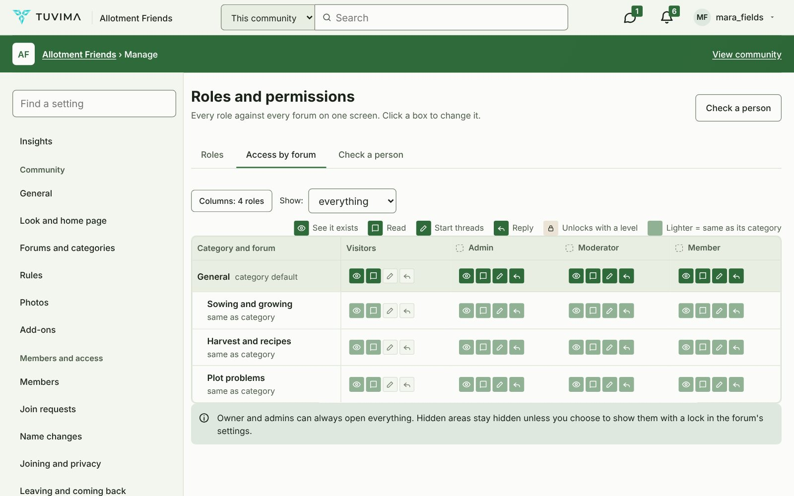
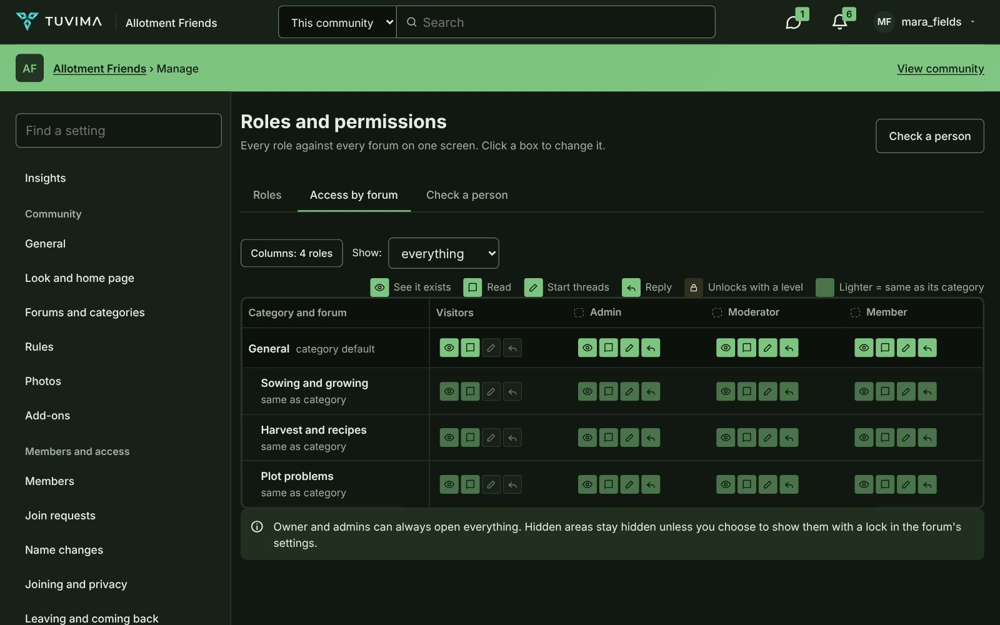
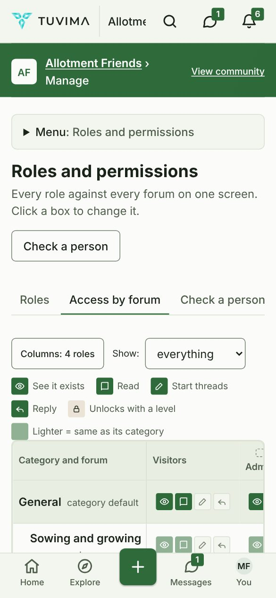
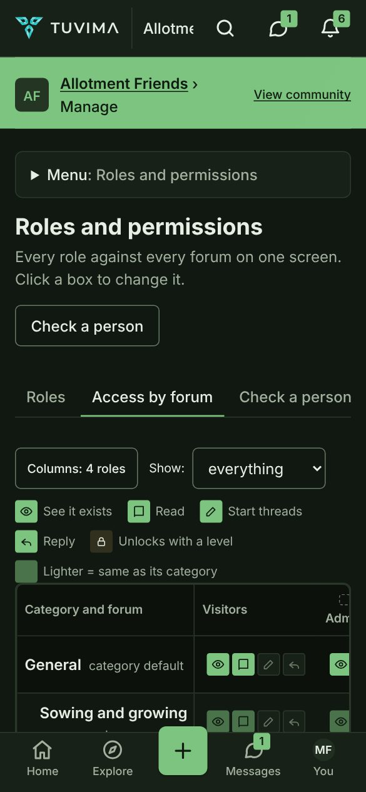

Forums and chat channels share one list of **permissions**. A permission is one thing a person may do, such as start a thread, reply or post a message in chat. Every role has its own community-wide switches, and every **place** can change them for that place with a **role exception**. A place is a category, a forum or a chat channel.

<figure class="tv-screens">

<figcaption>On a computer and on a phone; select a picture to see it full size. Everyone shown is a made-up sample person.</figcaption>
</figure>

Use this to make an announcements channel only staff can write in, to mute someone, or to let a helper moderate one forum and nowhere else.

The owner, and anyone with **Manage categories and forums**, can set permissions for categories and forums. For chat channels, the permission is **Manage chat channels**.

## The permissions

Open **Manage**, then **Roles and permissions**, and choose a role. Its page has groups, in this order.

**Everyday** is what ordinary members do. The Member role holds these, and any role can.

| Permission | What it lets someone do |
| --- | --- |
| **Start threads** | Start a new conversation in a forum. |
| **Reply** | Reply to a conversation. |
| **Post messages in chat** | Write in a chat channel. |
| **Add reactions and votes** | React to and vote on posts, and react to chat messages. |
| **Post photos** | Add photos to posts and messages. |
| **Add links** | Put links in posts and messages. |
| **Make polls** | Add a poll to a conversation. |
| **Use looking for group** | Post and answer looking for group requests. |

**Staff permissions** come in four groups: **Conversations**, **Chat**, **Members** and **Running the community**. They are for roles based on Moderator or Admin. See [roles](roles.md) for what each one does.

For a staff role, the Everyday group is folded into one line, "Same as Member, plus…", until you open it. For the Member role, the staff groups are hidden. The **Chat** group is shown but locked, with the note "Members can't hold staff permissions."

These switches are the community-wide answer. A place can change the answer for itself.

## Open a place's role exceptions

Open **Manage**, then **Forums and channels**, choose the category, forum or chat channel, and open its **Access** tab. See [the tree and the place tabs](categories-and-forums.md#open-a-places-settings). The **Access** tab has three parts: **Who can see and post here**, **Role exceptions here** and **Why can or can't someone post here?**.

### Role exceptions here

This list shows only the roles that work differently in this place. A role that simply follows the usual settings isn't listed. A line at the top says what the place follows: a forum names its category, and a category says how many forums and channels follow it.

Each listed role shows its **Allow** and **Deny** exceptions, with **Edit** and **Remove**. The owner also sees **View as <role>** on each row. The Owner is never listed, because the Owner is never affected. There is no row for the ready-made Member role either: **Everyone** stands for all members in a place.

To add one:

1. Choose **Add an exception**.
2. Pick the role, such as **Everyone** or **Announcer**.
3. Pick what it can or can't do here.
4. Choose **Allow** or **Deny**.

A permission with no exception for a role stays **Same as above**: no setting of its own here, and it works out to the category's setting or the role's community-wide switch. **Remove** takes an exception away and returns the role to that.

Only the permissions that apply to the place are offered. A forum offers conversation permissions, a chat channel offers chat ones, and a category offers both kinds. Like other changes on the tab, exceptions use the page's one save bar: **Save changes** or **Cancel**. If a change can't be made, the page says why in plain words.

**See every role in a grid** opens **Roles and permissions**, then **Access by forum**, which shows every place and role at once. See [choose who can see and post in each area](area-access.md#see-every-forum-at-once).

## How the choices add up

1. **The nearest place wins.** A forum or channel beats its category. A category beats the role's community-wide switches. A forum follows its category until it has a setting of its own.
2. **Everyone is the starting point.** A setting for Everyone applies to every member in the place. A setting for a named role beats it.
3. **Deny wins between roles.** If two of a person's roles disagree in the same place, Deny wins. A Muted role keeps working whatever else the person holds.
4. **The Owner is never affected.**
5. **Staff permissions stay with staff.** A role based on Member can never be given a staff permission, in any place. Those rows are locked, and so are all staff rows for Everyone.
6. **You can change only roles below your own**, and hand out only permissions you hold there yourself. An admin who lacks a permission can't allow it for anyone else.

These rules are also shown on the **Access** tab, under **How these settings work**.

## Who can see and post comes first

[**Who can see and post here**](area-access.md) is the first part of the same **Access** tab. It decides who may be in a place at all. Role exceptions then fine-tune it, role by role.

If someone can't open a place, no Allow here will let them in. If a place is only for Supporters, a Deny can take things away from Supporters, but Everyone can't get in by being allowed something.

## Recipes

### A read-only announcements channel

Members can read and react. Only Announcers can write.

1. Make a role called **Announcer**. See [make your own role](roles.md#make-your-own-role). A copy of Member is enough.
2. Give the role to the people who will post. See [give someone a role](roles.md#give-someone-a-role).
3. Open the channel's **Access** tab. Under **Role exceptions here**, choose **Add an exception** and pick **Everyone**.
4. Set **Post messages in chat** to **Deny**. Leave **Add reactions and votes** alone.
5. Add another exception: pick **Announcer** and set **Post messages in chat** to **Allow**.
6. Choose **Save changes**.

A named role beats Everyone, so Announcers can write and nobody else can. Check **Who can see and post here** for the channel too: if it says only moderators and up can post, change it to let members post, or the Allow for Announcer has nothing to work with. Other members see "Only some members can post here" in place of the message box. If you also want an admin to write there, pick **Admin** and choose **Allow** too. You can also make a read-only channel with **Who can see and post**; the permissions way lets you name exactly which roles may write.

### A Muted role

1. Make a role called **Muted**, as a copy of Member.
2. Open the category's **Access** tab, for example Hardware, and choose **Add an exception** for **Muted**.
3. Set **Start threads**, **Reply** and **Add reactions and votes** to **Deny**, and save.

Every forum in the category follows it, so one change covers them all. Deny beats the Member role's community-wide On, because the nearest place wins. Give the role to someone to mute them there. Take it away to unmute.

:::tip
A Deny meant to bind admins belongs on the forum itself. A forum that is moved out of a category stops following that category's settings.
:::

### A moderator for one forum only

1. Make a role called, for example, **Swap Meet moderator**. Start it from Moderator, with nothing switched on community-wide.
2. Open the forum's **Access** tab and add an exception for the role.
3. Under **Conversations**, set **Hide and remove posts**, **Pin and look after threads** and **Review reports** to **Allow**, and save.
4. Give the role to the member.

They can moderate that forum and no other. This replaces the old way of limiting a role to chosen forums. You can allow these only for permissions you hold in that forum yourself.

### A questions-only forum

Members can ask but not reply, for example a forum where staff answer.

1. Open the forum's **Access** tab and add an exception for **Everyone**.
2. Set **Start threads** to **Allow** and **Reply** to **Deny**, and save.
3. If staff should answer, add an exception for their role, such as **Moderator**, and set **Reply** to **Allow**.

Starting a thread asks only for **Start threads**, so a place can refuse replies and still let people ask.

## Compare roles in one place

On the roles list, choose **Compare roles**. The **In:** picker chooses a place, grouped by category, with each category's forums and channels. Choose **Show**. Each tick now means "yes in that place", after the place's own settings, and only the permissions that apply there are listed. See [compare roles](roles.md#compare-roles).

## View as a role and the post check

Two tools let you check your settings before members notice a mistake.

**View as a role** is for the owner. On a role's page, or beside a role under **Role exceptions here**, choose **View as <role>**. You then browse the community the way someone with that role sees it. A bar at the top says "Viewing as…" with an **Exit** button. Places the role can't see are missing from the lists, and so are actions it can't take, such as the message box in a channel where it can't post.

Nothing can be changed while you view, and you never act as that role. Your own messages, alerts and settings are hidden until you choose **Exit**. The view ends by itself after an hour, or when you sign out.

**Why can or can't someone post here?** answers "why can't this person do that here?". It is on the place's **Access** tab, and isn't shown to staff who can only manage chat channels. Pick a member and choose **Check**. The person isn't told. To check a person across other places, open **Manage**, then **Roles and permissions**, then **Check a person**. Pick a member or a role, then a place, and choose **Show**. Each permission shows **Yes** or **No** with the one line that decided it, for example "Denied for Everyone on #announcements, and none of their roles allow it." It only explains; it changes nothing.

## If you used the older settings

- **Limit this role to chosen forums** is gone. Use an **Allow** exception on the forum's **Access** tab instead. See [a moderator for one forum only](#a-moderator-for-one-forum-only).
- The role's separate feature switches, such as **Post photos**, **Start polls**, **Looking for group posts** and **Add links to posts**, now sit under **Everyday** with the other everyday permissions. Any place can change them.
- **Who can see and post** now sits on the same **Access** tab.

Tuvima does not turn old forum limits into place settings for you. Check each role's page, and set any place you want to differ.

## Every change is recorded

Each save is kept in the [moderation record](run-your-community.md#reports-and-the-moderation-record), with who made it, the role and the place.

## Next steps

- [Roles: ready-made and your own](roles.md)
- [Choose who can see and post in each area](area-access.md)
- [Set up chat channels](chat-channels.md)
