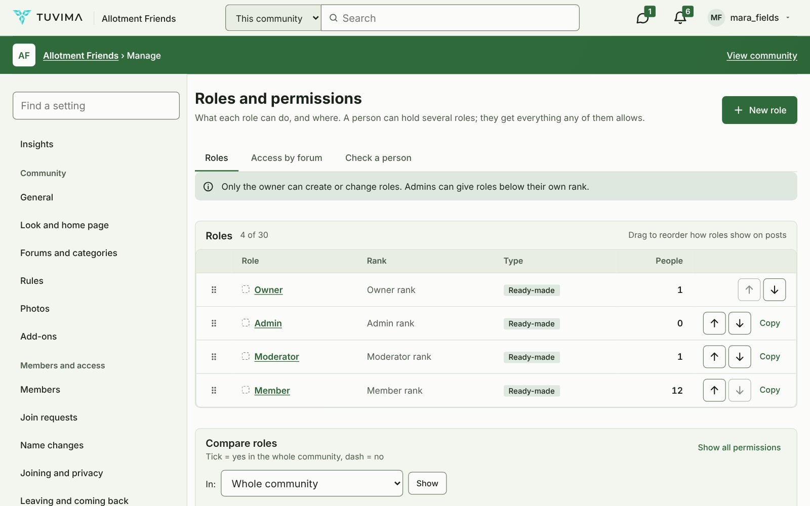
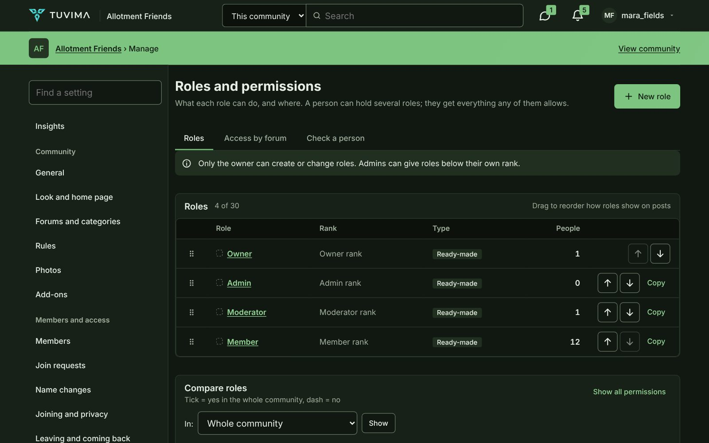
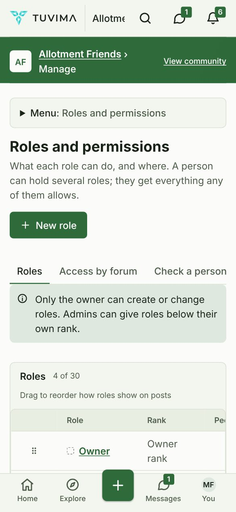
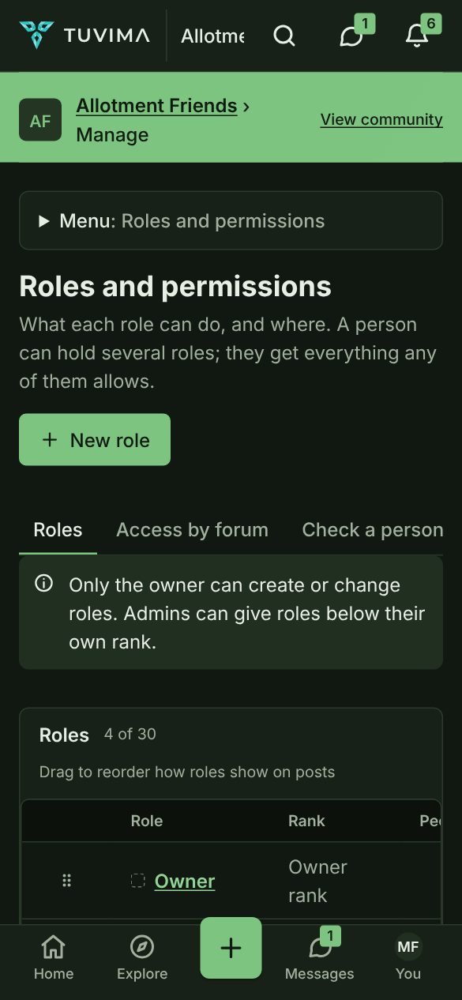

A **role** says what someone can do in your community, and can also open [members-only areas](area-access.md) to the people who hold it. A person can hold several roles. Every role lives in one list: **Manage**, then **Roles and permissions**. A role sets what its holders can do across the whole community. To change that for one category, forum or chat channel, see [set permissions for a place](place-permissions.md).

<figure class="tv-screens">

<figcaption>On a computer and on a phone; select a picture to see it full size. Everyone shown is a made-up sample person.</figcaption>
</figure>

Only the owner changes roles. Moderators and up can see what each role allows.

The list is grouped into **Staff**, **Members** and **Paths** (roles members pick for themselves). Each role also has a **What holders get** tab that decides which places holders find in their menu. See [path roles and what holders get](path-roles.md).

## The ready-made roles

Every community starts with four. Each can do everything the one below can.

| Role | Allows, to begin with |
| --- | --- |
| **Owner** | Everything, always. |
| **Admin** | Everything a moderator can, plus changing rules and settings, managing categories and forums, giving roles, making invites, managing newcomers and seeing [Numbers](run-your-community.md#numbers) (the **See the numbers** permission). |
| **Moderator** | Hiding and removing posts, pinning and looking after threads, marking accepted answers, suspending and banning, reviewing reports and requests to join, and seeing the members list and the moderation record. |
| **Member** | Everyday actions: starting threads, replying, chatting, reacting and voting, photos, links, polls and looking for group, plus reporting. Everyone who joins holds it. |

You can rename any of them to suit your community, for example Admin to "Guild Master". You can also change what Admin and Moderator allow: choose a role in the list to open it, switch permissions on or off, and choose **Save**. The button says how many changes you are saving. Choose **Show every permission** to see the full list beside the short one most owners need.

A role's page groups its permissions: **Everyday** (what ordinary members do), then the staff groups **Conversations**, **Chat**, **Members** and **Running the community**. See [the permissions](place-permissions.md#the-permissions) for the full list.

## Approve and change member names

**Approve and change member names** lets a role decide [name requests](name-changes.md#name-requests) from members with a private persona and [change a name now](name-changes.md#change-a-name-now). Admins have it to begin with. Moderators do not, unless you switch it on. It also adds a **Name changes** page under **Manage**.

Hiding a name as offensive needs **Suspend and ban** as well, because it comes with a mute, suspension, ban or warning.

## Let a role give achievements

The owner and admins can give [achievements](achievements.md) by hand. To let another role do it, open that role and switch on **Give achievements**. People with it can give and take back achievements given by hand, and see the hand-given log. They can't change the achievements themselves.

## Colour and a tag on posts

Each role can have a **colour** from a short list. The colour shows as a small square beside the role's name in the roles list, the access grid and on member pages. The name always stands beside it, so nobody has to rely on the colour alone.

Switch on **Show on posts** to put a small tag with the role's name next to its holders' names on their posts, for example "Mentor". The role editor shows a preview. When someone holds several roles that show on posts, the tag comes from the one highest in the roles list, so move roles up or down to choose which tag wins.

## Compare roles

Under the roles list, **Compare roles** shows what up to six roles allow side by side, grouped into everyday, moderation, members and running the community. A box says **Yes**, **No** or "not for newcomers". Choose **Choose roles to compare** to pick which roles to show, and **Show all permissions** for the full list. The **In:** picker chooses a place, such as a forum or a #channel. Choose **Show** to see what each role can do there, after that place's own [permissions](place-permissions.md).

## Everyday permissions

Posting photos, making polls, using looking for group and adding links are **Everyday** permissions, beside starting threads, replying, chatting and reacting. Switch one off for a role and people who hold only that role can't use it. When someone holds several roles, the most generous one wins, unless a place says Deny: see [how the choices add up](place-permissions.md#how-the-choices-add-up). The owner is never limited.

Some rights belong to the owner alone and cannot be given to any role: making the community public or private, handing it over, and deleting it. Choosing whether it is listed, showing edit history and setting levels by hand also stay with the owner.

## Make your own role

1. Choose **New role**.
2. Start from a copy of the role closest to what you want, for example Moderator, or start blank at the Admin, Moderator or Member rank. A blank role starts with nothing switched on.
3. Give it a **Name**, such as "Dungeon Master", and an optional description.
4. Open it in the list to pick what it allows, its colour and whether it shows on posts.

A copy keeps its source's place: a copy of Moderator acts like a moderator when it comes to who can act on whom. No role can act on its equals, on higher roles or on the owner.

A copy of **Member** has no staff permissions. Use one to open private areas to the people who hold it, such as "Supporters".

A community can have up to 30 roles. Custom roles can be deleted; the ready-made ones cannot.

## Moderate one forum only

To let someone look after one forum, make a copy of Moderator with nothing switched on, then choose **Allow** on that forum's Permissions tab. They moderate there and nowhere else. See [a moderator for one forum only](place-permissions.md#a-moderator-for-one-forum-only).

## Give someone a role

1. Open **Members** and choose the member, or tick several people and use **Give role** (see [look after members](members.md)).
2. Under **Roles**, tick the roles to give and untick those to take away.
3. Choose **Save roles**.

The person is told "You were given the … role". Admins, and anyone else whose role allows **Give roles**, can give only roles below their own, carrying only permissions they hold themselves. A role based on Member can never hold a staff permission, so it can't be used to give one. Nobody can change their own roles.

## Every change is recorded

Making, renaming, changing (including its colour and tag), deleting, giving and taking a role are all kept in the **moderation record**, with who did it.

## Next steps

- [Set permissions for a category, forum or chat channel](place-permissions.md)
- [Choose who can see and post in each area](area-access.md)
- [Run your community](run-your-community.md)
