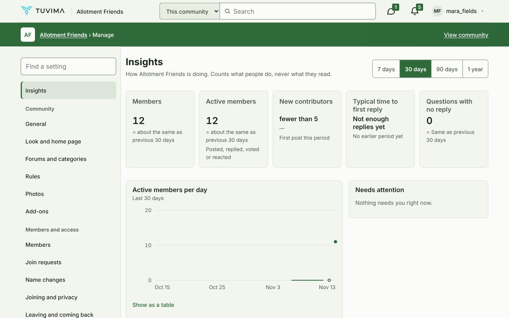
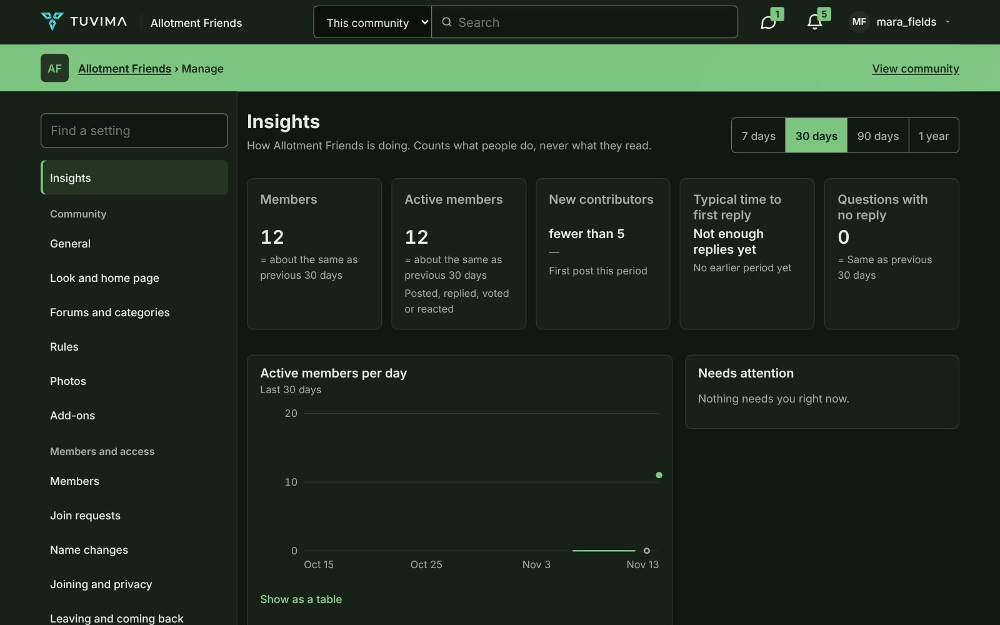
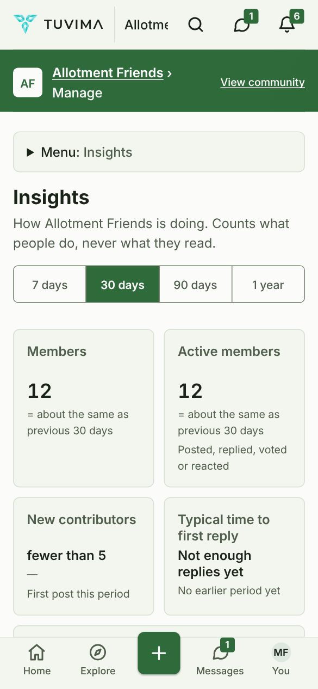
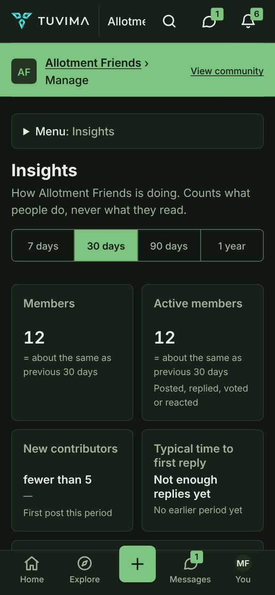

As owner, your community's rules, moderation and look are yours to decide, inside [the rules everyone follows](../guides/community-rules.md).

<figure class="tv-screens">

<figcaption>On a computer and on a phone; select a picture to see it full size. Everyone shown is a made-up sample person.</figcaption>
</figure>

## Roles

Every community comes with four ready-made roles: **Owner**, **Admin**, **Moderator** and **Member**. Each can do everything the one below can, and a role can act only on people below it.

| Role | Can, to begin with |
| --- | --- |
| **Member** | Post, reply, react, report, and edit or delete their own posts. |
| **Moderator** | Hide, remove and restore posts, pin conversations, use thread tools, suspend and ban members, review reports and requests to join, read the moderation record and see the members page. |
| **Admin** | Change settings, categories, forums and labels, give roles, make invites, manage newcomers and see [Numbers](#numbers). |
| **Owner** | Everything, including making the community public or private, choosing whether it is listed, showing or hiding edit history and using the launch checklist. |

You can rename the ready-made roles, change what Admin and Moderator allow, and make your own roles as copies, such as a helper for one forum. See [roles: ready-made and your own](roles.md). Give moderation only to people you trust. Every role change is recorded and can be undone. Handing over ownership is planned.

## Everything in one place

Choose **Manage** on your community's page to open its [admin area](admin-area.md): every setting and moderation tool, grouped into Overview, Community, People and Safety, with a **Find a setting** box.

## Members

The **Members** page is a table of everyone who has joined. Search it, filter by role, newcomers, suspended or banned, tick several people to give a role or warn them, or choose **Details** for a side panel with their warnings and private moderator notes. See [look after members](members.md). **Invites** is where you [make invites](invites.md). Open a member's page to give or take roles, make a newcomer a full member, or take a moderation step. The owner can also set a member's level by hand from there (see below).

## Levels

Members climb a ladder of levels as others value what they write: Newcomer, Member, Regular and Trusted to begin with. On **Manage > Levels and recognition > Levels** you can rename the levels, set what each one needs, choose whether the top level needs keeping up, turn the **Sparked a conversation** and **Top contributor** achievements on or off, and hide Reputation numbers so only levels show. Raising a number never moves anyone down.

As the owner you can also set a member's level by hand from their page in **Members**. It stays until you choose **Return to automatic**. The member is told their new level but not who changed it, and the change is kept in the moderation record. [Reputation and levels](../guides/reputation.md) explains the whole system.

## Achievements

Every community starts with a ready-made set of [achievements](achievements.md). On **Manage > Levels and recognition > Achievements** you can switch them off, change them, build your own with a rule builder and an emblem builder, give some by hand, import packs, and retire what you no longer want.

## Reports and the moderation record

Reported posts and messages, held posts and requests to join all wait in one **Approval queue** (**Manage > Safety > Approval queue**), where moderators decide on them one at a time. Every action is added to the **moderation record** (**Manage > Safety > Moderation history > Log**), which cannot be edited, and the queue's **Reports already dealt with** link shows past reports. Removed posts can be restored for 30 days. See [the approval queue](warnings-and-filters.md#the-approval-queue).

## Pins and thread tools

Moderators can pin, feature, lock, slow, move, merge and split conversations. See [pins and thread tools](moderator-tools.md).

## Add-ons

Polls, Looking for group and post templates are add-ons. See [add-ons](add-ons.md). Your welcome for new members lives on the [Trailhead](trailhead.md).

## Rules

Under **Manage > Community > Rules** you edit your community's rules in a working copy. Members do not see changes until you publish.

1. Edit the working copy. Add, change or remove rules. Each rule keeps its number.
   Each rule can have an optional **one-line explanation** under it, such as "Trading for fun is fine in Trading". New members read the rules, with these lines, as the last step of joining.
2. Choose to publish and add a note saying what changed. Members see the note.
3. If the change matters enough that members should agree again, mark it **important**. Only the owner can. After an important change, members can still read, but must agree before they post, reply, react or vote again.

Every member gets a notice when you publish. They can see what changed and earlier versions. You can also write **Forum guidelines** for a forum; they show above the editor. Moderators can name the broken rule when they act on a post. See [the rules everyone follows](../guides/community-rules.md#your-communitys-own-rules).

## Numbers

**Manage**, then **Overview**, then the **Numbers** tab, shows how your community is doing. It used to be called **Insights**. You see it if your role has the **See the numbers** permission, which the owner and admins have to begin with. Numbers counts what people do, never what they read, from Tuvima's own records and with no tracking scripts. It never shows page views, reading time or who looked at what.

### Choose a period

Use the switch at the top to choose **7 days**, **30 days**, **90 days** or **1 year**. Each number is compared with the period before, for example "+312 vs previous 30 days".

Numbers is counted once a night, just after midnight UTC, so today's activity shows up tomorrow. The bottom of the page says when it was last counted. A new community sees "Your first Numbers arrive after tonight's count" until then.

### The five tiles

| Tile | What it counts |
| --- | --- |
| **Members** | Everyone who has joined. |
| **Active members** | People who posted, replied, voted or reacted in the period. Its change is shown as a percent. |
| **New contributors** | People who made their first post in the period. |
| **Typical time to first reply** | How long a new conversation usually waits for its first reply, such as "38 min". Shows "Not enough replies yet" when there are too few to say. |
| **Questions with no reply** | Questions that are still waiting for an answer. |

Under each tile is its change since the previous period, with an arrow and words, or "No earlier period yet" for a new community.

### The rest of the page

- **Active members per day**: a chart for the period. For a year, each point is a week's daily average.
- **Needs attention**: what is waiting right now, each a link to deal with it. For example "3 questions from the last year in Help have no reply after 24 hours", posts waiting for approval, people waiting to join and reports waiting for review. This list is live, not counted overnight.
- **Forums**: a table of each forum's new threads, replies, conversations with no reply yet and typical time to first reply.
- **Members by level**: how many members are at each [level](../guides/reputation.md), as of last night.

### Small numbers are hidden

So nobody can be singled out, any count of people from 1 to 4 shows as **fewer than 5**. This is the same for everyone, including the owner. Zero shows as 0. Things anyone can already see, such as the number of threads and replies in a forum, stay exact.

- When hiding one number would let someone work it out by subtracting from a total, another number is hidden too and shows as **—** (hidden to protect small numbers). For example, in **Members by level**.
- Changes in counts of people (members, active members and new contributors) are rounded to the nearest 5 and say "about", such as **about +5** or **about −10**. Active members show the change as a percent of the rounded amount, except a change of about 5, which shows as the amount (**about +5**). **About the same** means the change was under 3. This way, switching between periods can't reveal a small group. Changes in things anyone can see, such as threads, replies and unanswered questions, and in time to first reply, stay exact. If either period is too small to compare, the change shows as **—**.

### Areas a moderator can't open

A moderator who can't open some areas sees the totals for the whole community, with the note "Totals include areas you can't open."

## Settings

The [admin area](admin-area.md) lists every settings page. You see the ones your roles allow.

- **Profile and look** (**Community**): the **Profile** tab holds the name, description and **Category on Tuvima** (which front-page category your community belongs to). The other tabs are **Address**, **Look**, **Home page** and **Menu**. See [change your community's look](look-and-feel.md) and [your community's address](community-address.md). **Menu** sets which extra pages members see under **Pages** in the community's menu (**Photos**, **Achievements** and **Rules**), and whether **Pages** starts folded. Hiding a page only takes it out of the menu: **Rules** can always be reached from **About and rules** in the community's own menu. Trailhead and Lamplighters show by themselves when you have them.
- **Forums and channels** (**Community**): how conversations are grouped, forum types, who can see and post in each, and their labels on Tuvima, on the **All places** and **Label history** tabs. See [categories, forums and the front page](categories-and-forums.md) and [choose who can see and post in each area](area-access.md).
- **Rules** (**Community**): **Community rules** and **Forum guidelines**.
- **Features** (**Community**): **Photos and albums**, **Polls**, **Looking for group** and **Add-ons**. See [add-ons](add-ons.md).
- **Joining and leaving** (**People**): **Privacy** (**Public** or **Private**, **Listed** or **Unlisted**), **How people join** and **Leaving and coming back**. The questions people answer when they ask to join are on **Onboarding**, on the **Member choices** tab. See [make your community private](make-it-private.md), [how people join](how-people-join.md) and [questions for new members](onboarding-questions.md).
- **Newcomers** (**People**): the limits for people who joined recently, what they can use, and **Waiting for a welcome**. See [warnings, word filters and the approval queue](warnings-and-filters.md#newcomers).
- **Roles and permissions** (**People**): see [roles: ready-made and your own](roles.md) and [set permissions for a place](place-permissions.md).
- **Moderation rules** (**Safety**): **Warnings**, **Word filters**, **Photo checks**, **Member moderation** and **Notices**. **Notices** holds the edit history and the "Hidden by moderators" notes that readers see. **Photo checks** is where adult and violent photos are handled. See [warnings, word filters and the approval queue](warnings-and-filters.md).
