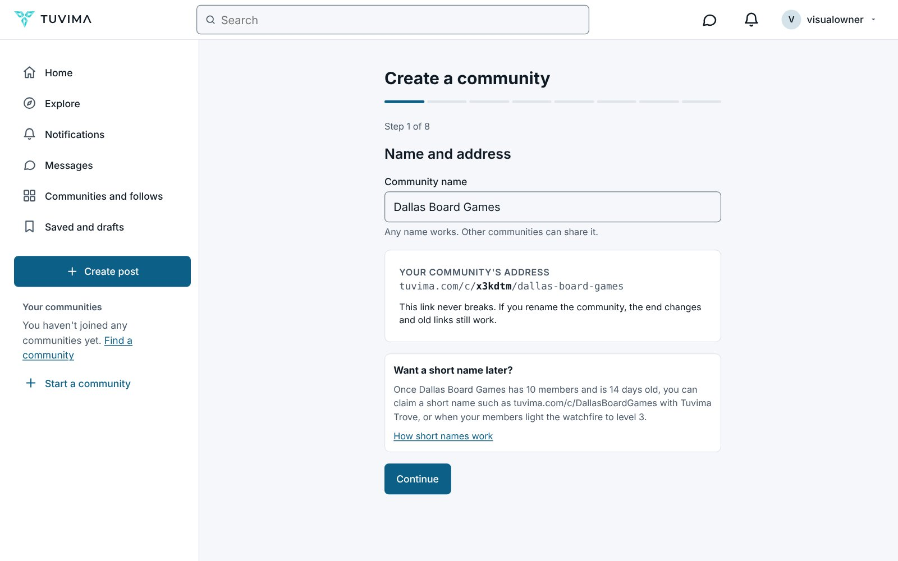
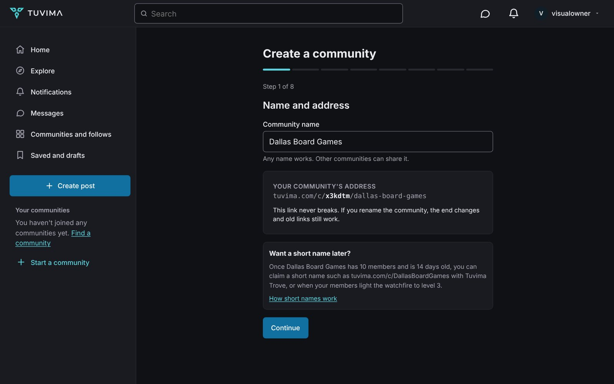
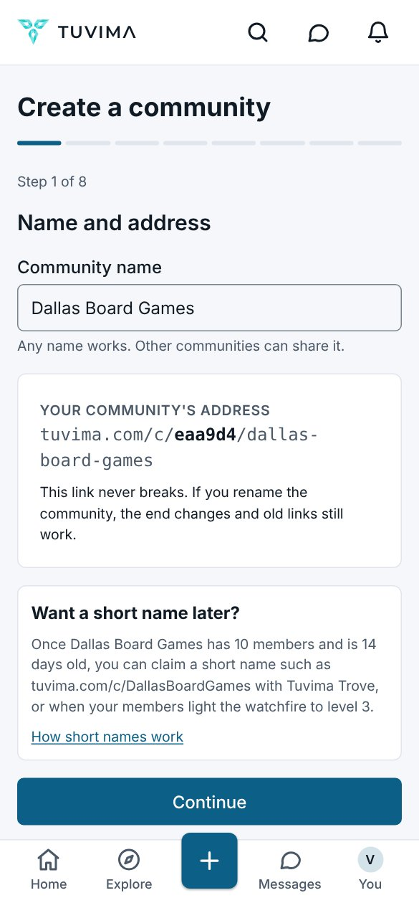
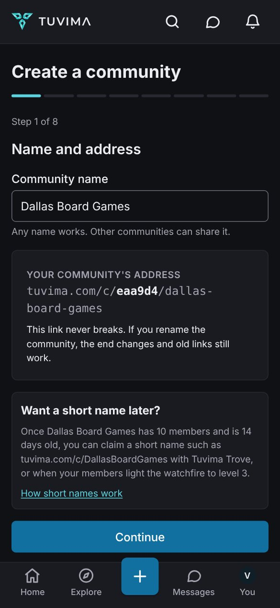

Starting a community is free, and Tuvima looks after the hosting. It takes about ten minutes. You become the community's **owner**.

<figure class="tv-screens">

<figcaption>On a computer and on a phone; select a picture to see it full size. Everyone shown is a made-up sample person.</figcaption>
</figure>

## Before you start

- Sign in and [choose your handle](../start/getting-started.md).
- Think about who the community is for. The best communities are specific, for example "Board game players in Dallas" rather than "Games". Broad subjects like news belong on the [front page](../guides/front-page.md).
- Have your rules in mind. Members agree to them when they join.

## Create it

Choose **Start a community** on the front page. The **Create a community** steps are:

1. **Name.** 3 to 80 characters. Other communities can have the same name. As you type, you see the community's [permanent address](community-address.md), for example `tuvima.com/c/k7f3q2/dragon-masters`: a code that never changes, then words from the name.
2. **Public or private.** **Public** means anyone can read and signed-in people can join. **Private** means only members can read; people join by asking or with an invite. See [make your community private](make-it-private.md).
3. **Description.** Up to 1,000 characters on what the community is about, and **where it shows on Tuvima**: a front-page category and subtopic. Tuvima suggests one from the name and description, for example Gaming › Tabletop for "D&D Gamers in Dallas". Your community's conversations carry this place as their labels.
4. **Rules.** Write your community's rules. They sit on top of [the rules everyone follows](../guides/community-rules.md).
5. **Forums.** The places conversations live, such as "Events" or "Help". You can give a forum an automatic content warning, such as "Spoilers". Later you can group forums under categories; see [categories, forums and the front page](categories-and-forums.md).
6. **Newcomer limits.** Off unless you switch on **Limit newcomers**. See below.
7. **Welcome new members.** Optional: pick a [template](onboarding-templates.md) (gaming group, product support, creator fan club or local club) to fill in your join questions, a welcome and first Waymarks, or leave it on **Not now**.
8. **Review.** Check everything, then choose **Create community**.

## Should you limit newcomers?

Newcomer limits slow down new members for their first few posts, which keeps spam out of a growing community. When you turn them on, the starting values are 5 posts and 2 new conversations an hour, and 10 posts to become a full member. Members also need a **sign of value from regulars**, which you can switch off. [Being new to a community](../guides/newcomers.md) explains how it feels to members. You can change all of this later in settings.

## Check the result

Your new community opens with a **launch checklist**: add your rules, write a first post, invite people and connect a website. The steps tick off by themselves as you do them. Connecting a website is coming later.

New communities are listed in the directory. To keep yours out of the directory and search, make it **Unlisted** in settings. To choose who can join and how, see [how people join](how-people-join.md).

## Next steps

- [Run your community](run-your-community.md)
- [Change your community's look](look-and-feel.md)
