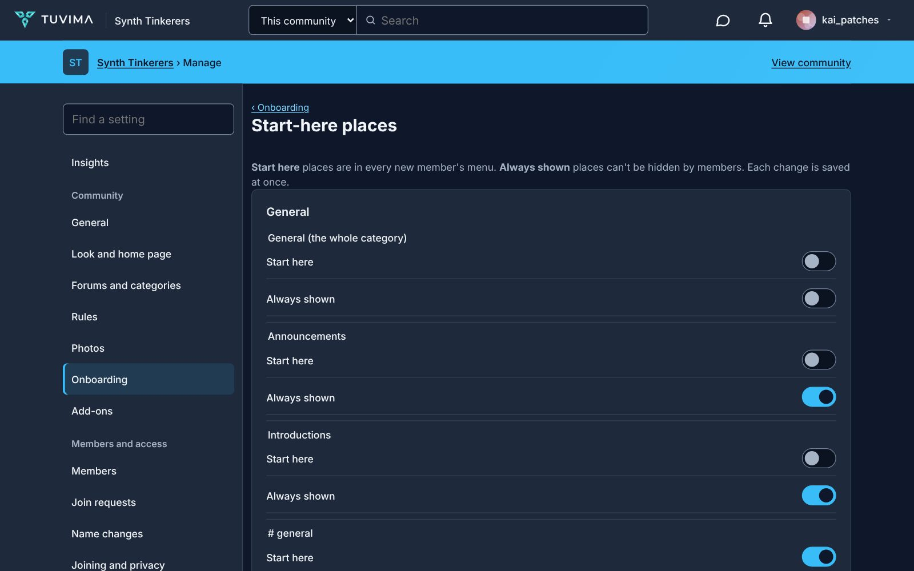
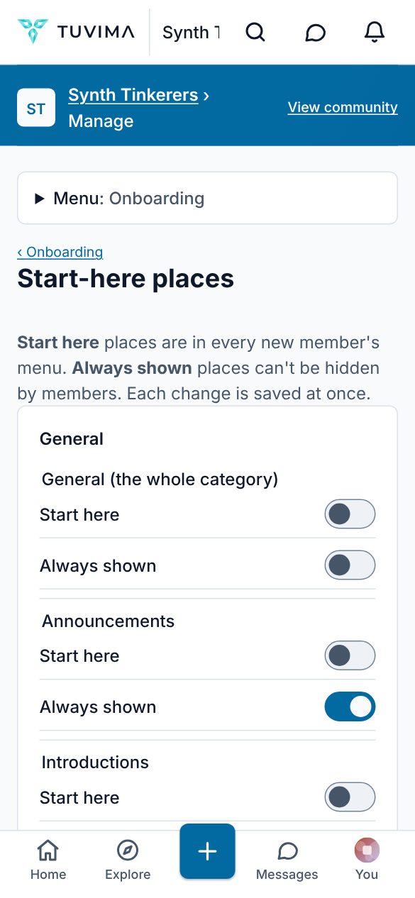
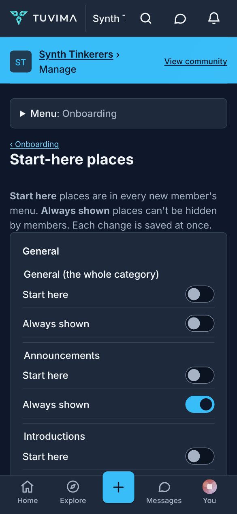

Open **Manage › People › Onboarding** and choose **Edit** on **Start-here places**. The page lists every category, forum and chat channel, grouped by category, with two switches each.

<figure class="tv-screens">

<figcaption>On a computer and on a phone; select a picture to see it full size. Everyone shown is a made-up sample person.</figcaption>
</figure>

- **Start here**: the place is in every new member's menu, whatever they picked. Choose a few welcoming places, such as an introductions forum and a general chat channel. Up to 10.
- **Always shown**: members can't hide the place or take it off their menu. Use it sparingly, for places such as Announcements. Up to 10.

Each switch saves as soon as you change it.

A start-here place that new members can't open (for example a members-only forum) shows as a warning on the Onboarding page, because newcomers would never see it.

You can also find both switches in the settings of each category, forum and channel.

## Next steps

- [Set up onboarding](onboarding.md)
- [Path roles and what holders get](path-roles.md)
