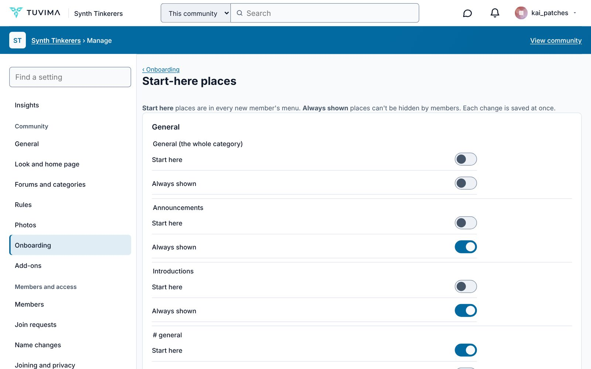

You decide how every place starts in members' menus. Open **Manage**, then **Onboarding**, on the **Member choices** tab, and go to **How each place starts**. It lists every category, forum and chat channel, grouped by category.

## The four choices

| Choice | What it means |
| --- | --- |
| **Normal** | The place isn't in new members' menus to begin with. They find it on **Pick what you see**, unless a role or level adds it to their menu. |
| **Start here** | The place is in every new member's menu, whatever they picked. They can take it off. Choose a few welcoming places, such as an introductions forum and a general chat channel. |
| **Always shown** | The place is in every menu, and members can't hide it. Use it sparingly, for places such as Announcements. |
| **Opt-in** | Only members who pick it see it. Forums and chat channels only. See [Opt-in places](#opt-in-places). |

You can have up to 10 start-here places and up to 10 always-shown places.

## Save a place

Choosing a start doesn't save it. Each place has its own **Save** button, which appears when you change it, and **Cancel** to put it back. When the change turns Opt-in on or off, a line beside the button says who will see the place afterwards.

The **Start here** tab under **Onboarding**, and the settings of each category, forum and channel, also have **Start here** and **Always shown** switches. Those save as soon as you change them.

<figure class="tv-screens">

<figcaption>The Start here tab, on a computer and on a phone; select a picture to see it full size. Everyone shown is a made-up sample person.</figcaption>
</figure>

A start-here place that new members can't open (for example a members-only forum) shows as a warning on the Onboarding **Overview**, because newcomers would never see it.

## Opt-in places

An **Opt-in** forum or chat channel stays out of everyone's menu. Members who want it choose **Add** beside it on [Pick what you see](../guides/paths-and-places.md), and only they can open it. A member's home says how many Opt-in places they haven't added, with a link to Pick what you see. For example, a cycling club can make a "Meetups" forum Opt-in, so only members who plan to ride together see it.

You can make a place Opt-in in two ways:

- choose **Opt-in** under **How each place starts** on **Member choices**, or
- on the place's **Access** tab, under **Who can see and post here**, choose **Only members who pick it** (see [who can see and post](area-access.md)).

Making a place Opt-in creates a role members can pick, named after the place, or reuses the one it had before. The role shows under **Roles members can pick**, marked **Made by an Opt-in place**.

Turning Opt-in off keeps the role, and the place becomes visible to all members.

### Who can change Opt-in

Turning Opt-in on or off needs **Manage onboarding** and the right to change who can see the place: **Manage categories and forums** for a forum, or the permission to manage chat channels for a channel. Without it, you see the choice but can't change it.

### A role that lets members in

While a place is Opt-in, the role made for it can't be deleted or made unpickable, because it's how members get in. Tuvima says **Turn Opt-in off for that place first**. Turn Opt-in off, then change the role.

## Next steps

- [Questions when people join](onboarding-questions.md)
- [Path roles and what holders get](path-roles.md)
- [Set up onboarding](onboarding.md)
