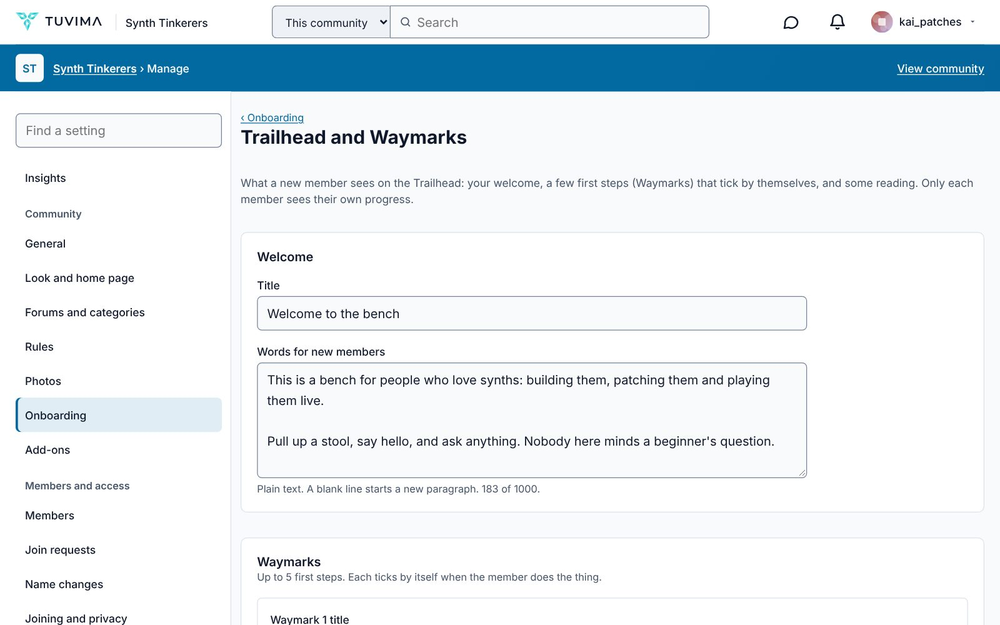
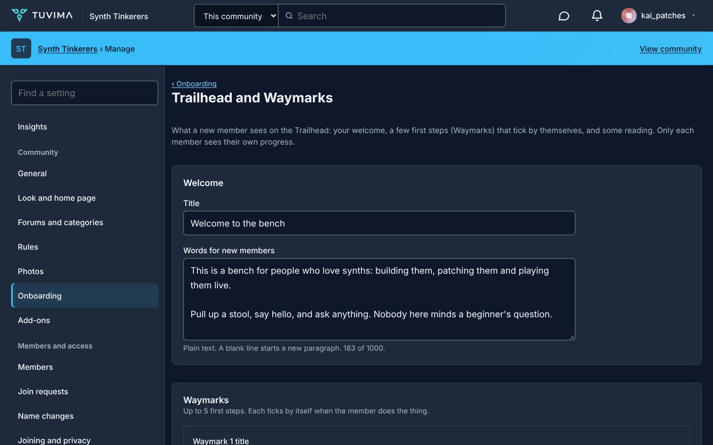
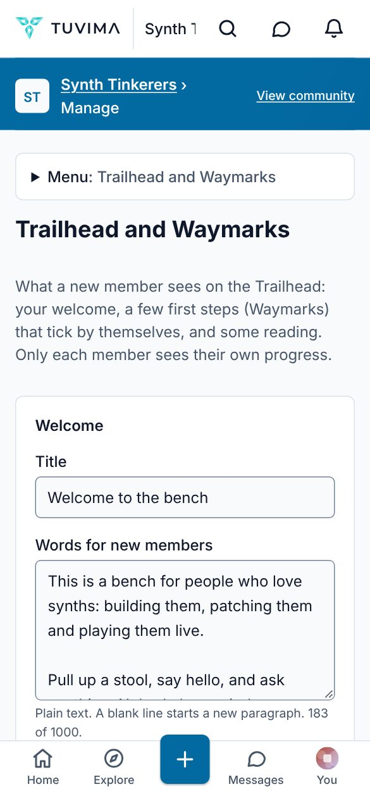
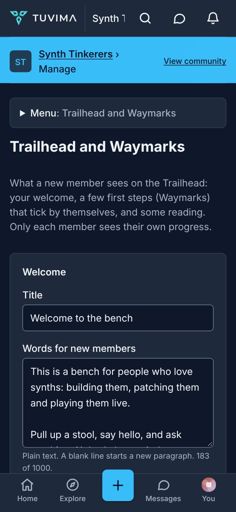
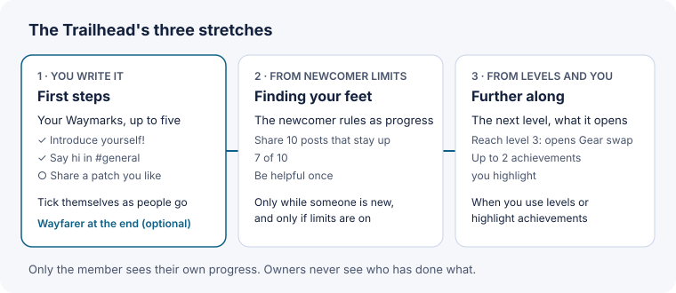

The **Trailhead** is your community's welcome page. New members land there after joining, and it stays one tap away in the community menu. You set it up on one page: open **Manage › People › Onboarding** and choose **Edit** on **Trailhead and Waymarks**. See [Set up onboarding](onboarding.md) for the whole picture. You need the **Manage onboarding** permission, which the Owner and Admin roles have.

<figure class="tv-screens">

<figcaption>On a computer and on a phone; select a picture to see it full size. Everyone shown is a made-up sample person.</figcaption>
</figure>

## Welcome

Write a short **title** and the **words for new members**: who you are, where to start and what you're proud of. Two short paragraphs is plenty. If you leave it empty, the Trailhead shows your community's description instead. The title can be up to 80 characters and the welcome up to 1,000. Choose **Save** at the bottom when you're done.

## Waymarks

Waymarks are up to five first steps, in your own words. Each one has:

- **A title.** Make it something a person does: "Introduce yourself!", "Share a patch you like". Up to 60 characters.
- **What ticks it.** Pick one:
  - **Post or reply there**: in a forum you choose.
  - **React to a post there**: in a forum you choose.
  - **Open a chat channel**: a channel you choose.
  - **Read a pinned conversation**: one of your pinned conversations.
  - **Read the rules**: opening the Rules page.
  - **Set a profile picture**.
- **Only for holders of** (optional). Pick a role to show the Waymark only to its holders, for example a "Sign up for jam night" step for the Jam crew [path role](path-roles.md). Leave it on **Everyone** for most steps.
- **Use for Introduce yourself** (only with **Post or reply there**). This Waymark opens a draft introduction written from the member's paths. One per community.

Waymarks tick themselves; members never tick them by hand. A member who can't open a Waymark's place (for example a members-only forum) doesn't see that Waymark. "Waymarks 2 of 4" shows at the top of each member's menu until they've done all theirs.

If you change what ticks a Waymark, or where, everyone starts that Waymark again. Changing only the title keeps everyone's ticks.

### Writing good Waymarks

- Three or four is usually right. Five is the most.
- Start with something easy and friendly ("Say hi in #general"), then one that shows off your best place.
- Point at places that are busy, so a newcomer's first post gets an answer.
- Keep "Read the rules" for communities where the rules really matter. Members already agreed to them when they joined.

## Lore

Lore is up to six things worth reading first:

- **Conversation**: one of your pinned conversations, such as "Start here".
- **Rules**: your community's rules.
- **Page I write**: a short page you write right here, such as "How jam night works" (up to 4,000 characters).

## Wayfarer

Tick **Give an achievement called Wayfarer to members who finish every Waymark they can see** to give members an achievement when they finish their Waymarks. It appears with your other [achievements](achievements.md). Switching it off later keeps it for everyone who already earned it.

## Introduce yourself

When **Introduce yourself** is on, the intro Waymark opens a new conversation with a draft: your **opening line** (or "Hi all, I'm {name}.") followed by the paths the member chose. Members can change or clear it, and nothing is posted until they choose to. Switch it off for a plain empty form.

To use it, first tick **Use for Introduce yourself** on one Waymark, then tick **Start a member's introduction from the paths they chose**. The opening line can be up to 200 characters; {name} becomes the member's name.

## Highlighted achievements

Pick up to two achievements to suggest under **Further along** on every member's Trailhead, with their progress. Only achievements that are switched on can be picked.

## What members see

- **First steps**: your Waymarks, with ticks.
- **Finding your feet**: shown to newcomers when you use [newcomer limits](../guides/newcomers.md). It turns the limits into progress, so nobody is surprised by them.
- **Further along**: shown when you use levels or highlight achievements: the member's next level, what it opens, and your suggested achievements.

Only the member sees their own progress. You don't see who has done what.

## The welcome message add-on

The Trailhead replaces the old **Welcome message** add-on. The small card on your community home now shows the Trailhead's welcome and the member's Waymarks progress, and a **Trailhead** block in your home layout (under **Look and home page**) shows the same card.

## Next steps

- [Try it as a new member](try-onboarding.md)
- [Path roles and what holders get](path-roles.md)
- [Achievements](achievements.md)
- [The Trailhead and Waymarks, for members](../guides/trailhead-and-waymarks.md)
