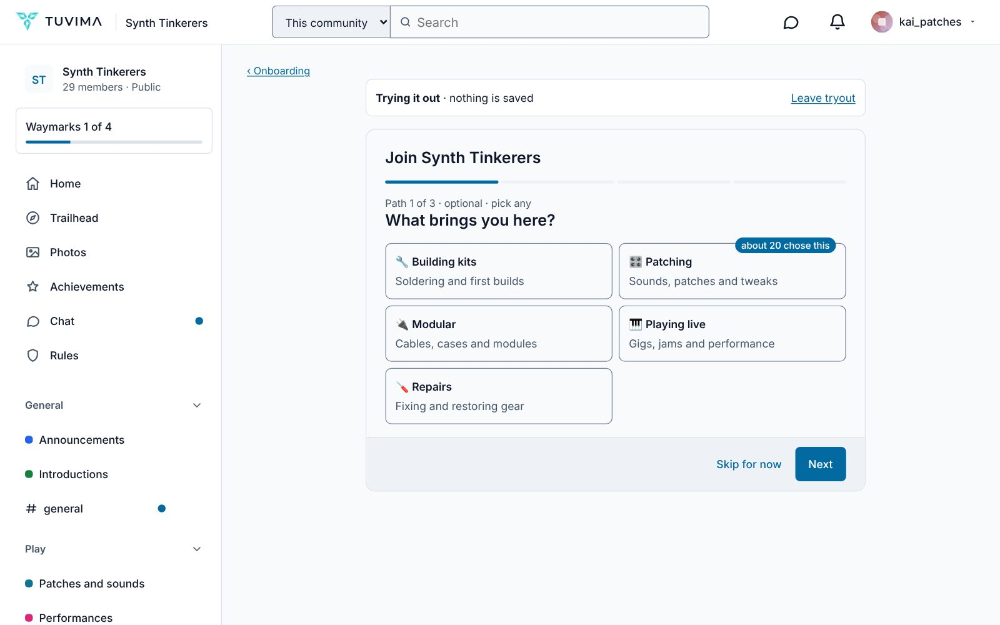
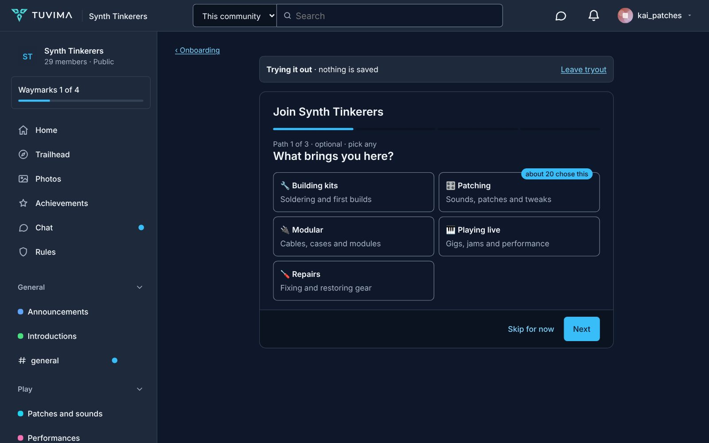
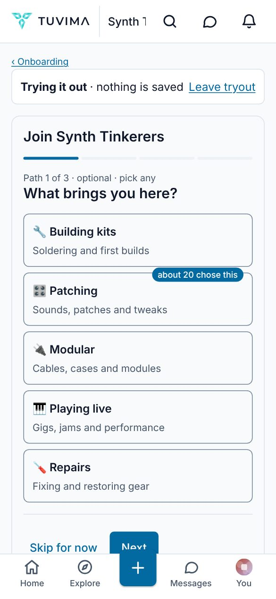
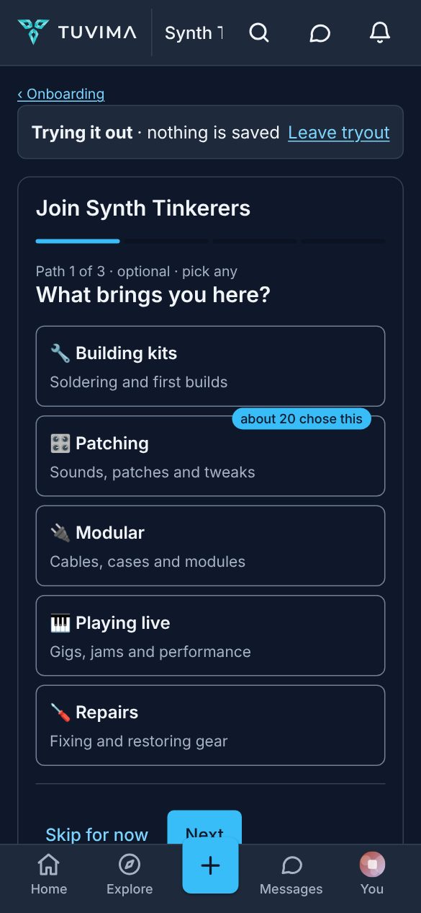

On **Manage › People › Onboarding**, choose **Try it as a new member** to go through your joining steps yourself: your questions, then your rules. A bar at the top says **Trying it out · nothing is saved**.

<figure class="tv-screens">

<figcaption>On a computer and on a phone; select a picture to see it full size. Everyone shown is a made-up sample person.</figcaption>
</figure>

- Pick answers to see the **You'll get** line: the roles and places each pick gives a new member.
- The last step is your rules, with **Finish tryout** where a newcomer would see **Join**. Nothing is sent: you don't join again and your picks aren't kept.
- Choose **Leave tryout** at any time to go back.

In a community where people ask to join, newcomers answer the questions once they are let in. The tryout shows them anyway, with a note saying so.

The owner can also choose **See the Trailhead as a new member**, which shows your Trailhead as a plain member sees it (this uses [View as a role](place-permissions.md#view-as-a-role-and-the-post-check)).

## Next steps

- [Set up onboarding](onboarding.md)
- [Set up the Trailhead and Waymarks](trailhead.md)
