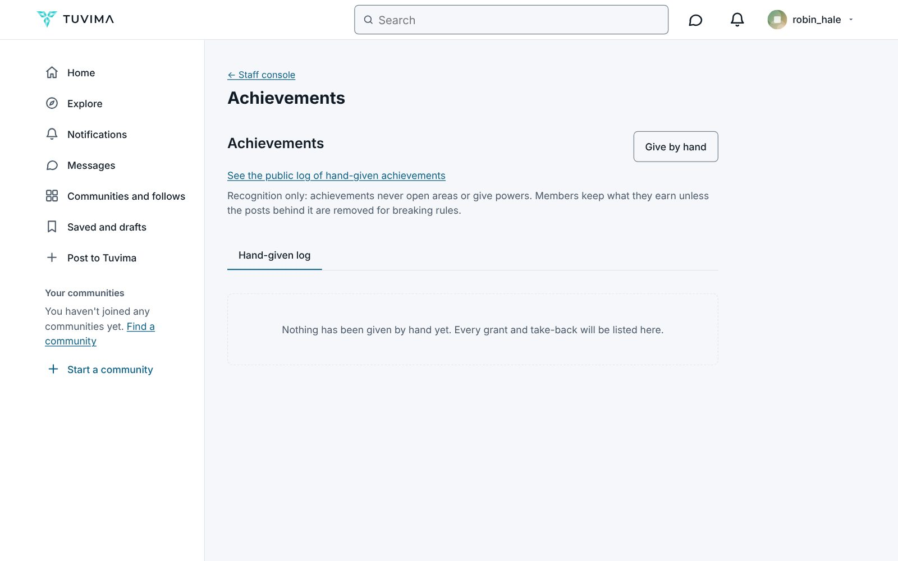
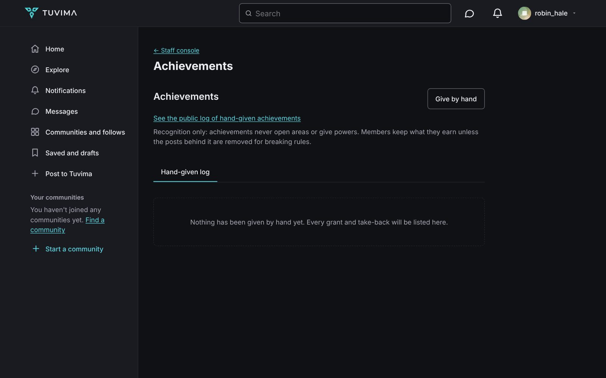
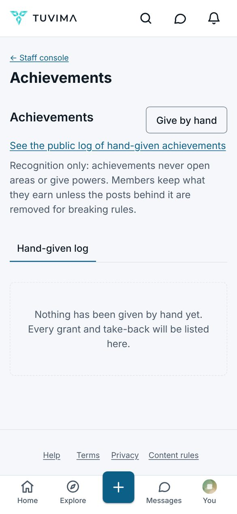
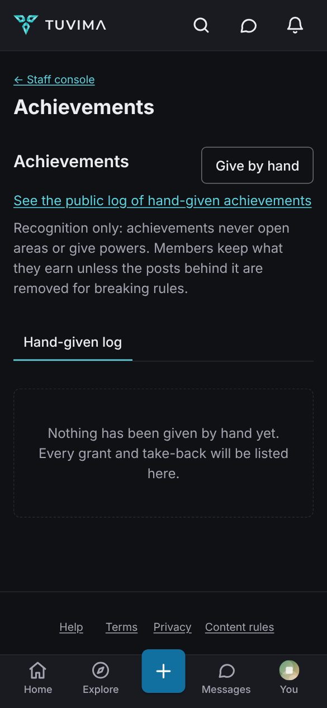

An achievement pack is a JSON file of ready-made achievements that a community imports in one step. Owners and admins import packs from **Manage**, **Achievements**, **Packs**, and can export their own achievements in the same format to share. See [Run achievements in your community](../owners/achievements.md#packs).

<figure class="tv-screens">




<figcaption>On a computer and on a phone; select a picture to see it full size. Everyone shown is a made-up sample person.</figcaption>
</figure>

## An example

```json
{
  "format": "tuvima-achievements/1",
  "name": "Book club starter pack",
  "achievements": [
    {
      "key": "bookworm",
      "name": "Bookworm",
      "description": "Started {step} conversations in {place}.",
      "kind": "count",
      "measure": "conversations_started",
      "steps": [5, 25, 100],
      "place": "each_forum",
      "secret": false,
      "emblem": { "shape": "hex", "symbol": "book", "colour1": "#fde68a", "colour2": "#b45309", "show_number": true, "shine": "rare" }
    }
  ]
}
```

## Fields

| Field | Needed | What it is |
| --- | --- | --- |
| `format` | Yes | Always `tuvima-achievements/1`. |
| `name` | No | The pack's name, shown on the achievements it adds. |
| `achievements` | Yes | Up to 100 items. |
| `key` | Yes | 1 to 60 lower-case letters, digits and underscores, unique in the community. It can't start with `supporter_`, which is kept for member tiers. |
| `name` | Yes | Up to 80 characters. May contain `{place}` and `{step}`. |
| `description` | No | Up to 280 characters. May contain `{place}` and `{step}`. |
| `kind` | Yes | `count`, `first_time`, `limited_time`, `time_member` (steps are years), `hand` or `event`. |
| `measure` | For `count`, `first_time` and `limited_time` | A key from the list below. |
| `steps` | For `count`, `limited_time` and `time_member` | 1 to 10 different whole numbers, from 1 to 1,000,000. For `time_member`, from 1 to 50. |
| `place` | No | `whole` (the default), `each_forum`, `each_category` or `each_tag`. Chosen forums can't travel between communities, so they are not in packs. |
| `window` | For `limited_time` | `start` and `end`, as ISO 8601 times, for example `2027-07-01T00:00:00Z`. |
| `secret` | No | `true` keeps its name and description hidden until someone earns it. |
| `emblem` | No | `shape` (`circle`, `square`, `hex`, `octagon`, `diamond` or `shield`), `symbol` (one of Tuvima's 30 symbols), `colour1` and `colour2` (`#rrggbb`), `show_number` and `shine` (`rare`, `always` or `never`). |

## What can count

`posts_and_replies`, `conversations_started`, `accepted_answers`, `positive_reactions`, `insightful_from_different_members`, `days_active`, `welcomer_replies`, `photos_shared`, `polls_10_voters` (Polls add-on), `link_posts_sparked`, `made_front_page`, `joined` (whole community only) and `lfg_groups_filled` (Looking for group add-on).

## Limits and checks

- A pack is up to 200 KB and 100 achievements.
- Every item is checked the way the rule builder checks one. An item with an unknown field, an unknown measure, a key already in use, or anything else the builder would refuse, is skipped with a reason. The other items still import.
- Community goals, collections, standing achievements and "who can earn it" conditions are not in format 1.
- Imported achievements count past activity. Members who already qualify get them that night, quietly in the bell.
- A community can have up to 500 achievements switched on. An import that would pass that is refused as a whole.
- **Export as a pack** saves only what format 1 can carry: your achievements that are not retired and have no chosen forums or "who can earn it" condition.
