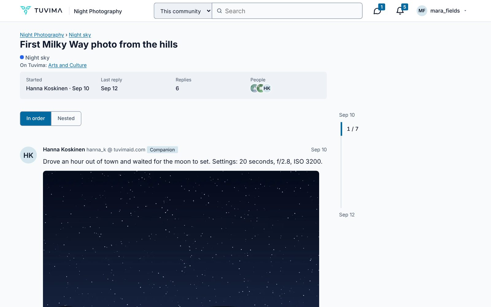
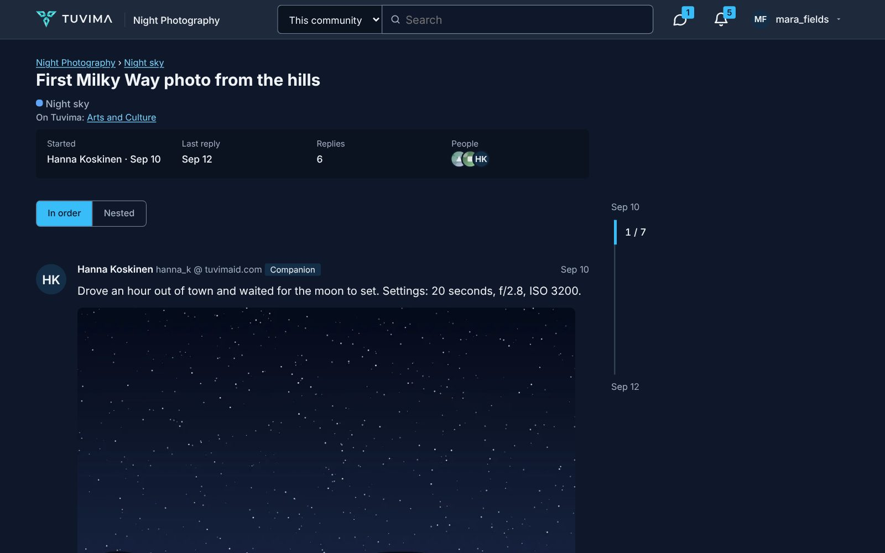
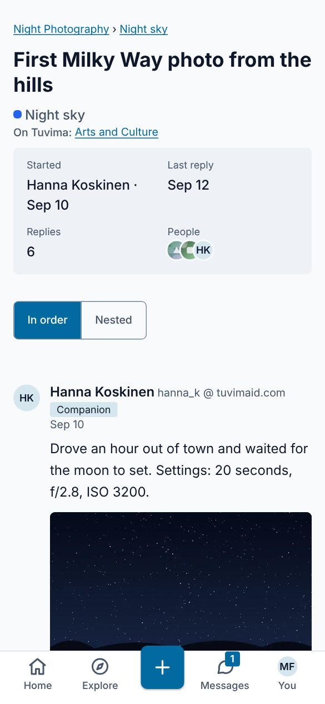
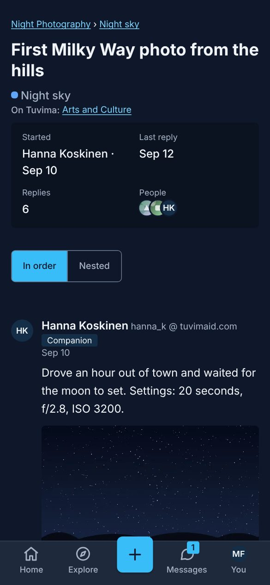

| Word | What it means |
| --- | --- |
| **Accepted answer** | The reply that the person who asked, or a moderator, marked as the most helpful. |
| **Achievement** | A mark of recognition a member earns, or is given by hand, such as a year as a member or ten accepted answers. It has an emblem, never gives access or powers, and has no score. |
| **Add-on** | A feature a community can switch on or off, such as Polls or Looking for group. |
| **Always shown** | A place the owner wants everyone to see, such as Announcements. Members can't hide it or take it off their menu. |
| **Castar** | Tuvima's currency, in four kinds: Silver, Gold, Ember and Onyx. Planned. See [Castar](../money/castar.md). |
| **Category** | A broad subject on the front page, such as Gaming. Communities also have their own categories, headings that group their forums. |
| **Community** | A space on Tuvima for a group with something specific in common, with its own members, rules and look. |
| **Concern** | On the front page, what you raise when a post needs tidying or may be harmful. It can open a case for a second look. |
| **Content warning** | A label that blurs a post until the reader chooses to see it. |
| **Creator level** | A step that raises a person's share of gifts as more people support them: Kindler, Torchbearer and Lightkeeper. Planned. See [Earning on Tuvima](../money/earning.md#creator-levels). |
| **Draft** | A post you have started and not sent. It saves to your persona as you type and is private to you. |
| **Eligibility page** | The page where a staff member sees how their organisation routes gifts and tips to them, and what they will be paid. Planned. |
| **Ember** | Monthly support that Trove members give a community or a person, paid for by Tuvima. Planned. |
| **Emblem** | The small picture on an achievement: a shape, a symbol and two colours. |
| **Featured** | A row on the community home with up to 4 conversations chosen by moderators. |
| **Finding your feet** | A part of the Trailhead that shows a newcomer how close they are to becoming a full member. |
| **Fold** | On the front page, collapsing a post behind a notice, either while members check a harmful concern or because reviewers agreed it should be folded. Readers can still choose **Show anyway**. |
| **Formerly** | A note beside a name, such as "formerly @old", that shows the name a person had before a rename or a switch. It shows only in that community, for the time the owner chose. |
| **Forum guidelines** | Short guidance for one forum, shown above the editor. |
| **Forum** | A place inside a community where conversations live, grouped under one of the community's categories. |
| **Front page** | The shared feed at tuvima.com, where everyone's posts appear by category. |
| **Full member** | A member who is no longer limited as a newcomer. |
| **Further along** | A part of the Trailhead that shows your next level, what it opens, and achievements the community suggests. |
| **Global persona** | Your one public persona, shown as `handle @ tuvimaid.com`, used on the front page and wherever you choose. |
| **Gold Castar** | Castar you buy, or get with a longer Trove plan, to give gifts that earn creators real money. It never expires. Planned. |
| **Handle** | Your public name, made of letters, numbers and underscores. On your global persona it is shown as `handle @ tuvimaid.com`. |
| **Held community** | A community Tuvima staff have paused while they review it. People can read but not post. |
| **House rules** | A community's own numbered rules, read as the last step of joining. Joining means agreeing to them. |
| **Important rules change** | A change to a community's rules that the owner marks important. Members can still read, but must agree before they post, reply, react or vote again. |
| **Invite** | A link, short code or QR code that lets someone join a community straight away. |
| **Join request** | A request to join a community that asks people to be approved first. A moderator approves or declines it. |
| **Labels** | The front-page category, subtopic and tags a community conversation carries, set by the community's owner and admins. |
| **Level** | A member's rung on a community's ladder of up to 50 levels. Every community starts with Wanderer, Companion, Pathfinder, Warden and Elder, and the front page uses the same names. |
| **Lore** | Up to six things a community wants new members to read first, shown on its Trailhead: a pinned conversation, the rules or a short page. |
| **Member moderation** | How the front page is looked after: members who are not involved, picked at random, take a second look at posts others raise concerns about, and decide together. |
| **Member tier** | A kind of membership a community offers, such as Supporter. It can open forums and show beside names, but never changes levels, Reputation or votes. |
| **Moderation record** | The permanent list of moderation actions in a community. |
| **Moderation history** | The public list, on every front-page post, of what was raised about it and what was decided, with counts and never names. |
| **New and rising** | A changing selection of young, active communities in the directory. |
| **Name changed recently** | A small label on a person's posts for 30 days after a rename or switch, if the owner has it on. |
| **Name hidden** | What members see in place of a name an admin has hidden as offensive: a blurred bar with no text. The member and staff still see the real name. |
| **Newcomer** | A new member whose posting is limited for a while, if the community uses newcomer limits. |
| **Onyx Castar** | The only Castar used in 18+ communities, bought separately by verified adults. Planned. |
| **Path** | An answer to one of a community's questions about what you're into. Each path is a role you pick yourself, which can put places in your menu. Only you see your paths. See [your paths and places](../guides/paths-and-places.md). |
| **Path role** | A role members can pick for themselves. It can put places in their menu, follow places and open members-only places, but never carries staff powers. |
| **Permission** | One thing a role may do, such as start threads, reply or post in chat. Owners can allow or deny each one for a role in a single category, forum or chat channel. See [permissions for a place](../owners/place-permissions.md). |
| **Persona** | Who you are to others on Tuvima: a handle, display name and picture. Your account stays hidden behind it. |
| **Pin** | Keeping a conversation at the top of the whole community or one forum, with an optional end date. |
| **Private community** | A community only its members can read. Others see its name and the details its owner chooses. |
| **Private persona** | A persona used in one community only, which no other member, moderator or owner can connect to your other personas. It hides who you are, not what you post. |
| **Profile** | The settings page where you edit a persona's name, picture and handle. |
| **Reaction** | One of seven ways to say how a post made you feel: Love, Funny, Insightful, Thanks, Wow, Sad or Angry. Reactions never move a post up or down. |
| **Reputation** | Points a member earns in one community when other people value what they wrote. |
| **Role** | What someone can do in a community, and which members-only areas they can open. Every community has Owner, Admin, Moderator and Member, and owners can make their own. |
| **Safety step** | One of four steps (New, Member, Regular, Trusted) that every level sits on, chosen by the owner and never shown to members. The step decides how much a vote counts. |
| **Second look** | A front-page case you have been picked to review. Open cases are listed under **Second look** in the You menu. |
| **See all places** | The page listing every place you can open in a community, with tabs for My places, All places and Hidden. |
| **Silver Castar** | Castar that comes with Trove each month, for awards and persona items. It has no cash value. Planned. |
| **Slow mode** | A limit on how often each person can post in a conversation, from 30 seconds to 1 hour. |
| **Showcase** | Up to six achievements shown at the top of a member's page in a community, above their pinned posts. |
| **Staff seat** | One person on an organisation plan who posts or moderates for the organisation. Volunteers are never charged. Planned. |
| **Start here** | A place the owner puts in every new member's menu, whatever paths they pick. |
| **Supporter** | Someone who gave you a gift, a tip or Ember, or subscribed, in the last 90 days. Planned. |
| **Switch** | Changing which persona you use in one community, from private to global or back, without leaving. See [Switch between your private and global persona](../guides/switch-persona.md). |
| **Tag** | A short label added to a front page post, such as `board-games`. |
| **Trailhead** | A community's welcome page: the owner's welcome, your Waymarks and the Lore. It's in the community menu. |
| **Tuvima ID** | The private account you sign in with. It keeps your email and security settings. |
| **Tuvima Trove** | An optional membership with extra perks across Tuvima, in four levels: Bronze, Silver, Gold and Platinum. Planned. See [Tuvima Trove](../money/tuvima-trove.md). |
| **Unlisted** | A community left out of the directory and search. A public one is reachable by link; a private one only by invite. |
| **Vote ring** | A group of accounts that mostly vote together or for each other. Their votes on the same post count as one. |
| **Vote** | Up or down on a post: "more like this" or "less like this". Votes decide what rises. |
| **Watch** | Follow a conversation to be told about new posts in it. |
| **Wayfarer** | An achievement some communities give when you finish their first Waymarks. |
| **Waymarks** | Up to five first steps a community writes for new members. They tick themselves as you do them, and only you see your progress. |
| **What holders get** | The settings on a role, level or member tier that decide which places holders find in their menu and which they follow. |

<figure class="tv-screens">

<figcaption>On a computer and on a phone; select a picture to see it full size. Everyone shown is a made-up sample person.</figcaption>
</figure>

