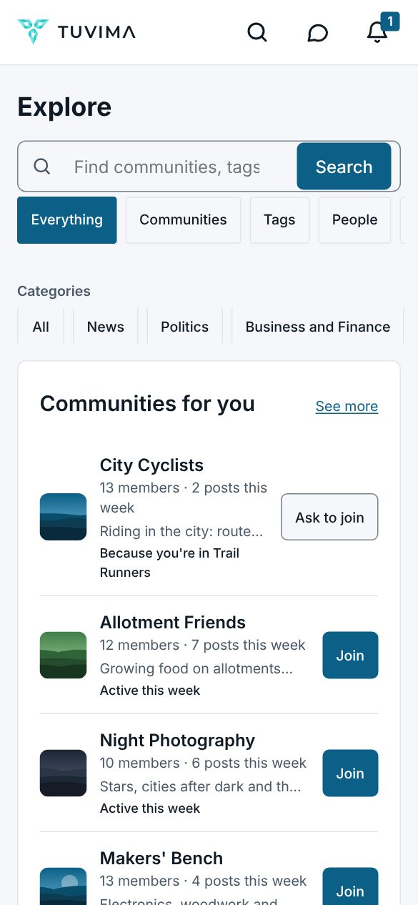
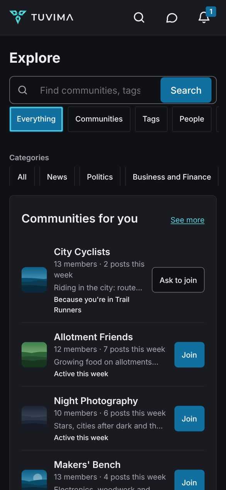

By the end of this page you will have a persona and be a member of your first community. It takes about five minutes.

<figure class="tv-screens">

<figcaption>On a computer and on a phone. Everyone shown is a made-up sample person.</figcaption>
</figure>

You can read the front page and public communities without an account. You need one only to post, reply, react or join.

## Sign in

1. Choose **Sign in** at the top of any page.
2. Create your Tuvima ID, or sign in to the one you have. If you are asked to, confirm your email address. [Tuvima ID's first-time guide](/products/id/start/getting-started.md) walks you through it.

## Choose your handle

Back on Tuvima, you are asked to **Choose your handle**. This is your public name, shown as `handle @ tuvimaid.com`. Use 3 to 30 letters, numbers and underscores.

When you see **You're all set**, the getting-started page asks **What are you into?** to suggest communities.

## Join your first community

1. Choose **Explore** in the menu, or **Find a community** on Home.
2. Open a community that looks right and read its rules.
3. Choose **Join**, then choose how to appear: as your global persona, or with a private persona just for this community.

[Joining a community](../guides/join-a-community.md) explains the choice in more detail.

## Check the result

The community now shows in your side menu and in **Communities and follows**, and you can start a conversation or reply.

## Next steps

- [Post and reply](../guides/posting.md)
- [Keep up with conversations](../guides/keep-up.md)
- [Explore the front page](../guides/front-page.md)
