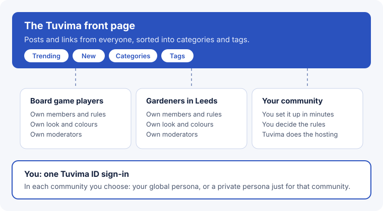

Tuvima is a home for communities. It has three parts that work together.

## The front page

The front page at tuvima.com is a scrolling feed of discussions and links shared by everyone on Tuvima. Posts are sorted into 16 broad **categories**, such as Gaming, Science or Food and Drink, and labelled with **tags**. Members vote posts up or down, and the best of them rise. [Read more about the front page](../guides/front-page.md).

## Communities

A **community** is a space for a group with something specific in common. Each one has its own members, rules, moderators, categories and colours. Anyone can [start a community](../owners/start-a-community.md) for free, and Tuvima looks after the hosting. You can find communities in the [directory](../guides/join-a-community.md#find-a-community).

## Your profiles

You sign in once with [Tuvima ID](/products/id/index.mdx). When you join a community, you choose how to appear there:

- **Your Tuvima profile**, shown as `handle @ tuvimaid.com`, is public and the same everywhere. You use it on the front page.
- **A private profile** is just for one community. Nobody there can tell that it is yours.

Your email address is never shown to anyone. [Your privacy on Tuvima](../guides/privacy.md) explains what others can and cannot see.

## Next steps

- [Why Tuvima exists](why-tuvima.md)
- [Get started](getting-started.md)
